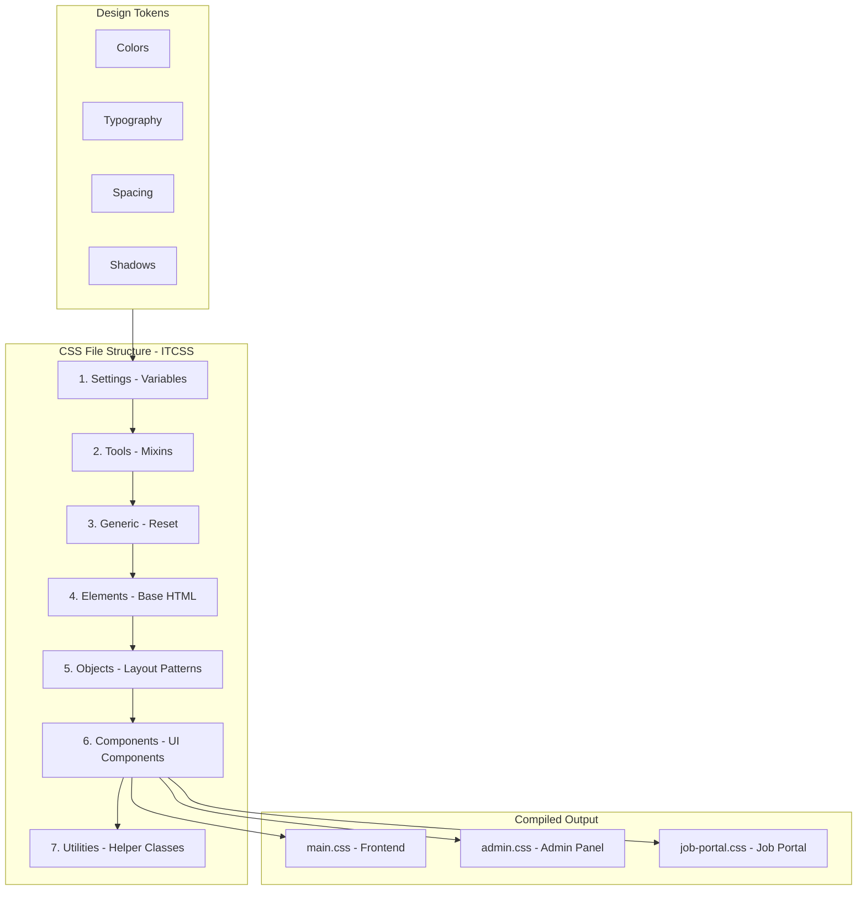
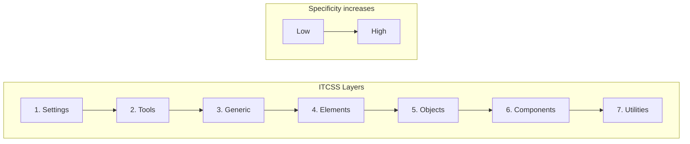

# CSS Architecture Strategy for Tulima Solar Website Reconstruction

## Table of Contents
1. [Executive Summary](#executive-summary)
2. [Current State Analysis](#current-state-analysis)
3. [Naming Convention](#naming-convention)
4. [Design Tokens](#design-tokens)
5. [File Structure](#file-structure)
6. [Class Categories](#class-categories)
7. [Responsive Strategy](#responsive-strategy)
8. [Component Patterns](#component-patterns)
9. [Migration Guidelines](#migration-guidelines)
10. [Documentation Standards](#documentation-standards)

---

## Executive Summary

This document establishes a comprehensive CSS architecture for the Tulima Solar website reconstruction project. The architecture follows industry best practices including:

- **BEM naming convention** for predictable, maintainable class names
- **CSS Custom Properties** for centralized design tokens
- **ITCSS methodology** for organized file structure
- **Mobile-first responsive design** with defined breakpoints
- **Utility-first approach** for rapid development alongside semantic components

### Architecture Diagram



---

## Current State Analysis

### Existing CSS Files

| File | Size | Purpose | Issues |
|------|------|---------|--------|
| [`master-style.css`](../master-style.css) | 41,574 chars | Main stylesheet | Mixed naming conventions, duplicate styles |
| [`COLORS-AND-FONTS.txt`](../COLORS-AND-FONTS.txt) | 4,554 chars | Design token reference | Not enforced in CSS |
| [`includes/css/navigation-footer.css`](../includes/css/navigation-footer.css) | 20,101 chars | Navigation styles | Duplicate CSS variables |
| [`admin/assets/css/admin.css`](../admin/assets/css/admin.css) | 101,090 chars | Admin panel styles | Inconsistent naming |
| [`job-portal/pages/assets/css/job-portal.css`](../job-portal/pages/assets/css/job-portal.css) | 55,038 chars | Job portal styles | Uses `--jp-` prefix inconsistently |

### Key Findings

1. **Inconsistent Naming**: Mix of BEM (`.modern-nav__logo`), utility (`.text-center`), and semantic (`.service-card`) patterns
2. **Duplicate Variables**: Each file defines its own CSS custom properties with different prefixes
3. **No Modular Structure**: All styles in monolithic files
4. **Bootstrap-style Breakpoints**: Using `575.98px`, `767.98px`, `991.98px` patterns

---

## Naming Convention

### BEM Methodology

We adopt the **BEM (Block Element Modifier)** naming convention for all component styles:

```
.block {}
.block__element {}
.block--modifier {}
.block__element--modifier {}
```

### Naming Rules

#### Block
A standalone, reusable component.

```css
/* Good */
.card {}
.navigation {}
.hero-section {}
.blog-post {}

/* Avoid - too generic or overly specific */
.div {}
.divContainer {}
.thisIsACardContainer {}
```

#### Element
A child of a block, separated by double underscores.

```css
/* Good */
.card__header {}
.card__image {}
.card__title {}
.card__body {}
.card__footer {}

/* Avoid - don't nest elements */
.card__header__title {}  /* Bad */
```

#### Modifier
A variation of a block or element, separated by double dashes.

```css
/* Good */
.card--featured {}
.card--horizontal {}
.btn--primary {}
.btn--large {}

/* Avoid - don't use modifier alone */
.--featured {}  /* Bad */
```

### Namespace Prefixes

For clarity and to avoid conflicts, use these prefixes:

| Prefix | Purpose | Example |
|--------|---------|---------|
| `c-` | Component | `.c-card`, `.c-button` |
| `l-` | Layout | `.l-container`, `.l-grid` |
| `u-` | Utility | `.u-mt-md`, `.u-text-center` |
| `is-` | State | `.is-active`, `.is-loading` |
| `has-` | State | `.has-error`, `.has-icon` |
| `js-` | JavaScript hook | `.js-toggle`, `.js-modal-trigger` |

### Complete Naming Examples

```css
/* Block: Button Component */
.c-btn {
    /* Base styles */
}

.c-btn__icon {
    /* Icon element within button */
}

.c-btn__text {
    /* Text element within button */
}

.c-btn--primary {
    /* Primary color variant */
}

.c-btn--secondary {
    /* Secondary color variant */
}

.c-btn--large {
    /* Size variant */
}

.c-btn--disabled,
.c-btn.is-disabled {
    /* State variant */
}
```

---

## Design Tokens

### Token Architecture

All design tokens are defined as CSS Custom Properties in the `:root` selector. This provides a single source of truth for the entire design system.

### Color Tokens

```css
:root {
    /* ==========================================
       BRAND COLORS - Primary Palette
       ========================================== */
    --color-primary: #660099;
    --color-primary-dark: #4A0066;
    --color-primary-darker: #2d1b4e;
    --color-primary-light: #F0E6F7;
    
    /* ==========================================
       BRAND COLORS - Secondary Palette
       ========================================== */
    --color-secondary: #B0D7AB;
    --color-secondary-dark: #8BC4A0;
    --color-secondary-light: #E8F5E8;
    
    /* ==========================================
       BRAND COLORS - Accent Palette
       ========================================== */
    --color-accent: #E98E39;
    --color-accent-dark: #D17A1F;
    --color-accent-light: #FDF4E8;
    
    /* ==========================================
       NEUTRAL COLORS - Gray Scale
       ========================================== */
    --color-gray-50: #FAFAFA;
    --color-gray-100: #F5F5F5;
    --color-gray-200: #E5E5E5;
    --color-gray-300: #D4D4D4;
    --color-gray-400: #A3A3A3;
    --color-gray-500: #737373;
    --color-gray-600: #525252;
    --color-gray-700: #404040;
    --color-gray-800: #262626;
    --color-gray-900: #171717;
    
    /* ==========================================
       SEMANTIC COLORS - Text
       ========================================== */
    --color-text-primary: #2C2C2C;
    --color-text-secondary: #4A4A4A;
    --color-text-muted: #6B6B6B;
    --color-text-inverse: #FFFFFF;
    
    /* ==========================================
       SEMANTIC COLORS - Background
       ========================================== */
    --color-bg-primary: #FFFFFF;
    --color-bg-secondary: #f8f9fa;
    --color-bg-tertiary: #e9ecef;
    --color-bg-dark: #1a1a2e;
    --color-bg-footer: #0d0d1a;
    
    /* ==========================================
       SEMANTIC COLORS - Status
       ========================================== */
    --color-success: #38a169;
    --color-success-light: #E8F5E8;
    --color-warning: #dd6b20;
    --color-warning-light: #FDF4E8;
    --color-danger: #e53e3e;
    --color-danger-light: #fff5f5;
    --color-info: #3182ce;
    --color-info-light: #ebf8ff;
    
    /* ==========================================
       BORDER COLORS
       ========================================== */
    --color-border: #dee2e6;
    --color-border-light: #e9ecef;
    --color-border-dark: #ced4da;
}
```

### Gradient Tokens

```css
:root {
    --gradient-primary: linear-gradient(135deg, var(--color-primary) 0%, var(--color-primary-dark) 100%);
    --gradient-secondary: linear-gradient(135deg, var(--color-primary) 0%, var(--color-secondary) 100%);
    --gradient-accent: linear-gradient(135deg, var(--color-accent) 0%, var(--color-accent-dark) 100%);
    --gradient-hero: linear-gradient(135deg, var(--color-primary) 0%, var(--color-secondary) 50%, var(--color-accent) 100%);
    --gradient-text: linear-gradient(135deg, var(--color-accent) 0%, var(--color-primary) 100%);
}
```

### Typography Tokens

```css
:root {
    /* ==========================================
       FONT FAMILIES
       ========================================== */
    --font-heading: 'Inter', 'Century Gothic', -apple-system, BlinkMacSystemFont, 'Segoe UI', sans-serif;
    --font-body: 'Inter', 'Calibri', -apple-system, BlinkMacSystemFont, 'Segoe UI', sans-serif;
    --font-mono: 'JetBrains Mono', 'Fira Code', 'Courier New', monospace;
    
    /* ==========================================
       FONT SIZES - Scale: 1.25 Major Third
       ========================================== */
    --font-size-xs: 0.75rem;      /* 12px */
    --font-size-sm: 0.875rem;     /* 14px */
    --font-size-base: 1rem;       /* 16px */
    --font-size-lg: 1.125rem;     /* 18px */
    --font-size-xl: 1.25rem;      /* 20px */
    --font-size-2xl: 1.5rem;      /* 24px */
    --font-size-3xl: 1.875rem;    /* 30px */
    --font-size-4xl: 2.25rem;     /* 36px */
    --font-size-5xl: 3rem;        /* 48px */
    --font-size-6xl: 3.75rem;     /* 60px */
    
    /* ==========================================
       FONT WEIGHTS
       ========================================== */
    --font-weight-light: 300;
    --font-weight-normal: 400;
    --font-weight-medium: 500;
    --font-weight-semibold: 600;
    --font-weight-bold: 700;
    --font-weight-extrabold: 800;
    
    /* ==========================================
       LINE HEIGHTS
       ========================================== */
    --leading-none: 1;
    --leading-tight: 1.25;
    --leading-snug: 1.375;
    --leading-normal: 1.5;
    --leading-relaxed: 1.625;
    --leading-loose: 2;
    
    /* ==========================================
       LETTER SPACING
       ========================================== */
    --tracking-tight: -0.025em;
    --tracking-normal: 0;
    --tracking-wide: 0.025em;
    --tracking-wider: 0.05em;
}
```

### Spacing Tokens

```css
:root {
    /* ==========================================
       SPACING SCALE - 4px base unit
       ========================================== */
    --space-0: 0;
    --space-1: 0.25rem;   /* 4px */
    --space-2: 0.5rem;    /* 8px */
    --space-3: 0.75rem;   /* 12px */
    --space-4: 1rem;      /* 16px */
    --space-5: 1.25rem;   /* 20px */
    --space-6: 1.5rem;    /* 24px */
    --space-8: 2rem;      /* 32px */
    --space-10: 2.5rem;   /* 40px */
    --space-12: 3rem;     /* 48px */
    --space-16: 4rem;     /* 64px */
    --space-20: 5rem;     /* 80px */
    --space-24: 6rem;     /* 96px */
    
    /* ==========================================
       SEMANTIC SPACING
       ========================================== */
    --spacing-section: var(--space-16);
    --spacing-component: var(--space-6);
    --spacing-element: var(--space-4);
    --spacing-inline: var(--space-2);
}
```

### Border Radius Tokens

```css
:root {
    --radius-none: 0;
    --radius-sm: 4px;
    --radius-md: 8px;
    --radius-lg: 12px;
    --radius-xl: 16px;
    --radius-2xl: 24px;
    --radius-full: 9999px;
    --radius-circle: 50%;
}
```

### Shadow Tokens

```css
:root {
    --shadow-xs: 0 1px 2px 0 rgba(0, 0, 0, 0.05);
    --shadow-sm: 0 1px 3px 0 rgba(0, 0, 0, 0.1), 0 1px 2px -1px rgba(0, 0, 0, 0.1);
    --shadow-md: 0 4px 6px -1px rgba(0, 0, 0, 0.1), 0 2px 4px -2px rgba(0, 0, 0, 0.1);
    --shadow-lg: 0 10px 15px -3px rgba(0, 0, 0, 0.1), 0 4px 6px -4px rgba(0, 0, 0, 0.1);
    --shadow-xl: 0 20px 25px -5px rgba(0, 0, 0, 0.1), 0 8px 10px -6px rgba(0, 0, 0, 0.1);
    --shadow-2xl: 0 25px 50px -12px rgba(0, 0, 0, 0.25);
    --shadow-inner: inset 0 2px 4px 0 rgba(0, 0, 0, 0.05);
    --shadow-glow: 0 0 40px rgba(102, 0, 153, 0.15);
}
```

### Transition Tokens

```css
:root {
    --transition-fast: 150ms cubic-bezier(0.4, 0, 0.2, 1);
    --transition-base: 200ms cubic-bezier(0.4, 0, 0.2, 1);
    --transition-slow: 300ms cubic-bezier(0.4, 0, 0.2, 1);
    --transition-bounce: 500ms cubic-bezier(0.68, -0.55, 0.265, 1.55);
    
    --ease-in: cubic-bezier(0.4, 0, 1, 1);
    --ease-out: cubic-bezier(0, 0, 0.2, 1);
    --ease-in-out: cubic-bezier(0.4, 0, 0.2, 1);
}
```

### Z-Index Tokens

```css
:root {
    --z-dropdown: 100;
    --z-sticky: 200;
    --z-fixed: 300;
    --z-modal-backdrop: 400;
    --z-modal: 500;
    --z-popover: 600;
    --z-tooltip: 700;
    --z-toast: 800;
}
```

---

## File Structure

### ITCSS Methodology

We use the **Inverted Triangle CSS (ITCSS)** methodology for organizing CSS files from generic to specific:



### Directory Structure

```
assets/
├── css/
│   ├── settings/
│   │   ├── _variables.css        # Design tokens (colors, typography, spacing)
│   │   └── _breakpoints.css      # Media query breakpoints
│   │
│   ├── tools/
│   │   ├── _mixins.css           # CSS mixins (if using preprocessor)
│   │   └── _functions.css        # CSS custom functions
│   │
│   ├── generic/
│   │   ├── _reset.css            # Modern CSS reset
│   │   ├── _normalize.css        # Cross-browser consistency
│   │   └── _box-sizing.css       # Box sizing rules
│   │
│   ├── elements/
│   │   ├── _root.css             # :root styles
│   │   ├── _body.css             # Body defaults
│   │   ├── _headings.css         # h1-h6 styles
│   │   ├── _links.css            # Anchor styles
│   │   ├── _images.css           # Image defaults
│   │   ├── _forms.css            # Form element defaults
│   │   └── _media.css            # Audio, video defaults
│   │
│   ├── objects/
│   │   ├── _container.css        # Layout containers
│   │   ├── _grid.css             # Grid system
│   │   ├── _flex.css             # Flexbox utilities
│   │   ├── _section.css          # Page sections
│   │   └── _wrapper.css          # Content wrappers
│   │
│   ├── components/
│   │   ├── _button.css           # Button component
│   │   ├── _card.css             # Card component
│   │   ├── _form.css             # Form component
│   │   ├── _navigation.css       # Navigation component
│   │   ├── _footer.css           # Footer component
│   │   ├── _hero.css             # Hero section
│   │   ├── _modal.css            # Modal component
│   │   ├── _badge.css            # Badge/tag component
│   │   ├── _alert.css            # Alert/notification component
│   │   ├── _table.css            # Table component
│   │   ├── _pagination.css       # Pagination component
│   │   ├── _breadcrumb.css       # Breadcrumb component
│   │   ├── _testimonial.css      # Testimonial component
│   │   └── _blog-post.css        # Blog post component
│   │
│   ├── utilities/
│   │   ├── _spacing.css          # Margin/padding utilities
│   │   ├── _typography.css       # Text utilities
│   │   ├── _colors.css           # Color utilities
│   │   ├── _display.css          # Display utilities
│   │   ├── _visibility.css       # Visibility utilities
│   │   ├── _position.css         # Position utilities
│   │   └── _responsive.css       # Responsive utilities
│   │
│   ├── main.css                  # Main compiled stylesheet
│   ├── admin.css                 # Admin panel stylesheet
│   └── job-portal.css            # Job portal stylesheet
│
└── scss/                         # SCSS source files (optional)
    └── ...                       # Same structure as css/
```

### Main Entry Point

```css
/* main.css - Main stylesheet entry point */

/* 1. Settings */
@import 'settings/variables.css';
@import 'settings/breakpoints.css';

/* 2. Tools */
@import 'tools/mixins.css';

/* 3. Generic */
@import 'generic/reset.css';
@import 'generic/box-sizing.css';

/* 4. Elements */
@import 'elements/root.css';
@import 'elements/body.css';
@import 'elements/headings.css';
@import 'elements/links.css';
@import 'elements/images.css';
@import 'elements/forms.css';

/* 5. Objects */
@import 'objects/container.css';
@import 'objects/grid.css';
@import 'objects/section.css';

/* 6. Components */
@import 'components/button.css';
@import 'components/card.css';
@import 'components/navigation.css';
@import 'components/footer.css';
@import 'components/hero.css';
@import 'components/form.css';
/* ... other components */

/* 7. Utilities */
@import 'utilities/spacing.css';
@import 'utilities/typography.css';
@import 'utilities/colors.css';
@import 'utilities/display.css';
@import 'utilities/responsive.css';
```

---

## Class Categories

### 1. Layout Classes

Layout classes handle page structure and are prefixed with `l-`.

```css
/* Container */
.l-container {
    max-width: 1320px;
    margin: 0 auto;
    padding: 0 var(--space-4);
}

.l-container--narrow {
    max-width: 960px;
}

.l-container--wide {
    max-width: 1600px;
}

/* Grid System */
.l-grid {
    display: grid;
    gap: var(--space-4);
}

.l-grid--2 {
    grid-template-columns: repeat(2, 1fr);
}

.l-grid--3 {
    grid-template-columns: repeat(3, 1fr);
}

.l-grid--4 {
    grid-template-columns: repeat(4, 1fr);
}

/* Flexbox */
.l-flex {
    display: flex;
}

.l-flex--center {
    align-items: center;
    justify-content: center;
}

.l-flex--between {
    justify-content: space-between;
}

.l-flex--column {
    flex-direction: column;
}

/* Section */
.l-section {
    padding: var(--spacing-section) 0;
}

.l-section--compact {
    padding: var(--space-8) 0;
}
```

### 2. Component Classes

Component classes are reusable UI elements prefixed with `c-`.

```css
/* Button Component */
.c-btn {
    display: inline-flex;
    align-items: center;
    justify-content: center;
    gap: var(--space-2);
    padding: var(--space-3) var(--space-6);
    font-family: var(--font-body);
    font-size: var(--font-size-base);
    font-weight: var(--font-weight-medium);
    line-height: var(--leading-normal);
    text-decoration: none;
    border: none;
    border-radius: var(--radius-md);
    cursor: pointer;
    transition: all var(--transition-base);
}

.c-btn--primary {
    background: var(--gradient-primary);
    color: var(--color-text-inverse);
}

.c-btn--secondary {
    background: var(--color-secondary);
    color: var(--color-text-inverse);
}

.c-btn--outline {
    background: transparent;
    color: var(--color-primary);
    border: 2px solid var(--color-primary);
}

.c-btn--sm {
    padding: var(--space-2) var(--space-4);
    font-size: var(--font-size-sm);
}

.c-btn--lg {
    padding: var(--space-4) var(--space-8);
    font-size: var(--font-size-lg);
}

/* Card Component */
.c-card {
    background: var(--color-bg-primary);
    border-radius: var(--radius-lg);
    box-shadow: var(--shadow-sm);
    overflow: hidden;
    transition: transform var(--transition-base), box-shadow var(--transition-base);
}

.c-card:hover {
    transform: translateY(-4px);
    box-shadow: var(--shadow-lg);
}

.c-card__image {
    width: 100%;
    aspect-ratio: 16/9;
    object-fit: cover;
}

.c-card__body {
    padding: var(--space-6);
}

.c-card__title {
    font-size: var(--font-size-xl);
    font-weight: var(--font-weight-semibold);
    margin-bottom: var(--space-2);
}

.c-card__text {
    color: var(--color-text-secondary);
    font-size: var(--font-size-base);
}

.c-card__footer {
    padding: var(--space-4) var(--space-6);
    border-top: 1px solid var(--color-border-light);
}

.c-card--horizontal {
    display: flex;
}

.c-card--featured {
    border: 2px solid var(--color-primary);
}
```

### 3. Utility Classes

Utility classes are single-purpose helpers prefixed with `u-`.

```css
/* Spacing Utilities */
.u-mt-0 { margin-top: 0; }
.u-mt-1 { margin-top: var(--space-1); }
.u-mt-2 { margin-top: var(--space-2); }
.u-mt-4 { margin-top: var(--space-4); }
.u-mt-6 { margin-top: var(--space-6); }
.u-mt-8 { margin-top: var(--space-8); }

.u-mb-0 { margin-bottom: 0; }
.u-mb-1 { margin-bottom: var(--space-1); }
.u-mb-2 { margin-bottom: var(--space-2); }
.u-mb-4 { margin-bottom: var(--space-4); }
.u-mb-6 { margin-bottom: var(--space-6); }
.u-mb-8 { margin-bottom: var(--space-8); }

.u-p-0 { padding: 0; }
.u-p-4 { padding: var(--space-4); }
.u-p-6 { padding: var(--space-6); }
.u-p-8 { padding: var(--space-8); }

/* Typography Utilities */
.u-text-center { text-align: center; }
.u-text-left { text-align: left; }
.u-text-right { text-align: right; }

.u-text-primary { color: var(--color-text-primary); }
.u-text-secondary { color: var(--color-text-secondary); }
.u-text-muted { color: var(--color-text-muted); }

.u-font-sm { font-size: var(--font-size-sm); }
.u-font-lg { font-size: var(--font-size-lg); }
.u-font-xl { font-size: var(--font-size-xl); }

.u-font-normal { font-weight: var(--font-weight-normal); }
.u-font-medium { font-weight: var(--font-weight-medium); }
.u-font-bold { font-weight: var(--font-weight-bold); }

/* Display Utilities */
.u-hidden { display: none; }
.u-block { display: block; }
.u-inline { display: inline; }
.u-inline-block { display: inline-block; }
.u-flex { display: flex; }
.u-grid { display: grid; }

/* Color Utilities */
.u-bg-primary { background-color: var(--color-primary); }
.u-bg-secondary { background-color: var(--color-secondary); }
.u-bg-accent { background-color: var(--color-accent); }
.u-bg-white { background-color: var(--color-bg-primary); }
.u-bg-gray { background-color: var(--color-bg-secondary); }
```

### 4. State Classes

State classes indicate component states, prefixed with `is-` or `has-`.

```css
/* Interactive States */
.is-active {
    /* Active/selected state */
}

.is-disabled {
    opacity: 0.5;
    pointer-events: none;
    cursor: not-allowed;
}

.is-hidden {
    display: none !important;
}

.is-visible {
    display: block;
}

.is-loading {
    position: relative;
    color: transparent;
}

.is-loading::after {
    content: '';
    position: absolute;
    top: 50%;
    left: 50%;
    width: 1em;
    height: 1em;
    border: 2px solid currentColor;
    border-right-color: transparent;
    border-radius: 50%;
    animation: spin 0.75s linear infinite;
}

/* Form States */
.has-error {
    border-color: var(--color-danger);
}

.has-success {
    border-color: var(--color-success);
}

.has-warning {
    border-color: var(--color-warning);
}

/* Component States */
.is-open {
    /* Dropdown/modal open state */
}

.is-collapsed {
    /* Collapsed accordion/menu state */
}

.is-expanded {
    /* Expanded accordion/menu state */
}

.is-focused {
    /* Focus state for custom components */
}
```

### 5. Responsive Modifiers

Responsive utilities follow the pattern `{class}@{breakpoint}`.

```css
/* Hide at breakpoints */
.u-hidden@sm { display: none; }
.u-hidden@md { display: none; }
.u-hidden@lg { display: none; }
.u-hidden@xl { display: none; }

/* Show at breakpoints */
.u-visible@sm { display: block; }
.u-visible@md { display: block; }
.u-visible@lg { display: block; }
.u-visible@xl { display: block; }

/* Responsive text alignment */
.u-text-center@md { text-align: center; }
.u-text-left@lg { text-align: left; }

/* Responsive flex direction */
.l-flex--column@md {
    flex-direction: column;
}

/* Responsive grid columns */
.l-grid--2@md {
    grid-template-columns: repeat(2, 1fr);
}

.l-grid--3@lg {
    grid-template-columns: repeat(3, 1fr);
}
```

---

## Responsive Strategy

### Mobile-First Approach

All base styles target mobile devices first, then use `min-width` media queries to add styles for larger screens.

### Breakpoint System

```css
:root {
    /* Breakpoint values */
    --breakpoint-sm: 576px;
    --breakpoint-md: 768px;
    --breakpoint-lg: 992px;
    --breakpoint-xl: 1200px;
    --breakpoint-2xl: 1400px;
}
```

### Breakpoint Definitions

| Breakpoint | Width | Target Devices |
|------------|-------|----------------|
| xs | < 576px | Mobile phones (portrait) |
| sm | ≥ 576px | Mobile phones (landscape), small tablets |
| md | ≥ 768px | Tablets |
| lg | ≥ 992px | Desktops, laptops |
| xl | ≥ 1200px | Large desktops |
| 2xl | ≥ 1400px | Extra large screens |

### Media Query Mixins

```css
/* Mobile-first media queries */

/* Small devices (landscape phones, 576px and up) */
@media (min-width: 576px) {
    /* sm styles */
}

/* Medium devices (tablets, 768px and up) */
@media (min-width: 768px) {
    /* md styles */
}

/* Large devices (desktops, 992px and up) */
@media (min-width: 992px) {
    /* lg styles */
}

/* Extra large devices (large desktops, 1200px and up) */
@media (min-width: 1200px) {
    /* xl styles */
}

/* Extra extra large devices (1400px and up) */
@media (min-width: 1400px) {
    /* 2xl styles */
}
```

### Responsive Component Example

```css
/* Hero Section - Mobile First */
.c-hero {
    padding: var(--space-12) 0;
    min-height: 60vh;
}

.c-hero__title {
    font-size: var(--font-size-3xl);
}

.c-hero__subtitle {
    font-size: var(--font-size-lg);
}

/* Tablet and up */
@media (min-width: 768px) {
    .c-hero {
        padding: var(--space-16) 0;
        min-height: 75vh;
    }
    
    .c-hero__title {
        font-size: var(--font-size-4xl);
    }
    
    .c-hero__subtitle {
        font-size: var(--font-size-xl);
    }
}

/* Desktop and up */
@media (min-width: 992px) {
    .c-hero {
        min-height: 85vh;
    }
    
    .c-hero__title {
        font-size: var(--font-size-5xl);
    }
}

/* Large desktop */
@media (min-width: 1200px) {
    .c-hero__title {
        font-size: var(--font-size-6xl);
    }
}
```

### Responsive Grid Example

```css
.l-grid {
    display: grid;
    gap: var(--space-4);
    grid-template-columns: 1fr; /* Mobile: 1 column */
}

@media (min-width: 576px) {
    .l-grid--responsive {
        grid-template-columns: repeat(2, 1fr); /* 2 columns */
    }
}

@media (min-width: 992px) {
    .l-grid--responsive {
        grid-template-columns: repeat(3, 1fr); /* 3 columns */
    }
}

@media (min-width: 1200px) {
    .l-grid--responsive {
        grid-template-columns: repeat(4, 1fr); /* 4 columns */
    }
}
```

---

## Component Patterns

### Button Component

```css
/* ==========================================
   BUTTON COMPONENT
   ========================================== */

.c-btn {
    /* Base styles */
    display: inline-flex;
    align-items: center;
    justify-content: center;
    gap: var(--space-2);
    padding: var(--space-3) var(--space-6);
    font-family: var(--font-body);
    font-size: var(--font-size-base);
    font-weight: var(--font-weight-medium);
    line-height: 1;
    text-decoration: none;
    border: 2px solid transparent;
    border-radius: var(--radius-md);
    cursor: pointer;
    transition: all var(--transition-base);
}

/* Elements */
.c-btn__icon {
    width: 1.25em;
    height: 1.25em;
}

.c-btn__text {
    /* Text styling if needed */
}

/* Color Modifiers */
.c-btn--primary {
    background: var(--gradient-primary);
    color: var(--color-text-inverse);
}

.c-btn--primary:hover {
    background: var(--gradient-accent);
    transform: translateY(-2px);
    box-shadow: var(--shadow-md);
}

.c-btn--secondary {
    background: var(--color-secondary);
    color: var(--color-text-inverse);
}

.c-btn--secondary:hover {
    background: var(--color-secondary-dark);
}

.c-btn--outline-primary {
    background: transparent;
    color: var(--color-primary);
    border-color: var(--color-primary);
}

.c-btn--outline-primary:hover {
    background: var(--color-primary);
    color: var(--color-text-inverse);
}

.c-btn--outline-light {
    background: transparent;
    color: var(--color-text-inverse);
    border-color: var(--color-text-inverse);
}

.c-btn--outline-light:hover {
    background: var(--color-text-inverse);
    color: var(--color-primary);
}

/* Size Modifiers */
.c-btn--sm {
    padding: var(--space-2) var(--space-4);
    font-size: var(--font-size-sm);
}

.c-btn--lg {
    padding: var(--space-4) var(--space-8);
    font-size: var(--font-size-lg);
}

/* State Modifiers */
.c-btn.is-disabled,
.c-btn:disabled {
    opacity: 0.5;
    cursor: not-allowed;
    pointer-events: none;
}

.c-btn.is-loading {
    color: transparent;
    pointer-events: none;
}

/* Full Width */
.c-btn--full {
    width: 100%;
}
```

### Card Component

```css
/* ==========================================
   CARD COMPONENT
   ========================================== */

.c-card {
    background: var(--color-bg-primary);
    border-radius: var(--radius-lg);
    box-shadow: var(--shadow-sm);
    overflow: hidden;
    transition: transform var(--transition-base), box-shadow var(--transition-base);
    height: 100%;
    display: flex;
    flex-direction: column;
}

.c-card:hover {
    transform: translateY(-4px);
    box-shadow: var(--shadow-lg);
}

/* Elements */
.c-card__image {
    width: 100%;
    aspect-ratio: 16/9;
    object-fit: cover;
}

.c-card__header {
    padding: var(--space-6);
    border-bottom: 1px solid var(--color-border-light);
}

.c-card__body {
    padding: var(--space-6);
    flex: 1;
}

.c-card__title {
    font-size: var(--font-size-xl);
    font-weight: var(--font-weight-semibold);
    color: var(--color-text-primary);
    margin-bottom: var(--space-2);
}

.c-card__subtitle {
    font-size: var(--font-size-sm);
    color: var(--color-text-muted);
    margin-bottom: var(--space-4);
}

.c-card__text {
    color: var(--color-text-secondary);
    font-size: var(--font-size-base);
    line-height: var(--leading-relaxed);
}

.c-card__footer {
    padding: var(--space-4) var(--space-6);
    border-top: 1px solid var(--color-border-light);
    background: var(--color-bg-secondary);
}

/* Modifiers */
.c-card--horizontal {
    flex-direction: row;
}

.c-card--horizontal .c-card__image {
    width: 40%;
    aspect-ratio: auto;
}

.c-card--featured {
    border: 2px solid var(--color-primary);
}

.c-card--compact .c-card__body {
    padding: var(--space-4);
}

/* Card Variants */
.c-card--service {
    text-align: center;
}

.c-card--service .c-card__icon {
    width: 64px;
    height: 64px;
    margin: 0 auto var(--space-4);
    padding: var(--space-4);
    background: var(--color-primary-light);
    border-radius: var(--radius-circle);
    color: var(--color-primary);
}

.c-card--testimonial {
    background: var(--gradient-secondary);
    color: var(--color-text-inverse);
}

.c-card--cta {
    background: var(--gradient-primary);
    color: var(--color-text-inverse);
    text-align: center;
}
```

### Form Component

```css
/* ==========================================
   FORM COMPONENT
   ========================================== */

.c-form {
    width: 100%;
}

.c-form__group {
    margin-bottom: var(--space-6);
}

.c-form__label {
    display: block;
    margin-bottom: var(--space-2);
    font-size: var(--font-size-sm);
    font-weight: var(--font-weight-medium);
    color: var(--color-text-primary);
}

.c-form__label--required::after {
    content: ' *';
    color: var(--color-danger);
}

.c-form__input {
    width: 100%;
    padding: var(--space-3) var(--space-4);
    font-family: var(--font-body);
    font-size: var(--font-size-base);
    color: var(--color-text-primary);
    background: var(--color-bg-primary);
    border: 1px solid var(--color-border);
    border-radius: var(--radius-md);
    transition: border-color var(--transition-fast), box-shadow var(--transition-fast);
}

.c-form__input:focus {
    outline: none;
    border-color: var(--color-primary);
    box-shadow: 0 0 0 3px rgba(102, 0, 153, 0.15);
}

.c-form__input::placeholder {
    color: var(--color-text-muted);
}

/* Textarea */
.c-form__textarea {
    min-height: 120px;
    resize: vertical;
}

/* Select */
.c-form__select {
    appearance: none;
    background-image: url("data:image/svg+xml,%3Csvg xmlns='http://www.w3.org/2000/svg' width='16' height='16' viewBox='0 0 24 24' fill='none' stroke='%236B6B6B' stroke-width='2'%3E%3Cpath d='M6 9l6 6 6-6'/%3E%3C/svg%3E");
    background-repeat: no-repeat;
    background-position: right var(--space-3) center;
    padding-right: var(--space-10);
}

/* Checkbox & Radio */
.c-form__check {
    display: flex;
    align-items: center;
    gap: var(--space-2);
    cursor: pointer;
}

.c-form__check-input {
    width: 18px;
    height: 18px;
    accent-color: var(--color-primary);
}

/* Validation States */
.c-form__group.has-error .c-form__input {
    border-color: var(--color-danger);
}

.c-form__group.has-error .c-form__input:focus {
    box-shadow: 0 0 0 3px rgba(229, 62, 62, 0.15);
}

.c-form__group.has-success .c-form__input {
    border-color: var(--color-success);
}

.c-form__error {
    display: block;
    margin-top: var(--space-1);
    font-size: var(--font-size-sm);
    color: var(--color-danger);
}

.c-form__help {
    display: block;
    margin-top: var(--space-1);
    font-size: var(--font-size-sm);
    color: var(--color-text-muted);
}

/* Input Sizes */
.c-form__input--sm {
    padding: var(--space-2) var(--space-3);
    font-size: var(--font-size-sm);
}

.c-form__input--lg {
    padding: var(--space-4) var(--space-5);
    font-size: var(--font-size-lg);
}
```

### Navigation Component

```css
/* ==========================================
   NAVIGATION COMPONENT
   ========================================== */

.c-nav {
    position: fixed;
    top: 0;
    left: 0;
    right: 0;
    z-index: var(--z-sticky);
    transition: all var(--transition-base);
}

.c-nav--transparent {
    background: transparent;
}

.c-nav--solid {
    background: rgba(255, 255, 255, 0.98);
    backdrop-filter: blur(20px);
    box-shadow: var(--shadow-md);
}

.c-nav__container {
    max-width: 1400px;
    margin: 0 auto;
    padding: var(--space-4) var(--space-6);
    display: flex;
    align-items: center;
    justify-content: space-between;
}

/* Logo */
.c-nav__logo {
    display: flex;
    align-items: center;
    gap: var(--space-2);
    text-decoration: none;
}

.c-nav__logo-image {
    height: 40px;
    width: auto;
}

.c-nav__logo-text {
    font-family: var(--font-heading);
    font-size: var(--font-size-xl);
    font-weight: var(--font-weight-bold);
    color: var(--color-text-inverse);
    transition: color var(--transition-base);
}

.c-nav--solid .c-nav__logo-text {
    color: var(--color-text-primary);
}

/* Menu */
.c-nav__menu {
    display: flex;
    align-items: center;
    gap: var(--space-8);
    list-style: none;
    margin: 0;
    padding: 0;
}

.c-nav__item {
    position: relative;
}

.c-nav__link {
    font-size: var(--font-size-base);
    font-weight: var(--font-weight-medium);
    color: var(--color-text-inverse);
    text-decoration: none;
    padding: var(--space-2) 0;
    transition: color var(--transition-base);
}

.c-nav--solid .c-nav__link {
    color: var(--color-text-primary);
}

.c-nav__link:hover,
.c-nav__link.is-active {
    color: var(--color-accent);
}

/* Mobile Menu Toggle */
.c-nav__toggle {
    display: none;
    padding: var(--space-2);
    background: none;
    border: none;
    cursor: pointer;
}

.c-nav__toggle-icon {
    display: block;
    width: 24px;
    height: 2px;
    background: var(--color-text-inverse);
    position: relative;
}

.c-nav__toggle-icon::before,
.c-nav__toggle-icon::after {
    content: '';
    position: absolute;
    width: 100%;
    height: 100%;
    background: inherit;
    left: 0;
}

.c-nav__toggle-icon::before {
    top: -8px;
}

.c-nav__toggle-icon::after {
    top: 8px;
}

/* Mobile Styles */
@media (max-width: 991.98px) {
    .c-nav__toggle {
        display: block;
    }
    
    .c-nav__menu {
        position: fixed;
        top: 0;
        right: -100%;
        width: 80%;
        max-width: 320px;
        height: 100vh;
        flex-direction: column;
        align-items: flex-start;
        padding: var(--space-16) var(--space-6);
        background: var(--color-bg-primary);
        box-shadow: var(--shadow-xl);
        transition: right var(--transition-base);
    }
    
    .c-nav__menu.is-open {
        right: 0;
    }
    
    .c-nav__link {
        color: var(--color-text-primary);
        font-size: var(--font-size-lg);
    }
}
```

---

## Migration Guidelines

### Phase 1: Design Token Consolidation

1. **Create unified design tokens file** at `assets/css/settings/_variables.css`
2. **Map existing variables** from all CSS files to new token names
3. **Update CSS custom properties** to use new naming convention

```css
/* Old → New Token Mapping */
--primary-purple     → --color-primary
--secondary-green    → --color-secondary
--accent-orange      → --color-accent
--text-primary       → --color-text-primary
--spacing-md         → --space-4
--radius-md          → --radius-md (unchanged)
```

### Phase 2: File Structure Migration

1. **Create new directory structure** under `assets/css/`
2. **Extract base styles** from `master-style.css` into modular files
3. **Create component files** for each major UI component
4. **Update import paths** in main entry point

### Phase 3: Class Name Migration

#### Mapping Table

| Old Class | New Class | Notes |
|-----------|-----------|-------|
| `.btn` | `.c-btn` | Add component prefix |
| `.btn-primary` | `.c-btn--primary` | BEM modifier |
| `.btn-lg` | `.c-btn--lg` | BEM modifier |
| `.card` | `.c-card` | Add component prefix |
| `.card-body` | `.c-card__body` | BEM element |
| `.service-card` | `.c-card--service` | BEM modifier |
| `.hero-section-modern` | `.c-hero` | Simplified naming |
| `.hero-title` | `.c-hero__title` | BEM element |
| `.container` | `.l-container` | Layout prefix |
| `.text-center` | `.u-text-center` | Utility prefix |

#### Migration Script Pattern

```php
// PHP helper for class migration
$classMapping = [
    'btn' => 'c-btn',
    'btn-primary' => 'c-btn--primary',
    'card' => 'c-card',
    'card-body' => 'c-card__body',
    // ... more mappings
];

function migrateClasses($html, $mapping) {
    foreach ($mapping as $old => $new) {
        $html = str_replace($old, $new, $html);
    }
    return $html;
}
```

### Phase 4: Component-by-Component Migration

1. **Start with atomic components** (buttons, inputs, badges)
2. **Move to composite components** (cards, forms, navigation)
3. **Finally migrate page-specific styles**

### Migration Checklist

```markdown
## Component Migration Checklist

### Button Component
- [ ] Create `assets/css/components/_button.css`
- [ ] Extract button styles from `master-style.css`
- [ ] Convert to BEM naming
- [ ] Update HTML templates
- [ ] Test all button variants
- [ ] Remove old button styles

### Card Component
- [ ] Create `assets/css/components/_card.css`
- [ ] Extract all card variants
- [ ] Consolidate duplicate card styles
- [ ] Convert to BEM naming
- [ ] Update HTML templates
- [ ] Test all card variants
- [ ] Remove old card styles

### Navigation Component
- [ ] Create `assets/css/components/_navigation.css`
- [ ] Merge `navigation-footer.css` navigation styles
- [ ] Convert to BEM naming
- [ ] Update header templates
- [ ] Test responsive behavior
- [ ] Remove old navigation styles

### Form Component
- [ ] Create `assets/css/components/_form.css`
- [ ] Extract form styles
- [ ] Convert to BEM naming
- [ ] Update form templates
- [ ] Test validation states
- [ ] Remove old form styles
```

### Backward Compatibility

During migration, maintain backward compatibility using CSS aliasing:

```css
/* Temporary aliases during migration */
.btn { composes: c-btn; }
.btn-primary { composes: c-btn--primary; }
.card { composes: c-card; }
.card-body { composes: c-card__body; }

/* Or using CSS cascade */
.btn,
.c-btn {
    /* shared styles */
}
```

---

## Documentation Standards

### File Header Comments

```css
/**
 * @file Button Component
 * @description Reusable button styles with multiple variants
 * @version 1.0.0
 * @author Tulima Solar Development Team
 * 
 * @requires settings/variables.css
 * 
 * @example
 * <button class="c-btn c-btn--primary">
 *     <span class="c-btn__text">Click Me</span>
 * </button>
 */
```

### Component Documentation

```css
/* ==========================================
   COMPONENT NAME
   ==========================================
   
   Description:
   Brief description of the component and its purpose.
   
   Elements:
   - __element-one: Description
   - __element-two: Description
   
   Modifiers:
   - --modifier-one: Description
   - --modifier-two: Description
   
   States:
   - is-active: When component is active
   - is-disabled: When component is disabled
   
   Example Usage:
   <div class="c-component c-component--modifier">
       <div class="c-component__element">Content</div>
   </div>
   
   ========================================== */
```

### Inline Comments

```css
.c-btn {
    /* Base button reset */
    appearance: none;
    
    /* Layout */
    display: inline-flex;
    align-items: center;
    
    /* Spacing */
    padding: var(--space-3) var(--space-6);
    
    /* Typography */
    font-size: var(--font-size-base);
    font-weight: var(--font-weight-medium);
    
    /* Visual */
    border-radius: var(--radius-md);
    
    /* Animation */
    transition: all var(--transition-base);
}
```

### Token Documentation

```css
:root {
    /**
     * Color Tokens
     * 
     * Naming convention: --color-{variant}-{shade}
     * - variant: primary, secondary, accent, gray, etc.
     * - shade: darkest, dark, base, light, lightest
     * 
     * Usage:
     * color: var(--color-primary);
     * background: var(--color-primary-light);
     */
    
    --color-primary: #660099;      /* Base brand purple */
    --color-primary-dark: #4A0066; /* Darker variant for hover states */
    --color-primary-light: #F0E6F7; /* Light variant for backgrounds */
}
```

---

## Quick Reference

### BEM Naming Summary

```
.block                    /* Independent component */
.block__element           /* Child of block */
.block--modifier          /* Variation of block */
.block__element--modifier /* Variation of element */
```

### Prefix Summary

| Prefix | Usage | Example |
|--------|-------|---------|
| `c-` | Component | `.c-card` |
| `l-` | Layout | `.l-grid` |
| `u-` | Utility | `.u-mt-4` |
| `is-` | State | `.is-active` |
| `has-` | State | `.has-error` |
| `js-` | JavaScript hook | `.js-toggle` |

### Breakpoint Summary

| Name | Min Width | Target |
|------|-----------|--------|
| xs | 0 | Mobile portrait |
| sm | 576px | Mobile landscape |
| md | 768px | Tablets |
| lg | 992px | Desktops |
| xl | 1200px | Large desktops |
| 2xl | 1400px | Extra large |

### Spacing Scale

| Token | Value | Pixels |
|-------|-------|--------|
| `--space-1` | 0.25rem | 4px |
| `--space-2` | 0.5rem | 8px |
| `--space-3` | 0.75rem | 12px |
| `--space-4` | 1rem | 16px |
| `--space-6` | 1.5rem | 24px |
| `--space-8` | 2rem | 32px |
| `--space-12` | 3rem | 48px |
| `--space-16` | 4rem | 64px |

---

## Conclusion

This CSS architecture provides a solid foundation for the Tulima Solar website reconstruction. By following these guidelines, the development team will achieve:

1. **Consistency**: Unified naming and design tokens across all CSS
2. **Maintainability**: Modular file structure that's easy to navigate and update
3. **Scalability**: Architecture that grows with the project
4. **Performance**: Optimized CSS through systematic organization
5. **Collaboration**: Clear documentation for team members

For questions or clarifications, refer to the existing documentation in the [`docs/`](.) directory or consult the development team lead.
