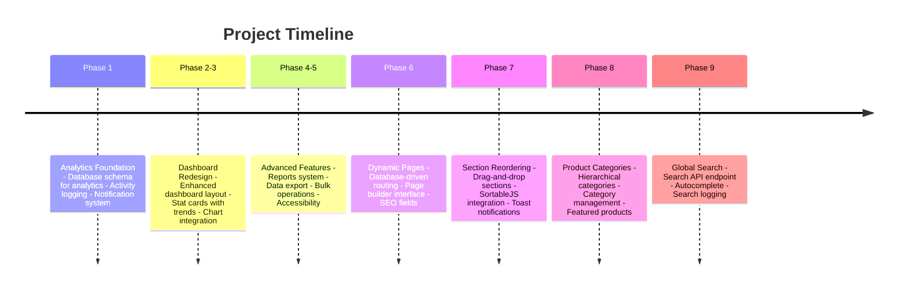

# Tulima Solar Website & Admin Portal - Project Completion Documentation

**Version:** 1.0.0  
**Completion Date:** February 2026  
**Status:** ✅ Complete

---

## Table of Contents

1. [Project Overview](#1-project-overview)
2. [Implementation Summary](#2-implementation-summary)
3. [Admin Portal Features](#3-admin-portal-features)
4. [Frontend Pages](#4-frontend-pages)
5. [Database Schema](#5-database-schema)
6. [Installation Guide](#6-installation-guide)
7. [API Reference](#7-api-reference)
8. [User Guide Summary](#8-user-guide-summary)
9. [Developer Notes](#9-developer-notes)
10. [Deployment Checklist](#10-deployment-checklist)

---

## 1. Project Overview

### Executive Summary

The Tulima Solar Website and Admin Portal is a comprehensive content management system built for Tulima Solar, a company specializing in solar-powered agricultural solutions. The project delivers a fully-featured public website with 16+ pages and a powerful admin portal with 20+ management pages.

### Key Features and Capabilities

| Category | Features |
|----------|----------|
| **Content Management** | Dynamic page creation, drag-and-drop page builder, section management, media library |
| **E-commerce Ready** | Product catalog with categories, featured products, product filtering |
| **Analytics** | Page view tracking, visitor analytics, traffic trends, content performance |
| **User Management** | Role-based access, admin user management, activity logging |
| **SEO** | Meta tags, SEO-friendly URLs, dynamic routing |
| **Search** | Global search across all content types, autocomplete, search logging |
| **Notifications** | Admin notification system, contact submission alerts |
| **Reports** | Traffic reports, content reports, contact analytics, product performance |
| **Data Export** | CSV export for all content types, filtered exports |
| **Accessibility** | WCAG AA compliant, keyboard navigation, screen reader support |

### Technology Stack

| Layer | Technologies |
|-------|-------------|
| **Backend** | PHP 8.0+, PDO/MySQL |
| **Database** | MySQL 8.0+ / MariaDB 10.5+ |
| **Frontend** | HTML5, CSS3, JavaScript ES6+ |
| **CSS Framework** | Custom CSS with CSS Variables |
| **Charts** | Chart.js 4.4.0 |
| **Drag & Drop** | SortableJS 1.15.0 |
| **Web Server** | Apache/Nginx with URL rewriting |

### Project Statistics

- **Total Files Created/Modified:** 100+
- **Admin Pages:** 24
- **Frontend Pages:** 16+
- **Database Tables:** 20+
- **API Endpoints:** 4
- **Helper Functions:** 100+
- **Migration Files:** 17
- **Documentation Pages:** 10

---

## 2. Implementation Summary

### Phases Completed



### Phase Details

#### Phase 1: Analytics Foundation
- Database schema for analytics tracking
- Page view tracking script
- Analytics API endpoints
- Activity logging system
- Notification system
- Chart components CSS and JavaScript

#### Phase 2-3: Dashboard Redesign
- Redesigned dashboard layout with grid system
- Enhanced stat card components with trend indicators
- Traffic overview charts
- Content performance widgets
- Contact analytics section

#### Phase 4-5: Advanced Features & Reporting
- Comprehensive reports page with 5 report types
- Enhanced analytics API
- Advanced activity log filtering
- Data export system for 7 content types
- Bulk operations for contact submissions
- Accessibility improvements (WCAG AA)

#### Phase 6: Dynamic Page Creation
- Database-driven page routing
- Enhanced page management interface
- Page builder with drag-and-drop
- SEO fields (meta_title, meta_description)
- Page hierarchy support

#### Phase 7: Drag-and-Drop Section Reordering
- Section management API endpoint
- SortableJS integration
- Toast notifications
- Keyboard accessibility
- Fallback up/down buttons

#### Phase 8: Product Categories System
- Hierarchical categories table
- Category management interface
- Product filtering by category
- Featured products support
- Frontend category pages

#### Phase 9: Global Search Functionality
- Search API endpoint
- Admin search results page
- Frontend public search
- Autocomplete with keyboard navigation
- Search logging and analytics

---

## 3. Admin Portal Features

### Complete List of Admin Pages

| Page | File | Description |
|------|------|-------------|
| **Dashboard** | [`admin/index.php`](../admin/index.php) | Main dashboard with analytics, quick stats, recent activity |
| **Pages** | [`admin/pages.php`](../admin/pages.php) | Page management with CRUD, SEO fields, hierarchy |
| **Page Builder** | [`admin/page_builder.php`](../admin/page_builder.php) | Visual page builder with drag-and-drop sections |
| **Sections** | [`admin/sections.php`](../admin/sections.php) | Section management with reordering |
| **Section Items** | [`admin/section_items.php`](../admin/section_items.php) | Individual section item management |
| **Products** | [`admin/products.php`](../admin/products.php) | Product catalog management with categories |
| **Product Categories** | [`admin/product_categories.php`](../admin/product_categories.php) | Category hierarchy management |
| **Testimonials** | [`admin/testimonials.php`](../admin/testimonials.php) | Customer testimonial management |
| **Partners** | [`admin/partners.php`](../admin/partners.php) | Partner logo and information management |
| **Office Locations** | [`admin/office_locations.php`](../admin/office_locations.php) | Office location management |
| **Impact Numbers** | [`admin/impact_numbers.php`](../admin/impact_numbers.php) | Impact statistics management |
| **Contact Submissions** | [`admin/contact_submissions.php`](../admin/contact_submissions.php) | Contact form submissions with bulk operations |
| **Legal Pages** | [`admin/legal_pages.php`](../admin/legal_pages.php) | Privacy, Terms, Sitemap content |
| **Media Library** | [`admin/media/index.php`](../admin/media/index.php) | File upload and media management |
| **Media Picker** | [`admin/media/picker.php`](../admin/media/picker.php) | Media selection modal |
| **Navigation** | [`admin/navigation.php`](../admin/navigation.php) | Menu and navigation management |
| **Users** | [`admin/users.php`](../admin/users.php) | Admin user management with roles |
| **Reports** | [`admin/reports.php`](../admin/reports.php) | Analytics reports with charts |
| **Activity Log** | [`admin/activity-log.php`](../admin/activity-log.php) | Audit trail with filtering |
| **Search** | [`admin/search.php`](../admin/search.php) | Global search results |
| **Settings** | [`admin/settings.php`](../admin/settings.php) | Site-wide configuration |
| **Login** | [`admin/login.php`](../admin/login.php) | Authentication page |
| **Logout** | [`admin/logout.php`](../admin/logout.php) | Session termination |

### CMS Capabilities

#### Content Management
- **Dynamic Page Creation**: Create pages without code changes
- **Page Builder**: Visual drag-and-drop section management
- **Section Templates**: Pre-configured section types
- **Media Library**: Upload, organize, and select images/videos
- **WYSIWYG Editing**: Rich text content editing

#### SEO Features
- **Meta Titles**: Custom SEO titles per page
- **Meta Descriptions**: Custom meta descriptions
- **URL Slugs**: SEO-friendly URL management
- **Hierarchy Support**: Parent/child page relationships

#### Analytics & Reporting
- **Traffic Overview**: Page views, unique visitors
- **Content Performance**: Top pages, engagement metrics
- **Contact Analytics**: Submission trends, response rates
- **Product Performance**: Views, inquiries, conversion rates
- **Device Breakdown**: Desktop/Mobile/Tablet statistics

### User Management Features

| Feature | Description |
|---------|-------------|
| **Role-Based Access** | Admin, Editor, Viewer roles |
| **User CRUD** | Create, edit, delete admin users |
| **Password Security** | Bcrypt password hashing |
| **Session Management** | Secure login/logout |
| **Activity Tracking** | All actions logged per user |

---

## 4. Frontend Pages

### List of All Frontend Pages

| Page | Slug/URL | Description |
|------|----------|-------------|
| **Home** | `/` or `/home` | Landing page with hero, products, testimonials |
| **About** | `/about` | Company information and team |
| **Products** | `/products` or `/pages/products-listing.php` | Product catalog with categories |
| **Product Detail** | `/pages/products-listing.php?product=slug` | Individual product page |
| **Category Page** | `/pages/products-listing.php?category=slug` | Products by category |
| **Impact** | `/impact` | Impact statistics and metrics |
| **Contact** | `/contact` | Contact form and information |
| **Partners** | `/partners` | Partner logos and information |
| **Careers** | `/careers` | Job listings |
| **Blog** | `/blog` | Blog posts listing |
| **FAQ** | `/faq` | Frequently asked questions |
| **Search** | `/pages/search.php` | Public search results |
| **Privacy Policy** | `/privacy` | Privacy policy page |
| **Terms of Service** | `/terms` | Terms and conditions |
| **Sitemap** | `/sitemap` | Site map page |
| **Dynamic Pages** | `/{slug}` | Any dynamically created page |

### Dynamic Routing Explanation

The website uses a front controller pattern with dynamic route resolution:

```
URL Request → index.php → Database Lookup → Template Rendering
```

**Flow:**
1. All requests route through [`index.php`](../index.php)
2. The slug is extracted from the URL
3. Database queries the `pages` table for matching slug
4. If found and active, the appropriate template is loaded
5. Page sections are fetched and rendered
6. If not found, 404 page is displayed

**URL Examples:**
- `/about` → Page with slug "about"
- `/products/solar-pumps` → Nested page with parent
- `/contact` → Page with slug "contact"

### SEO Features

| Feature | Implementation |
|---------|---------------|
| **Meta Titles** | Dynamic from database or page title fallback |
| **Meta Descriptions** | Custom per page from database |
| **Open Graph** | OG tags for social sharing |
| **URL Structure** | Clean, SEO-friendly URLs |
| **Sitemap** | Auto-generated from pages table |
| **Breadcrumbs** | Hierarchical navigation |

---

## 5. Database Schema

### All Tables with Descriptions

| Table | Description | Migration |
|-------|-------------|-----------|
| `admins` | Admin user accounts | schema.sql |
| `site_settings` | Key-value site configuration | schema.sql |
| `pages` | Dynamic page content | schema.sql, migration_dynamic_pages.sql |
| `page_sections` | Content sections for pages | schema.sql |
| `page_section_items` | Individual items within sections | migration_section_items.sql |
| `page_templates` | Template definitions | migration_dynamic_pages.sql |
| `products` | Product catalog | schema.sql, migration_product_categories.sql |
| `product_categories` | Product category hierarchy | migration_product_categories.sql |
| `benefits` | Reusable benefit/feature items | schema.sql |
| `contact_info` | Contact information | schema.sql |
| `contact_submissions` | Contact form submissions | migration_contact_submissions.sql |
| `media` | Media library files | migration_media.sql |
| `testimonials` | Customer testimonials | migration_testimonials.sql |
| `partners` | Partner organizations | migration_impact_partners_offices.sql |
| `office_locations` | Office addresses | migration_impact_partners_offices.sql |
| `impact_numbers` | Impact statistics | migration_impact_partners_offices.sql |
| `faqs` | Frequently asked questions | migration_faqs.sql |
| `legal_pages` | Legal content pages | migration_legal_pages.sql |
| `page_views` | Analytics page views | migration_analytics.sql |
| `activity_log` | Admin action audit trail | migration_analytics.sql |
| `notifications` | Admin notifications | migration_analytics.sql |
| `product_analytics` | Product performance metrics | migration_analytics.sql |
| `search_logs` | Search query logging | Auto-created |

### Migration Files List

| File | Purpose |
|------|---------|
| `schema.sql` | Base database schema |
| `seed.sql` | Initial data seeding |
| `migration_admin_users_advanced.sql` | Enhanced admin user fields |
| `migration_analytics.sql` | Analytics tables |
| `migration_contact_submissions.sql` | Contact submission enhancements |
| `migration_dynamic_pages.sql` | Dynamic page routing fields |
| `migration_faqs.sql` | FAQ table |
| `migration_hero.sql` | Hero section fields |
| `migration_impact_icon.sql` | Impact icon field |
| `migration_impact_partners_offices.sql` | Impact, partners, offices tables |
| `migration_legal_pages.sql` | Legal pages table |
| `migration_media.sql` | Media library table |
| `migration_office_locations_lat_lng.sql` | Latitude/longitude fields |
| `migration_product_categories.sql` | Product categories |
| `migration_section_items.sql` | Section items table |
| `migration_show_in_footer.sql` | Footer display flag |
| `migration_testimonials.sql` | Testimonials table |
| `migration_testimonials_image.sql` | Testimonial image field |

### Relationships Diagram (Text-Based)

```
admins ──────────────────┐
    │                    │
    │ 1:N                │ 1:N
    ▼                    ▼
activity_log        notifications
    │
    │ N:1
    ▼
admins (created_by)

pages ───────────────────┬───────────────────┐
    │                    │                   │
    │ 1:N                │ 1:N               │ 1:N
    ▼                    ▼                   ▼
page_sections        benefits            page_views
    │
    │ 1:N
    ▼
page_section_items

products ────────────────┐
    │                    │
    │ N:1                │ 1:N
    ▼                    ▼
product_categories   product_analytics

contact_submissions ─────┐
    │                    │
    │ creates            │
    ▼                    ▼
notifications        page_views
```

---

## 6. Installation Guide

### Prerequisites

| Requirement | Version | Notes |
|-------------|---------|-------|
| PHP | 8.0+ | PDO extension required |
| MySQL | 8.0+ | Or MariaDB 10.5+ |
| Apache/Nginx | Latest | URL rewriting enabled |
| Composer | 2.0+ | Optional, for dependencies |

### Step-by-Step Installation

#### 1. Download/Clone Project

```bash
git clone https://github.com/your-repo/tulima-solar.git
cd tulima-solar
```

#### 2. Configure Database Connection

Edit [`config/database.php`](../config/database.php):

```php
<?php
$host = 'localhost';
$dbname = 'tulima_solar';
$username = 'your_username';
$password = 'your_password';

try {
    $pdo = new PDO("mysql:host=$host;dbname=$dbname;charset=utf8mb4", $username, $password, [
        PDO::ATTR_ERRMODE => PDO::ERRMODE_EXCEPTION,
        PDO::ATTR_DEFAULT_FETCH_MODE => PDO::FETCH_ASSOC,
    ]);
} catch (PDOException $e) {
    die('Database connection failed: ' . $e->getMessage());
}
```

#### 3. Create Database and Import Schema

```bash
# Create database
mysql -u root -p -e "CREATE DATABASE tulima_solar CHARACTER SET utf8mb4 COLLATE utf8mb4_unicode_ci;"

# Import base schema
mysql -u root -p tulima_solar < database/schema.sql

# Import all migrations (in order)
mysql -u root -p tulima_solar < database/migration_analytics.sql
mysql -u root -p tulima_solar < database/migration_contact_submissions.sql
mysql -u root -p tulima_solar < database/migration_testimonials.sql
mysql -u root -p tulima_solar < database/migration_faqs.sql
mysql -u root -p tulima_solar < database/migration_hero.sql
mysql -u root -p tulima_solar < database/migration_impact_partners_offices.sql
mysql -u root -p tulima_solar < database/migration_legal_pages.sql
mysql -u root -p tulima_solar < database/migration_media.sql
mysql -u root -p tulima_solar < database/migration_section_items.sql
mysql -u root -p tulima_solar < database/migration_dynamic_pages.sql
mysql -u root -p tulima_solar < database/migration_product_categories.sql
mysql -u root -p tulima_solar < database/migration_admin_users_advanced.sql
mysql -u root -p tulima_solar < database/migration_show_in_footer.sql
mysql -u root -p tulima_solar < database/migration_office_locations_lat_lng.sql
mysql -u root -p tulima_solar < database/migration_impact_icon.sql
mysql -u root -p tulima_solar < database/migration_testimonials_image.sql

# Import seed data
mysql -u root -p tulima_solar < database/seed.sql
mysql -u root -p tulima_solar < database/seed_home_tulima.sql
mysql -u root -p tulima_solar < database/seed_impact_partners_offices.sql
mysql -u root -p tulima_solar < database/seed_testimonials.sql
```

#### 4. Configure Web Server

**Apache (.htaccess):**
```apache
RewriteEngine On
RewriteCond %{REQUEST_FILENAME} !-f
RewriteCond %{REQUEST_FILENAME} !-d
RewriteRule ^(.*)$ index.php?route=$1 [L,QSA]
```

**Nginx:**
```nginx
location / {
    try_files $uri $uri/ /index.php?route=$uri&$args;
}
```

#### 5. Set File Permissions

```bash
# Set ownership
chown -R www-data:www-data /path/to/tulima-solar

# Set directory permissions
find /path/to/tulima-solar -type d -exec chmod 755 {} \;

# Set file permissions
find /path/to/tulima-solar -type f -exec chmod 644 {} \;

# Make media directory writable
chmod -R 775 /path/to/tulima-solar/media
```

#### 6. Access Admin Panel

1. Navigate to `https://yourdomain.com/admin`
2. Default credentials:
   - Username: `admin`
   - Password: `password`
3. **IMPORTANT:** Change the default password immediately!

### Configuration Options

| Setting | Location | Description |
|---------|----------|-------------|
| Database | `config/database.php` | DB connection settings |
| Base Path | `config/path.php` | Application paths |
| Site Settings | Admin > Settings | Site-wide configuration |
| Analytics | `site_settings` table | Enable/disable tracking |
| Media Path | `config/path.php` | Upload directory path |

---

## 7. API Reference

### All API Endpoints

#### Analytics API (`admin/api/analytics.php`)

| Action | Method | Parameters | Description |
|--------|--------|------------|-------------|
| `overview` | GET | `days` | Overall statistics |
| `traffic-trends` | GET | `days`, `limit` | Traffic data over time |
| `top-pages` | GET | `days`, `limit` | Top performing pages |
| `contact-analytics` | GET | `days` | Contact submission analytics |
| `content-performance` | GET | `days`, `limit` | Page and product performance |
| `visitor-stats` | GET | `days` | Device and referrer analysis |
| `peak-hours` | GET | `days` | Contact submission by hour |

**Example Request:**
```
GET /admin/api/analytics.php?action=overview&days=30
```

**Example Response:**
```json
{
  "success": true,
  "data": {
    "total_views": 15420,
    "unique_visitors": 8543,
    "total_submissions": 127,
    "avg_response_time": "2.5 hours"
  }
}
```

#### Export API (`admin/api/export.php`)

| Type | Parameters | Description |
|------|------------|-------------|
| `contact_submissions` | `format`, `days` | Export contact submissions |
| `page_views` | `format`, `days` | Export analytics data |
| `activity_log` | `format`, `days` | Export admin activity |
| `products` | `format` | Export product catalog |
| `testimonials` | `format` | Export testimonials |
| `partners` | `format` | Export partners |
| `pages` | `format` | Export page metadata |

**Example Request:**
```
GET /admin/api/export.php?type=contact_submissions&format=csv&days=30
```

#### Search API (`admin/api/search.php`)

| Action | Method | Parameters | Description |
|--------|--------|------------|-------------|
| `search` | GET | `q`, `types`, `limit`, `page` | Full search |
| `suggestions` | GET | `q`, `limit` | Autocomplete suggestions |
| `instant` | GET | `q` | Quick preview results |
| `recent` | GET | `limit` | Recent searches |
| `popular` | GET | `days`, `limit` | Popular search terms |

**Example Request:**
```
GET /admin/api/search.php?action=search&q=solar&types=products,pages&limit=10
```

**Example Response:**
```json
{
  "query": "solar",
  "results": {
    "products": [
      {
        "id": 1,
        "title": "Solar Water Pump",
        "snippet": "...solar powered pump for...",
        "relevance": 100
      }
    ],
    "pages": []
  },
  "total": 5,
  "page": 1,
  "has_more": false
}
```

#### Sections API (`admin/api/sections.php`)

| Action | Method | Parameters | Description |
|--------|--------|------------|-------------|
| `list` | GET | `page_id` | Get sections for page |
| `get` | GET | `section_id` | Get single section |
| `reorder` | POST | `page_id`, `section_ids[]` | Update section order |
| `move-up` | POST | `section_id` | Move section up |
| `move-down` | POST | `section_id` | Move section down |

### Authentication

All admin API endpoints require:
1. Valid admin session (`$_SESSION['admin_id']`)
2. CSRF token for POST requests (when applicable)

**Session Check:**
```php
session_start();
if (!isset($_SESSION['admin_id'])) {
    http_response_code(401);
    echo json_encode(['error' => 'Unauthorized']);
    exit;
}
```

---

## 8. User Guide Summary

### Admin Quick Start

#### First-Time Login
1. Navigate to `/admin`
2. Enter username and password
3. Click "Login"
4. **Immediately change the default password**

#### Dashboard Overview
- **Stat Cards**: Quick metrics at the top
- **Traffic Chart**: Page views over time
- **Recent Activity**: Latest admin actions
- **Quick Links**: Fast access to common tasks

#### Common Tasks

**Creating a New Page:**
1. Go to **Pages** → Click **Create New Page**
2. Fill in title, slug, and content
3. Set SEO meta title and description
4. Click **Create Page**
5. Use **Page Builder** to add sections

**Adding a Product:**
1. Go to **Products** → Click **Add Product**
2. Enter product details and select category
3. Upload product image
4. Set featured status if needed
5. Click **Save Product**

**Managing Contact Submissions:**
1. Go to **Contact Submissions**
2. Click on a submission to view details
3. Update status (New, Read, Replied, Archived)
4. Use bulk actions for multiple submissions

**Viewing Reports:**
1. Go to **Reports**
2. Select report type (Overview, Traffic, Content, Contacts, Products)
3. Use date range filters
4. Export data as CSV if needed

### Troubleshooting

| Issue | Solution |
|-------|----------|
| Cannot login | Check credentials, clear browser cache, verify admin exists in database |
| Page not found | Verify page is active in database, check slug spelling |
| Upload fails | Check file permissions on media directory, verify file type is allowed |
| Charts not loading | Ensure Chart.js is loaded, check browser console for errors |
| Search not working | Verify search_logs table exists, check API endpoint is accessible |

---

## 9. Developer Notes

### Code Organization

```
tulima_php/
├── admin/                    # Admin panel
│   ├── api/                  # API endpoints
│   ├── assets/               # CSS, JS, images
│   ├── includes/             # Header, footer
│   └── *.php                 # Admin pages
├── config/                   # Configuration files
├── database/                 # Schema and migrations
├── docs/                     # Documentation
├── includes/                 # Shared includes
│   ├── functions.php         # Helper functions
│   ├── analytics.php         # Analytics tracking
│   ├── activity_logger.php   # Activity logging
│   └── notifications.php     # Notification system
├── media/                    # Uploaded files
├── pages/                    # Frontend page templates
├── static/                   # Static assets
├── index.php                 # Front controller
└── install/                  # Installation scripts
```

### Helper Functions List

#### Database & Settings
| Function | Description |
|----------|-------------|
| `getSetting($pdo, $key)` | Get site setting value |
| `getDb()` | Get database connection |

#### Pages
| Function | Description |
|----------|-------------|
| `getPageBySlug($pdo, $slug)` | Get page by URL slug |
| `getPageById($pdo, $id)` | Get page by ID |
| `getPageSections($pdo, $pageId)` | Get all sections for page |
| `getSectionByKey($pdo, $pageId, $key)` | Get specific section |
| `getAllPages($pdo, $filters)` | Get all pages with filters |
| `createPage($pdo, $data)` | Create new page |
| `updatePage($pdo, $id, $data)` | Update page |
| `deletePage($pdo, $id)` | Delete page |
| `duplicatePage($pdo, $sourceId, $newTitle)` | Duplicate page |
| `generateSlug($title)` | Generate URL-safe slug |
| `generateUniqueSlug($pdo, $title, $excludeId)` | Generate unique slug |

#### Products
| Function | Description |
|----------|-------------|
| `getProducts($pdo)` | Get all active products |
| `getProductBySlug($pdo, $slug)` | Get product by slug |
| `getProductsByCategory($pdo, $categoryId)` | Get products in category |
| `getFeaturedProducts($pdo, $limit)` | Get featured products |
| `getRelatedProducts($pdo, $productId, $limit)` | Get related products |

#### Categories
| Function | Description |
|----------|-------------|
| `getProductCategories($pdo, $includeEmpty, $activeOnly)` | Get all categories |
| `getCategoryBySlug($pdo, $slug)` | Get category by slug |
| `getCategoryById($pdo, $id)` | Get category by ID |
| `getCategoryHierarchy($pdo, $activeOnly)` | Get nested hierarchy |
| `getSubcategories($pdo, $parentId)` | Get child categories |

#### Content
| Function | Description |
|----------|-------------|
| `getTestimonials($pdo, $limit)` | Get testimonials |
| `getPartners($pdo)` | Get partners |
| `getOfficeLocations($pdo)` | Get office locations |
| `getImpactNumbers($pdo)` | Get impact statistics |
| `getFaqs($pdo)` | Get FAQs |
| `getLegalPage($pdo, $key)` | Get legal page content |
| `getNavPages($pdo)` | Get pages for navigation |
| `getFooterPages($pdo)` | Get pages for footer |

#### Search
| Function | Description |
|----------|-------------|
| `globalSearch($pdo, $query, $types, $limit, $admin)` | Search all content |
| `searchProducts($pdo, $query, $limit, $admin)` | Search products |
| `searchPages($pdo, $query, $limit, $admin)` | Search pages |
| `getSearchSuggestions($pdo, $query, $limit)` | Get autocomplete suggestions |
| `logSearch($pdo, $query, $count, $userId)` | Log search query |

#### Sections
| Function | Description |
|----------|-------------|
| `getSectionItems($pdo, $sectionId)` | Get section items |
| `getSectionsByPage($pdo, $pageId)` | Get sections for page |
| `updateSectionOrder($pdo, $pageId, $sectionIds)` | Update section order |
| `moveSectionUp($pdo, $sectionId)` | Move section up |
| `moveSectionDown($pdo, $sectionId)` | Move section down |

#### Activity & Notifications
| Function | Description |
|----------|-------------|
| `logActivity($pdo, $action, $entityType, $entityId, $title, $details)` | Log activity |
| `getRecentActivity($pdo, $limit, $filters)` | Get activity log |
| `createNotification($pdo, $type, $title, $message, $adminId, $link)` | Create notification |
| `getNotifications($pdo, $adminId, $unreadOnly)` | Get notifications |

#### Utilities
| Function | Description |
|----------|-------------|
| `e($string)` | HTML escape output |
| `parse_impact_value($value)` | Parse impact number for animation |
| `impact_icon_svg($icon)` | Get SVG icon for impact stat |

### Extending the System

#### Adding a New Content Type

1. **Create database table:**
```sql
CREATE TABLE new_content (
    id INT AUTO_INCREMENT PRIMARY KEY,
    title VARCHAR(255) NOT NULL,
    content TEXT,
    is_active TINYINT(1) DEFAULT 1,
    created_at TIMESTAMP DEFAULT CURRENT_TIMESTAMP
);
```

2. **Add helper functions** in [`includes/functions.php`](../includes/functions.php):
```php
function getNewContent(PDO $pdo): array {
    return $pdo->query('SELECT * FROM new_content WHERE is_active = 1')->fetchAll();
}
```

3. **Create admin page** in `admin/new_content.php`

4. **Add menu item** in [`admin/includes/header.php`](../admin/includes/header.php)

5. **Add to search** by updating `globalSearch()` function

#### Adding a New API Endpoint

1. **Create endpoint file** in `admin/api/new_endpoint.php`

2. **Add authentication check:**
```php
session_start();
if (!isset($_SESSION['admin_id'])) {
    http_response_code(401);
    echo json_encode(['error' => 'Unauthorized']);
    exit;
}
```

3. **Handle actions:**
```php
header('Content-Type: application/json');
$action = $_GET['action'] ?? '';

switch ($action) {
    case 'list':
        // Handle list action
        echo json_encode(['success' => true, 'data' => $data]);
        break;
    default:
        echo json_encode(['error' => 'Invalid action']);
}
```

---

## 10. Deployment Checklist

### Pre-Deployment Steps

#### Code Review
- [ ] All code reviewed and approved
- [ ] No debug code or console.log statements
- [ ] No hardcoded credentials
- [ ] Error handling is comprehensive
- [ ] All features tested

#### Database
- [ ] Database backup created
- [ ] All migrations tested on staging
- [ ] Seed data prepared
- [ ] Indexes optimized
- [ ] Default admin password changed

#### Security
- [ ] SSL certificate installed
- [ ] HTTPS enforced
- [ ] File permissions correct
- [ ] Sensitive files protected
- [ ] CSRF protection enabled
- [ ] XSS prevention in place
- [ ] SQL injection prevention verified

### Production Configuration

#### PHP Settings
```ini
; php.ini recommendations
display_errors = Off
log_errors = On
error_log = /var/log/php/errors.log
upload_max_filesize = 10M
post_max_size = 10M
max_execution_time = 30
memory_limit = 256M
```

#### Apache Configuration
```apache
# Security headers
Header always set X-Content-Type-Options "nosniff"
Header always set X-Frame-Options "SAMEORIGIN"
Header always set X-XSS-Protection "1; mode=block"
Header always set Referrer-Policy "strict-origin-when-cross-origin"

# Enable compression
AddOutputFilterByType DEFLATE text/html text/css application/javascript

# Browser caching
<IfModule mod_expires.c>
    ExpiresActive On
    ExpiresByType image/jpeg "access plus 1 year"
    ExpiresByType image/png "access plus 1 year"
    ExpiresByType text/css "access plus 1 month"
    ExpiresByType application/javascript "access plus 1 month"
</IfModule>
```

#### Environment Variables
```php
// config/database.php - Use environment variables
$host = getenv('DB_HOST') ?: 'localhost';
$dbname = getenv('DB_NAME') ?: 'tulima_solar';
$username = getenv('DB_USER') ?: 'root';
$password = getenv('DB_PASS') ?: '';
```

### Security Considerations

| Area | Recommendation |
|------|----------------|
| **Authentication** | Use strong passwords, implement rate limiting |
| **Session** | Use secure cookies, set HttpOnly and Secure flags |
| **File Uploads** | Validate file types, limit size, scan for malware |
| **Database** | Use prepared statements, least privilege user |
| **Error Handling** | Don't expose errors to users, log securely |
| **Backups** | Regular automated backups, off-site storage |
| **Updates** | Keep PHP, MySQL, and libraries updated |

### Post-Deployment Verification

#### Functional Testing
- [ ] Homepage loads correctly
- [ ] All pages accessible
- [ ] Contact form submits successfully
- [ ] Admin login works
- [ ] All admin pages functional
- [ ] File uploads work
- [ ] Search returns results
- [ ] Reports generate correctly
- [ ] Exports download properly

#### Performance Testing
- [ ] Page load times acceptable (<3s)
- [ ] Database queries optimized
- [ ] Images compressed
- [ ] Caching enabled
- [ ] CDN configured (if applicable)

#### Security Testing
- [ ] SSL working correctly
- [ ] No sensitive data exposed
- [ ] Authentication required for admin
- [ ] File upload restrictions working
- [ ] Error messages don't leak information

### Monitoring & Maintenance

#### Set Up Monitoring
- [ ] Server health monitoring
- [ ] Error log monitoring
- [ ] Uptime monitoring
- [ ] Database performance monitoring

#### Regular Maintenance Tasks
| Task | Frequency |
|------|-----------|
| Database backups | Daily |
| Log rotation | Weekly |
| Security updates | As released |
| Performance review | Monthly |
| Full backup verification | Monthly |

---

## Appendix

### Version History

| Version | Date | Changes |
|---------|------|---------|
| 1.0.0 | February 2026 | Initial release with all phases complete |

### Support & Contact

For technical support or questions:
- Review the documentation in the `/docs` directory
- Check the troubleshooting sections in each phase document
- Contact the development team

### License

This project is proprietary software for Tulima Solar. All rights reserved.

---

*Documentation generated: February 2026*  
*Project Status: Complete ✅*
