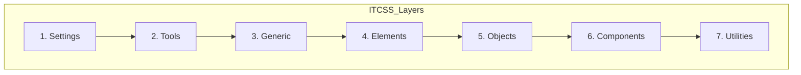
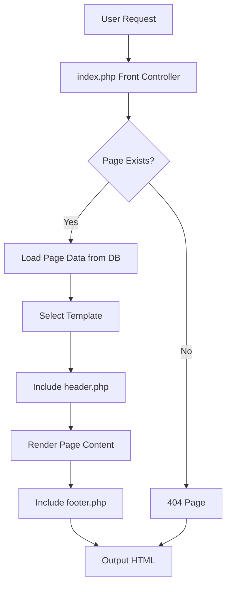
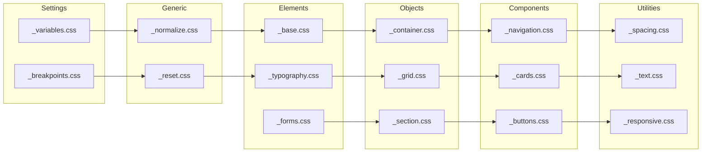
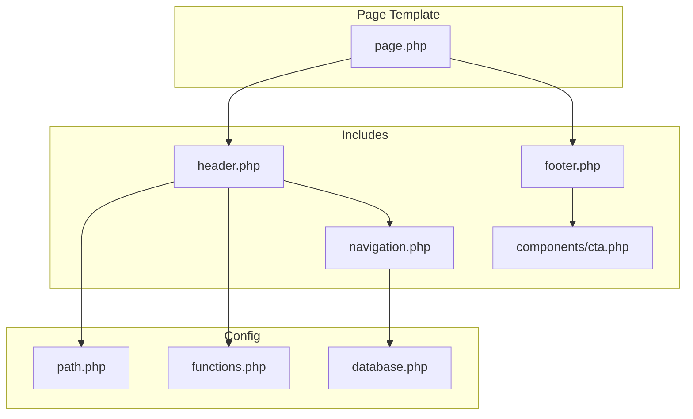

# Public Pages Architecture - Tulima Solar

## Executive Summary

This document outlines the architecture for rebuilding the public-facing frontend pages for Tulima Solar's website. The architecture leverages existing patterns from the admin portal while establishing a clean, modular structure for public pages.

---

## Table of Contents

1. [Admin Portal Pattern Analysis](#admin-portal-pattern-analysis)
2. [Proposed File Structure](#proposed-file-structure)
3. [CSS Architecture](#css-architecture)
4. [Include Logic Recommendations](#include-logic-recommendations)
5. [Page Content Outlines](#page-content-outlines)
6. [Asset Path Conventions](#asset-path-conventions)
7. [Implementation Guidelines](#implementation-guidelines)

---

## Admin Portal Pattern Analysis

### Key Findings from Admin Portal Analysis

#### 1. Include Structure Pattern

The admin portal uses a consistent include pattern found in [`admin/includes/header.php`](../admin/includes/header.php):

```php
<?php
if (!defined('BASE_PATH')) {
    require_once __DIR__ . '/../../config/path.php';
}
// ... additional setup ...
$pageTitle = $pageTitle ?? 'Admin';
$adminBase = rtrim(BASE_PATH, '/') . '/admin';
?>
<!DOCTYPE html>
<html lang="en">
<head>
  <meta charset="UTF-8">
  <meta name="viewport" content="width=device-width, initial-scale=1.0">
  <title><?php echo htmlspecialchars($pageTitle); ?> | Tulima Admin</title>
  <!-- CSS imports -->
  <link rel="stylesheet" href="<?php echo $adminBase; ?>/assets/css/v2/admin-main.css">
  <link rel="stylesheet" href="<?php echo $adminBase; ?>/assets/css/admin.css">
</head>
```

**Key Patterns:**
- BASE_PATH constant for relative URL generation
- Fallback to config/path.php if BASE_PATH not defined
- Variable initialization with null coalescing operator
- Modular CSS loading (v2 main + legacy fallback)

#### 2. Footer Include Pattern

From [`admin/includes/footer.php`](../admin/includes/footer.php):

```php
    </main>
  </div>
  <!-- Hidden upload form for media handling -->
  <iframe name="admin_upload_frame" ...></iframe>
  <form id="admin_upload_form" ...></form>
  <script>
    window.ADMIN_BASE = <?php echo json_encode($adminBaseUrl); ?>;
    // Global JavaScript utilities
  </script>
```

**Key Patterns:**
- Closes layout containers opened in header
- Hidden utility elements (upload iframe/form)
- Global JavaScript configuration
- Mobile sidebar toggle functionality

#### 3. Path Configuration

From [`config/path.php`](../config/path.php):

```php
define('BASE_PATH', '/tulima_php');
define('UPLOAD_DIR', 'uploads');
```

**Usage Pattern:**
```php
$assetUrl = BASE_PATH . '/assets/css/main.css';
$uploadPath = BASE_PATH . '/' . UPLOAD_DIR . '/images/';
```

### CSS Framework Analysis

#### Current CSS Architecture

The project has a documented ITCSS architecture in [`docs/CSS-ARCHITECTURE.md`](./CSS-ARCHITECTURE.md), but the modular files in `assets/css/` have not been created yet.

**Existing CSS Files:**

| File | Purpose | Status |
|------|---------|--------|
| [`master-style.css`](../master-style.css) | Main public site styles | Active, monolithic |
| [`admin/assets/css/admin.css`](../admin/assets/css/admin.css) | Admin panel styles | Active, monolithic |
| [`admin/assets/css/v2/admin-main.css`](../admin/assets/css/v2/admin-main.css) | Admin modular entry point | Active, imports from assets/css/ |
| [`job-portal/pages/assets/css/job-portal.css`](../job-portal/pages/assets/css/job-portal.css) | Job portal styles | Active, uses --jp- prefix |

#### Design Tokens (from existing files)

```css
:root {
  /* Brand Colors */
  --primary-purple: #660099;
  --secondary-green: #B0D7AB;
  --accent-orange: #E98E39;
  
  /* Darker Variants */
  --dark-purple: #4A0066;
  --dark-green: #8BC4A0;
  --dark-orange: #D17A1F;
  
  /* Light Variants */
  --light-purple: #F0E6F7;
  --light-green: #E8F5E8;
  --light-orange: #FDF4E8;
  
  /* Typography */
  --font-header: 'Century Gothic', 'CenturyGothic', sans-serif;
  --font-body: 'Calibri', 'Candara', 'Segoe UI', sans-serif;
  
  /* Spacing Scale */
  --spacing-xs: 0.25rem;
  --spacing-sm: 0.5rem;
  --spacing-md: 1rem;
  --spacing-lg: 1.5rem;
  --spacing-xl: 2rem;
  --spacing-2xl: 3rem;
}
```

---

## Proposed File Structure

```
tulima_php/
├── config/
│   ├── database.php              # Database connection
│   └── path.php                  # Path constants (BASE_PATH, UPLOAD_DIR)
│
├── includes/
│   ├── functions.php             # Global helper functions
│   ├── header.php                # Public site header
│   ├── footer.php                # Public site footer
│   ├── navigation.php            # Navigation component
│   └── components/
│       ├── hero.php              # Reusable hero section
│       ├── cta.php               # Call-to-action section
│       ├── testimonial-card.php  # Testimonial card component
│       ├── service-card.php      # Service card component
│       └── contact-form.php      # Contact form component
│
├── assets/
│   ├── css/
│   │   ├── main.css              # Main entry point (imports all partials)
│   │   │
│   │   ├── settings/
│   │   │   ├── _variables.css    # Design tokens
│   │   │   └── _breakpoints.css  # Media query breakpoints
│   │   │
│   │   ├── tools/
│   │   │   ├── _mixins.css       # CSS mixins
│   │   │   └── _functions.css    # CSS functions
│   │   │
│   │   ├── generic/
│   │   │   ├── _reset.css        # Modern CSS reset
│   │   │   └── _normalize.css    # Cross-browser consistency
│   │   │
│   │   ├── elements/
│   │   │   ├── _base.css         # Base HTML elements
│   │   │   ├── _typography.css   # Headings, text styles
│   │   │   ├── _links.css        # Anchor styles
│   │   │   ├── _images.css       # Image defaults
│   │   │   └── _forms.css        # Form element defaults
│   │   │
│   │   ├── objects/
│   │   │   ├── _container.css    # Layout containers
│   │   │   ├── _grid.css         # Grid system
│   │   │   ├── _section.css      # Page sections
│   │   │   └── _flex.css         # Flexbox utilities
│   │   │
│   │   ├── components/
│   │   │   ├── _navigation.css   # Main navigation
│   │   │   ├── _footer.css       # Site footer
│   │   │   ├── _hero.css         # Hero sections
│   │   │   ├── _cards.css        # Card components
│   │   │   ├── _buttons.css      # Button styles
│   │   │   ├── _forms.css        # Form components
│   │   │   ├── _testimonials.css # Testimonial slider
│   │   │   ├── _cta.css          # Call-to-action blocks
│   │   │   └── _impact-stats.css # Impact statistics
│   │   │
│   │   └── utilities/
│   │       ├── _spacing.css      # Margin/padding utilities
│   │       ├── _display.css      # Display utilities
│   │       ├── _text.css         # Text alignment utilities
│   │       └── _responsive.css   # Responsive visibility
│   │
│   ├── js/
│   │   ├── main.js               # Main JavaScript file
│   │   ├── navigation.js         # Navigation functionality
│   │   └── components/
│   │       ├── slider.js         # Testimonial slider
│   │       └── form-validation.js # Form validation
│   │
│   └── images/
│       ├── logo/
│       ├── icons/
│       └── backgrounds/
│
├── pages/
│   ├── home.php                  # Home page
│   ├── about.php                 # About page
│   ├── services.php              # Services page
│   ├── projects.php              # Projects/Portfolio page
│   └── contact.php               # Contact page
│
├── index.php                     # Front controller (routing)
└── master-style.css              # Legacy (keep for reference, deprecate)
```

---

## CSS Architecture

### ITCSS Methodology

Follow the Inverted Triangle CSS methodology as documented in [`docs/CSS-ARCHITECTURE.md`](./CSS-ARCHITECTURE.md):



### Main.css Entry Point

Create [`assets/css/main.css`](../assets/css/main.css) as the single entry point:

```css
/**
 * Tulima Solar - Public Site CSS
 * Main entry point following ITCSS methodology
 * 
 * @version 1.0.0
 */

/* ==========================================================================
   1. SETTINGS - Design Tokens & Variables
   ========================================================================== */
@import url('settings/_variables.css');
@import url('settings/_breakpoints.css');

/* ==========================================================================
   2. TOOLS - Mixins & Functions
   ========================================================================== */
@import url('tools/_mixins.css');
@import url('tools/_functions.css');

/* ==========================================================================
   3. GENERIC - Reset & Normalize
   ========================================================================== */
@import url('generic/_normalize.css');
@import url('generic/_reset.css');

/* ==========================================================================
   4. ELEMENTS - Base HTML Elements
   ========================================================================== */
@import url('elements/_base.css');
@import url('elements/_typography.css');
@import url('elements/_links.css');
@import url('elements/_images.css');
@import url('elements/_forms.css');

/* ==========================================================================
   5. OBJECTS - Layout Patterns
   ========================================================================== */
@import url('objects/_container.css');
@import url('objects/_grid.css');
@import url('objects/_section.css');
@import url('objects/_flex.css');

/* ==========================================================================
   6. COMPONENTS - UI Components
   ========================================================================== */
@import url('components/_navigation.css');
@import url('components/_footer.css');
@import url('components/_hero.css');
@import url('components/_cards.css');
@import url('components/_buttons.css');
@import url('components/_forms.css');
@import url('components/_testimonials.css');
@import url('components/_cta.css');
@import url('components/_impact-stats.css');

/* ==========================================================================
   7. UTILITIES - Helper Classes
   ========================================================================== */
@import url('utilities/_spacing.css');
@import url('utilities/_display.css');
@import url('utilities/_text.css');
@import url('utilities/_responsive.css');
```

### BEM Naming Convention

Use BEM (Block Element Modifier) for all component classes:

```css
/* Block */
.c-card { }

/* Element */
.c-card__header { }
.c-card__title { }
.c-card__body { }
.c-card__footer { }

/* Modifier */
.c-card--featured { }
.c-card--horizontal { }
```

### Namespace Prefixes

| Prefix | Purpose | Example |
|--------|---------|---------|
| `c-` | Component | `.c-navigation`, `.c-card` |
| `l-` | Layout | `.l-container`, `.l-grid` |
| `u-` | Utility | `.u-mt-lg`, `.u-text-center` |
| `is-` | State | `.is-active`, `.is-loading` |
| `js-` | JavaScript hook | `.js-toggle`, `.js-submit` |

### Responsive Breakpoints

```css
/* Mobile First Breakpoints */
:root {
  --bp-sm: 576px;
  --bp-md: 768px;
  --bp-lg: 992px;
  --bp-xl: 1200px;
  --bp-2xl: 1400px;
}

/* Usage */
@media (min-width: 768px) { /* md and up */ }
@media (min-width: 992px) { /* lg and up */ }
```

---

## Include Logic Recommendations

### Header Include Template

Create [`includes/header.php`](../includes/header.php):

```php
<?php
/**
 * Public Site Header Include
 * 
 * Expected variables (optional):
 * @var string $pageTitle - Page title suffix
 * @var string $pageDescription - Meta description
 * @var string $bodyClass - Additional body classes
 */

if (!defined('BASE_PATH')) {
    require_once __DIR__ . '/../config/path.php';
}

$pageTitle = $pageTitle ?? '';
$pageDescription = $pageDescription ?? 'Tulima Solar - Renewable Energy Solutions';
$bodyClass = $bodyClass ?? '';
$siteBase = rtrim(BASE_PATH, '/');

// Get site settings from database if available
$siteName = 'Tulima Solar';
if (isset($pdo)) {
    require_once __DIR__ . '/functions.php';
    $siteName = getSetting($pdo, 'site_name') ?: 'Tulima Solar';
}

$fullTitle = $pageTitle ? "{$pageTitle} | {$siteName}" : $siteName;
?>
<!DOCTYPE html>
<html lang="en">
<head>
  <meta charset="UTF-8">
  <meta name="viewport" content="width=device-width, initial-scale=1.0">
  <meta name="description" content="<?php echo htmlspecialchars($pageDescription); ?>">
  <title><?php echo htmlspecialchars($fullTitle); ?></title>
  
  <!-- Favicon -->
  <link rel="icon" type="image/png" href="<?php echo $siteBase; ?>/assets/images/favicon.png">
  
  <!-- Google Fonts -->
  <link rel="preconnect" href="https://fonts.googleapis.com">
  <link rel="preconnect" href="https://fonts.gstatic.com" crossorigin>
  <link href="https://fonts.googleapis.com/css2?family=Inter:wght@400;500;600;700;800&display=swap" rel="stylesheet">
  
  <!-- Main CSS -->
  <link rel="stylesheet" href="<?php echo $siteBase; ?>/assets/css/main.css">
  
  <!-- Page-specific CSS (optional) -->
  <?php if (isset($pageCss)): ?>
  <link rel="stylesheet" href="<?php echo $siteBase; ?>/assets/css/pages/<?php echo $pageCss; ?>">
  <?php endif; ?>
</head>
<body class="<?php echo htmlspecialchars($bodyClass); ?>">
  <a href="#main-content" class="skip-to-content">Skip to main content</a>
  
  <?php include __DIR__ . '/navigation.php'; ?>
  
  <main id="main-content" class="l-main">
```

### Footer Include Template

Create [`includes/footer.php`](../includes/footer.php):

```php
  </main>
  
  <?php include __DIR__ . '/components/cta.php'; ?>
  
  <footer class="c-footer">
    <div class="l-container">
      <div class="c-footer__grid">
        <!-- Footer sections -->
      </div>
      <div class="c-footer__bottom">
        <p>&copy; <?php echo date('Y'); ?> Tulima Solar. All rights reserved.</p>
        <nav class="c-footer__legal">
          <a href="<?php echo BASE_PATH; ?>/privacy">Privacy Policy</a>
          <a href="<?php echo BASE_PATH; ?>/terms">Terms of Service</a>
        </nav>
      </div>
    </div>
  </footer>
  
  <!-- JavaScript -->
  <script src="<?php echo BASE_PATH; ?>/assets/js/main.js" defer></script>
  
  <?php if (isset($pageJs)): ?>
  <script src="<?php echo BASE_PATH; ?>/assets/js/pages/<?php echo $pageJs; ?>" defer></script>
  <?php endif; ?>
  
  <script>
    // Global configuration
    window.SITE_CONFIG = {
      basePath: <?php echo json_encode(BASE_PATH); ?>,
      ajaxUrl: <?php echo json_encode(BASE_PATH . '/api/'); ?>
    };
  </script>
</body>
</html>
```

### Page Template Pattern

Example page structure ([`pages/home.php`](../pages/home.php)):

```php
<?php
/**
 * Home Page
 */

// Set page variables
$pageTitle = 'Home';
$pageDescription = 'Tulima Solar provides renewable energy solutions...';
$bodyClass = 'page-home';

// Include header
include __DIR__ . '/../includes/header.php';

// Page sections
$heroSection = $sectionMap['hero'] ?? null;
$servicesSection = $sectionMap['services'] ?? null;
$impactSection = $sectionMap['impact'] ?? null;
?>

<!-- Hero Section -->
<?php if ($heroSection): ?>
<section class="c-hero c-hero--home">
  <div class="c-hero__background">
    <!-- Background video/image -->
  </div>
  <div class="l-container">
    <div class="c-hero__content">
      <h1 class="c-hero__title"><?php echo e($heroSection['title']); ?></h1>
      <p class="c-hero__subtitle"><?php echo e($heroSection['subtitle']); ?></p>
      <div class="c-hero__actions">
        <a href="<?php echo BASE_PATH; ?>/contact" class="c-btn c-btn--primary">Get Started</a>
        <a href="<?php echo BASE_PATH; ?>/services" class="c-btn c-btn--outline">Our Services</a>
      </div>
    </div>
  </div>
</section>
<?php endif; ?>

<!-- Services Section -->
<?php if ($servicesSection): ?>
<section class="l-section l-section--services">
  <div class="l-container">
    <header class="l-section__header">
      <h2 class="l-section__title">Our Services</h2>
      <p class="l-section__subtitle">Comprehensive solar energy solutions</p>
    </header>
    <div class="l-grid l-grid--3">
      <!-- Service cards -->
    </div>
  </div>
</section>
<?php endif; ?>

<?php include __DIR__ . '/../includes/footer.php'; ?>
```

---

## Page Content Outlines

### Home Page

**URL:** `/` or `/home`

**Sections:**
1. **Hero Section**
   - Full-width video/image background
   - Main headline: "Powering Africa's Future with Solar Energy"
   - Subheadline: Brief value proposition
   - CTAs: "Get a Quote" and "Learn More"

2. **Impact Statistics**
   - Number of installations
   - CO2 emissions reduced
   - Households powered
   - Countries served

3. **Services Overview**
   - 3-4 service cards with icons
   - Solar Water Pumps
   - Agricultural Processing
   - Solar Home Systems
   - Commercial Solutions

4. **Why Choose Us**
   - Key differentiators
   - Experience, quality, support

5. **Testimonials**
   - Customer testimonials slider
   - Photo, quote, name, location

6. **Partners/Trust Indicators**
   - Partner logos
   - Certifications

7. **CTA Section**
   - "Ready to Go Solar?"
   - Contact form or link

### About Page

**URL:** `/about`

**Sections:**
1. **Hero Section**
   - Company story headline
   - Mission statement

2. **Our Story**
   - Company history timeline
   - Founder story
   - Milestones

3. **Mission & Vision**
   - Mission statement
   - Vision for the future
   - Core values

4. **Team Section**
   - Leadership team
   - Team member cards with photos

5. **Impact/Results**
   - Key achievements
   - Statistics and metrics

6. **CTA Section**
   - "Join Our Mission"
   - Careers link or contact

### Services Page

**URL:** `/services`

**Sections:**
1. **Hero Section**
   - Services overview headline
   - Brief description

2. **Service Categories**
   - Solar Water Pumps
     - Surface pumps
     - Submersible pumps
   - Agricultural Processing Machines
   - Solar Home Systems
   - Commercial/Industrial Solutions

3. **Service Details**
   - For each service:
     - Icon/image
     - Title
     - Description
     - Benefits list
     - CTA button

4. **Process Section**
   - How we work
   - Step-by-step process

5. **FAQ Section**
   - Common questions
   - Accordion format

6. **CTA Section**
   - Request a consultation

### Projects Page

**URL:** `/projects`

**Sections:**
1. **Hero Section**
   - Portfolio headline
   - Filter controls

2. **Project Filters**
   - By category
   - By location
   - By type

3. **Project Grid**
   - Project cards with:
     - Featured image
     - Project name
     - Location
     - Capacity/type
     - Brief description

4. **Featured Projects**
   - Larger showcase
   - Detailed case studies

5. **CTA Section**
   - "Start Your Project"

### Contact Page

**URL:** `/contact`

**Sections:**
1. **Hero Section**
   - "Get in Touch"
   - Brief message

2. **Contact Information**
   - Phone numbers
   - Email addresses
   - Office locations with maps

3. **Contact Form**
   - Name
   - Email
   - Phone
   - Service interest (dropdown)
   - Message
   - Submit button

4. **Office Locations**
   - Multiple offices
   - Address, phone, hours
   - Embedded map

5. **Social Media Links**
   - LinkedIn, Twitter, Facebook

---

## Asset Path Conventions

### URL Generation Pattern

Always use `BASE_PATH` for asset URLs:

```php
<!-- CSS -->
<link rel="stylesheet" href="<?php echo BASE_PATH; ?>/assets/css/main.css">

<!-- JavaScript -->
<script src="<?php echo BASE_PATH; ?>/assets/js/main.js"></script>

<!-- Images -->
/assets/images/logo.svg" alt="Tulima Solar">

<!-- Media (uploads) -->
/media/blog_images/example.jpg" alt="...">
```

### Directory Constants

Consider adding to [`config/path.php`](../config/path.php):

```php
// Existing
define('BASE_PATH', '/tulima_php');
define('UPLOAD_DIR', 'uploads');

// Recommended additions
define('ASSETS_URL', BASE_PATH . '/assets');
define('MEDIA_URL', BASE_PATH . '/media');
define('INCLUDES_PATH', __DIR__ . '/../includes');
define('PAGES_PATH', __DIR__ . '/../pages');
```

### Helper Functions

Add to [`includes/functions.php`](../includes/functions.php):

```php
/**
 * Generate asset URL
 */
function asset(string $path): string {
    return BASE_PATH . '/assets/' . ltrim($path, '/');
}

/**
 * Generate media URL
 */
function media(string $path): string {
    return BASE_PATH . '/media/' . ltrim($path, '/');
}

/**
 * Generate page URL
 */
function pageUrl(string $slug): string {
    return BASE_PATH . '/index.php?page=' . urlencode($slug);
}

/**
 * Escape HTML output
 */
function e(string $string): string {
    return htmlspecialchars($string, ENT_QUOTES, 'UTF-8');
}
```

---

## Implementation Guidelines

### Phase 1: Foundation

1. **Create CSS Directory Structure**
   - Create all directories under `assets/css/`
   - Create `_variables.css` with design tokens
   - Create `_breakpoints.css` with media queries
   - Create `_reset.css` and `_normalize.css`

2. **Create Include Files**
   - Create `includes/functions.php` with helper functions
   - Create `includes/header.php` template
   - Create `includes/footer.php` template
   - Create `includes/navigation.php` component

3. **Migrate Essential Styles**
   - Extract variables from `master-style.css`
   - Create base element styles
   - Create layout objects (container, grid, section)

### Phase 2: Components

1. **Create Core Components**
   - Navigation component
   - Footer component
   - Button styles
   - Card components
   - Form components

2. **Create Feature Components**
   - Hero section
   - Impact statistics
   - Testimonial slider
   - CTA blocks

### Phase 3: Pages

1. **Create Page Templates**
   - Home page
   - About page
   - Services page
   - Projects page
   - Contact page

2. **Integrate with Routing**
   - Update `index.php` front controller
   - Ensure proper template selection

### Phase 4: JavaScript

1. **Core Functionality**
   - Mobile navigation toggle
   - Smooth scrolling
   - Form validation

2. **Interactive Components**
   - Testimonial slider
   - FAQ accordion
   - Project filters

### Best Practices

1. **CSS**
   - Never use `!important` unless absolutely necessary
   - Keep selectors short and specific
   - Use CSS custom properties for theming
   - Mobile-first responsive design

2. **PHP**
   - Always escape output with `e()` function
   - Use prepared statements for database queries
   - Validate and sanitize all input
   - Use null coalescing for optional variables

3. **Accessibility**
   - Include skip-to-content link
   - Proper heading hierarchy
   - Alt text for images
   - Focus states for interactive elements
   - ARIA labels where needed

4. **Performance**
   - Minimize HTTP requests
   - Optimize images
   - Use `defer` for JavaScript
   - Consider critical CSS inlining

---

## Mermaid Diagrams

### Page Rendering Flow



### CSS Architecture Flow



### Include Hierarchy



---

## Summary

This architecture provides:

1. **Consistency** with the admin portal patterns
2. **Modularity** through ITCSS and BEM
3. **Maintainability** through clear file organization
4. **Scalability** for future growth
5. **Performance** through optimized asset loading

The implementation should follow the phased approach, starting with the CSS foundation and include templates, then building out components and pages incrementally.

For questions or clarifications, refer to:
- [`docs/CSS-ARCHITECTURE.md`](./CSS-ARCHITECTURE.md) for detailed CSS guidelines
- [`admin/includes/header.php`](../admin/includes/header.php) for include pattern reference
- [`job-portal/pages/assets/css/job-portal.css`](../job-portal/pages/assets/css/job-portal.css) for public page CSS patterns
