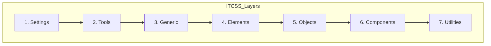
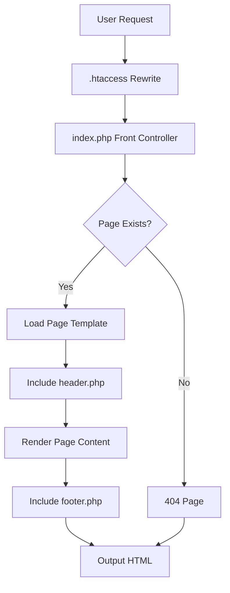

# Public Pages Rebuild - Complete Documentation

## Project Overview

### Purpose
The public-facing frontend for Tulima Solar has been completely rebuilt following modern web development best practices. This rebuild:

- Implements a modular, maintainable CSS architecture using ITCSS methodology
- Creates reusable PHP includes for header and footer components
- Establishes clean URL routing for better SEO and user experience
- Provides page-specific styling and JavaScript for optimized performance
- References the design patterns from [test.tulimasolar.com](https://test.tulimasolar.com)

### Reference Website
The rebuild was based on the design and functionality of **test.tulimasolar.com**, ensuring brand consistency and modern user experience.

---

## File Structure

### Complete Directory Tree

```
tulima_php/
├── config/
│   ├── database.php              # Database connection configuration
│   └── path.php                  # Path constants (BASE_PATH, UPLOAD_DIR)
│
├── includes/
│   ├── header.php                # Public site header with navigation
│   └── footer.php                # Public site footer with newsletter
│
├── pages/
│   ├── home.php                  # Home page
│   ├── about.php                 # About page
│   ├── services.php              # Services page
│   ├── projects.php              # Projects/Portfolio page
│   ├── contact.php               # Contact page
│   └── 404.php                   # 404 error page
│
├── assets/
│   ├── css/
│   │   ├── main.css              # Main entry point (imports all partials)
│   │   │
│   │   ├── settings/
│   │   │   ├── _variables.css    # Design tokens (colors, typography, spacing)
│   │   │   └── _breakpoints.css  # Media query breakpoints
│   │   │
│   │   ├── tools/
│   │   │   ├── _mixins.css       # CSS custom media queries
│   │   │   └── _functions.css    # CSS custom functions
│   │   │
│   │   ├── generic/
│   │   │   ├── _reset.css        # Modern CSS reset
│   │   │   └── _normalize.css    # Cross-browser consistency
│   │   │
│   │   ├── elements/
│   │   │   └── _base.css         # Base HTML element styles
│   │   │
│   │   ├── objects/
│   │   │   ├── _layout.css       # Layout patterns (container, grid, section)
│   │   │   └── _media.css        # Media object pattern
│   │   │
│   │   ├── components/
│   │   │   ├── _navigation.css   # Main navigation styles
│   │   │   ├── _footer.css       # Site footer styles
│   │   │   ├── _hero.css         # Hero section styles
│   │   │   ├── _cards.css        # Card components
│   │   │   ├── _buttons.css      # Button styles
│   │   │   ├── _forms.css        # Form components
│   │   │   └── _sections.css     # Section styles
│   │   │
│   │   ├── pages/
│   │   │   ├── home.css          # Home page specific styles
│   │   │   ├── about.css         # About page specific styles
│   │   │   ├── services.css      # Services page specific styles
│   │   │   ├── projects.css      # Projects page specific styles
│   │   │   └── contact.css       # Contact page specific styles
│   │   │
│   │   └── utilities/
│   │       └── _utilities.css    # Utility classes
│   │
│   ├── js/
│   │   ├── main.js               # Main JavaScript (global functionality)
│   │   └── pages/
│   │       ├── home.js           # Home page JavaScript
│   │       ├── services.js       # Services page JavaScript
│   │       ├── projects.js       # Projects page JavaScript
│   │       └── contact.js        # Contact page JavaScript
│   │
│   └── images/
│       ├── logo/                 # Logo files
│       ├── icons/                # Icon files
│       └── backgrounds/          # Background images
│
├── index.php                     # Front controller (routing)
└── .htaccess                     # Apache configuration for clean URLs
```

### File Descriptions

| File | Purpose |
|------|---------|
| [`includes/header.php`](../includes/header.php) | HTML header with navigation, meta tags, CSS imports |
| [`includes/footer.php`](../includes/footer.php) | HTML footer with newsletter, social links, JS imports |
| [`pages/home.php`](../pages/home.php) | Home page with hero, services, impact stats, testimonials |
| [`pages/about.php`](../pages/about.php) | About page with company story, team, values, milestones |
| [`pages/services.php`](../pages/services.php) | Services page with service categories, process steps, FAQ |
| [`pages/projects.php`](../pages/projects.php) | Projects page with project grid and filters |
| [`pages/contact.php`](../pages/contact.php) | Contact page with form, map, office locations |
| [`pages/404.php`](../pages/404.php) | 404 error page for not found routes |
| [`assets/css/main.css`](../assets/css/main.css) | Main CSS entry point importing all partials |
| [`assets/js/main.js`](../assets/js/main.js) | Main JavaScript with global functionality |

---

## Architecture Summary

### CSS Architecture (ITCSS Methodology)

The CSS follows the **Inverted Triangle CSS** methodology, organizing styles from generic to specific:



**Layer Descriptions:**

1. **Settings** - Design tokens (variables, colors, typography, breakpoints)
2. **Tools** - Mixins and functions for CSS logic
3. **Generic** - Reset and normalize for cross-browser consistency
4. **Elements** - Base HTML element styles (headings, links, forms)
5. **Objects** - Layout patterns (container, grid, sections)
6. **Components** - UI components (navigation, cards, buttons, hero)
7. **Utilities** - Helper classes for quick adjustments

### BEM Naming Convention

All component classes follow BEM (Block Element Modifier):

```css
/* Block */
.c-card { }

/* Element */
.c-card__header { }
.c-card__title { }
.c-card__body { }

/* Modifier */
.c-card--featured { }
.c-card--horizontal { }
```

### Namespace Prefixes

| Prefix | Purpose | Example |
|--------|---------|---------|
| `c-` | Component | `.c-navigation`, `.c-card` |
| `l-` | Layout | `.l-container`, `.l-grid` |
| `u-` | Utility | `.u-mt-lg`, `.u-text-center` |
| `is-` | State | `.is-active`, `.is-loading` |
| `js-` | JavaScript hook | `.js-toggle`, `.js-submit` |

### Include Pattern

Pages use a simple include pattern:

```php
<?php
// 1. Set page variables
$pageTitle = 'Page Title';
$pageDescription = 'Meta description';
$bodyClass = 'page-slug';
$pageCss = 'page.css';  // Optional: page-specific CSS
$pageJs = 'page.js';    // Optional: page-specific JavaScript

// 2. Include header
include __DIR__ . '/../includes/header.php';

// 3. Page content
?>

<!-- Page HTML content here -->

<?php
// 4. Include footer (automatically included at end)
```

### Routing Mechanism

The routing system uses Apache mod_rewrite for clean URLs:



---

## Pages Created

### Home Page (`/` or `/home`)

**File:** [`pages/home.php`](../pages/home.php)  
**CSS:** [`assets/css/pages/home.css`](../assets/css/pages/home.css)  
**JS:** [`assets/js/pages/home.js`](../assets/js/pages/home.js)

**Sections:**
1. **Hero Section** - Full-width video/image background with CTAs
2. **Impact Statistics** - Animated counters (homes powered, CO2 reduced, etc.)
3. **Services Overview** - Service cards with icons
4. **Why Choose Us** - Key differentiators
5. **Testimonials** - Customer testimonials slider
6. **Partners** - Partner logos

### About Page (`/about`)

**File:** [`pages/about.php`](../pages/about.php)  
**CSS:** [`assets/css/pages/about.css`](../assets/css/pages/about.css)

**Sections:**
1. **Hero Section** - Company story headline
2. **Our Story** - Company history timeline with milestones
3. **Mission & Vision** - Mission statement and core values
4. **Team Section** - Leadership team (directors, advisors, staff)
5. **Impact/Results** - Key achievements

### Services Page (`/services`)

**File:** [`pages/services.php`](../pages/services.php)  
**CSS:** [`assets/css/pages/services.css`](../assets/css/pages/services.css)  
**JS:** [`assets/js/pages/services.js`](../assets/js/pages/services.js)

**Sections:**
1. **Hero Section** - Services overview
2. **Service Categories** - Grid of service cards
3. **Service Details** - Each service with features
4. **Process Section** - Step-by-step process
5. **FAQ Section** - Accordion with common questions

### Projects Page (`/projects`)

**File:** [`pages/projects.php`](../pages/projects.php)  
**CSS:** [`assets/css/pages/projects.css`](../assets/css/pages/projects.css)  
**JS:** [`assets/js/pages/projects.js`](../assets/js/pages/projects.js)

**Sections:**
1. **Hero Section** - Portfolio headline
2. **Project Filters** - Category/location filters
3. **Project Grid** - Project cards with images
4. **Featured Projects** - Larger showcase items

### Contact Page (`/contact`)

**File:** [`pages/contact.php`](../pages/contact.php)  
**CSS:** [`assets/css/pages/contact.css`](../assets/css/pages/contact.css)  
**JS:** [`assets/js/pages/contact.js`](../assets/js/pages/contact.js)

**Sections:**
1. **Hero Section** - Get in touch
2. **Contact Form** - Name, email, phone, message
3. **Office Locations** - Multiple offices with maps
4. **Contact Information** - Phone, email, address

### 404 Page (`/404`)

**File:** [`pages/404.php`](../pages/404.php)

**Sections:**
1. **Error Message** - Friendly 404 message
2. **Navigation** - Links to main pages
3. **Search** - Site search option

---

## Design Tokens

### Color Palette

```css
/* Primary Brand Colors */
--primary-purple: #660099;
--secondary-green: #B0D7AB;
--accent-orange: #E98E39;

/* Darker Variants */
--dark-purple: #4A0066;
--dark-green: #8BC4A0;
--dark-orange: #D17A1F;
--navbar-dark: #2d1b4e;

/* Lighter Variants */
--light-purple: #F0E6F7;
--light-green: #E8F5E8;
--light-orange: #FDF4E8;

/* Neutral Colors */
--text-primary: #2C2C2C;
--text-secondary: #4A4A4A;
--text-muted: #6B6B6B;
--white: #FFFFFF;
--black: #000000;
--light-gray: #f8f9fa;
--border-color: #dee2e6;

/* Semantic Colors */
--color-success: #28a745;
--color-warning: #ffc107;
--color-error: #dc3545;
--color-info: #17a2b8;
```

### Typography

```css
/* Font Families */
--font-header: 'Inter', 'Century Gothic', sans-serif;
--font-body: 'Inter', 'Calibri', 'Segoe UI', sans-serif;

/* Font Sizes (Mobile First) */
--font-size-xs: 0.75rem;    /* 12px */
--font-size-sm: 0.875rem;   /* 14px */
--font-size-base: 1rem;     /* 16px */
--font-size-md: 1.125rem;   /* 18px */
--font-size-lg: 1.25rem;    /* 20px */
--font-size-xl: 1.5rem;     /* 24px */
--font-size-2xl: 1.75rem;   /* 28px */
--font-size-3xl: 2rem;      /* 32px */
--font-size-4xl: 2.5rem;    /* 40px */
--font-size-5xl: 3rem;      /* 48px */

/* Font Weights */
--font-weight-normal: 400;
--font-weight-medium: 500;
--font-weight-semibold: 600;
--font-weight-bold: 700;
--font-weight-extrabold: 800;

/* Line Heights */
--line-height-tight: 1.2;
--line-height-snug: 1.35;
--line-height-normal: 1.5;
--line-height-relaxed: 1.65;
--line-height-loose: 1.8;
```

### Spacing Scale

```css
--spacing-0: 0;
--spacing-1: 0.25rem;   /* 4px */
--spacing-2: 0.5rem;    /* 8px */
--spacing-3: 0.75rem;   /* 12px */
--spacing-4: 1rem;      /* 16px */
--spacing-5: 1.25rem;   /* 20px */
--spacing-6: 1.5rem;    /* 24px */
--spacing-8: 2rem;      /* 32px */
--spacing-10: 2.5rem;   /* 40px */
--spacing-12: 3rem;     /* 48px */
--spacing-16: 4rem;     /* 64px */
--spacing-20: 5rem;     /* 80px */
--spacing-24: 6rem;     /* 96px */
```

### Breakpoints

```css
/* Mobile First Breakpoints */
--bp-xs: 0;          /* Extra small (phones) */
--bp-sm: 576px;      /* Small (landscape phones) */
--bp-md: 768px;      /* Medium (tablets) */
--bp-lg: 992px;      /* Large (desktops) */
--bp-xl: 1200px;     /* Extra large (large desktops) */
--bp-2xl: 1400px;    /* Extra extra large */

/* Usage */
@media (min-width: 768px) { /* md and up */ }
@media (min-width: 992px) { /* lg and up */ }
```

---

## Usage Guide

### How to Create a New Page

1. **Create the PHP file** in `pages/` directory:

```php
<?php
/**
 * New Page - Tulima Solar
 */

// Page variables for header
$pageTitle = 'New Page Title';
$pageDescription = 'Meta description for SEO';
$bodyClass = 'page-new-page';
$pageCss = 'new-page.css';     // Optional
$pageJs = 'new-page.js';       // Optional

// Include header
include __DIR__ . '/../includes/header.php';

// Get database connection if needed
require_once __DIR__ . '/../config/database.php';
$pdo = getDb();
?>

<!-- Page content here -->
<section class="l-section">
  <div class="l-container">
    <h1>New Page</h1>
    <p>Content goes here...</p>
  </div>
</section>

<?php include __DIR__ . '/../includes/footer.php'; ?>
```

2. **Create the CSS file** (optional) in `assets/css/pages/`:

```css
/**
 * New Page Styles
 */

.page-new-page {
  /* Page-specific styles */
}

.page-new-page .l-section {
  /* Section overrides */
}
```

3. **Create the JavaScript file** (optional) in `assets/js/pages/`:

```javascript
(function() {
  'use strict';
  
  // Page-specific JavaScript
})();
```

4. **Add route** to `.htaccess`:

```apache
RewriteRule ^new-page$ index.php?page=new-page [L,QSA]
```

### How to Add New CSS Components

1. **Create the component file** in `assets/css/components/`:

```css
/**
 * Component Name
 * Brief description
 */

.c-component-name {
  /* Base styles */
}

.c-component-name__element {
  /* Element styles */
}

.c-component-name--modifier {
  /* Modifier styles */
}
```

2. **Import in** [`assets/css/main.css`](../assets/css/main.css):

```css
/* Add to Components section */
@import url('components/_component-name.css');
```

### How to Add New JavaScript Functionality

1. **Global functionality** - Add to [`assets/js/main.js`](../assets/js/main.js):

```javascript
function initNewFeature() {
  // Feature code
}

// Add to domReady callback
domReady(function() {
  initNewFeature();
});
```

2. **Page-specific functionality** - Create file in `assets/js/pages/`:

```javascript
(function() {
  'use strict';
  
  // Page-specific code
  const element = document.querySelector('.js-element');
  
  if (element) {
    // Code runs only if element exists
  }
})();
```

---

## Database Integration

### Tables Used

| Table | Purpose | Used In |
|-------|---------|---------|
| `team_members` | Team member information | About page |
| `impact_numbers` | Impact statistics | Home page |
| `testimonials` | Customer testimonials | Home page |
| `partners` | Partner logos | Home page |
| `office_locations` | Office locations | Contact page |
| `contact_submissions` | Contact form submissions | Contact page |
| `pages` | Dynamic page content | All pages |
| `sections` | Page sections | All pages |

### Fetching Dynamic Data

```php
// Get database connection
require_once __DIR__ . '/../config/database.php';
$pdo = getDb();

// Fetch team members
$stmt = $pdo->query("SELECT * FROM team_members WHERE is_active = 1 ORDER BY display_order ASC");
$teamMembers = $stmt->fetchAll(PDO::FETCH_ASSOC);

// Fetch impact statistics
$stmt = $pdo->query("SELECT * FROM impact_numbers WHERE is_active = 1 ORDER BY sort_order ASC");
$impactStats = $stmt->fetchAll(PDO::FETCH_ASSOC);

// Fetch testimonials
$stmt = $pdo->query("SELECT * FROM testimonials WHERE is_active = 1 ORDER BY sort_order ASC LIMIT 6");
$testimonials = $stmt->fetchAll(PDO::FETCH_ASSOC);

// Fetch partners
$stmt = $pdo->query("SELECT * FROM partners WHERE is_active = 1 ORDER BY sort_order ASC");
$partners = $stmt->fetchAll(PDO::FETCH_ASSOC);

// Fetch office locations
$stmt = $pdo->query("SELECT * FROM office_locations WHERE is_active = 1 ORDER BY sort_order ASC");
$offices = $stmt->fetchAll(PDO::FETCH_ASSOC);
```

---

## URL Routes

### Available Routes

| Clean URL | Maps To | Description |
|-----------|---------|-------------|
| `/` | `index.php?page=home` | Home page |
| `/home` | `index.php?page=home` | Home page (alias) |
| `/about` | `index.php?page=about` | About page |
| `/about-us` | `index.php?page=about` | About page (alias) |
| `/services` | `index.php?page=services` | Services page |
| `/our-services` | `index.php?page=services` | Services page (alias) |
| `/projects` | `index.php?page=projects` | Projects page |
| `/our-projects` | `index.php?page=projects` | Projects page (alias) |
| `/contact` | `index.php?page=contact` | Contact page |
| `/contact-us` | `index.php?page=contact` | Contact page (alias) |
| `/products` | `index.php?page=products` | Products page |
| `/blog` | `index.php?page=blog` | Blog listing |
| `/blog/{slug}` | `blog/post.php?slug={slug}` | Blog post |
| `/careers` | `index.php?page=careers` | Careers page |
| `/jobs` | `index.php?page=careers` | Careers page (alias) |
| `/quote` | `index.php?page=quote` | Quote request |
| `/get-a-quote` | `index.php?page=quote` | Quote request (alias) |
| `/privacy` | `index.php?page=privacy` | Privacy Policy |
| `/terms` | `index.php?page=terms` | Terms & Conditions |
| `/cookies` | `index.php?page=cookies` | Cookie Policy |
| `/sitemap` | `index.php?page=sitemap` | Sitemap |

### Clean URL Patterns

The `.htaccess` file handles URL rewriting:

```apache
# Skip rewriting for existing files and directories
RewriteCond %{REQUEST_FILENAME} !-f
RewriteCond %{REQUEST_FILENAME} !-d

# Skip specific directories
RewriteCond %{REQUEST_URI} !^/admin [NC]
RewriteCond %{REQUEST_URI} !^/assets [NC]
RewriteCond %{REQUEST_URI} !^/includes [NC]
RewriteCond %{REQUEST_URI} !^/api [NC]
RewriteCond %{REQUEST_URI} !^/blog [NC]

# Catch-all for single-level slugs
RewriteRule ^([a-z0-9\-]+)$ index.php?page=$1 [L,QSA,NC]
```

---

## Future Enhancements

### Suggested Improvements

1. **Performance Optimization**
   - Implement critical CSS inlining
   - Add service worker for caching
   - Optimize images with WebP format
   - Minify CSS and JavaScript for production

2. **Accessibility**
   - Add ARIA labels where needed
   - Implement skip links
   - Ensure proper heading hierarchy
   - Add keyboard navigation support

3. **SEO Enhancements**
   - Add structured data (JSON-LD)
   - Implement Open Graph tags
   - Add XML sitemap generation
   - Implement canonical URLs

4. **Features to Add**
   - Dark mode toggle
   - Multi-language support
   - Advanced search functionality
   - Live chat integration
   - Customer portal/dashboard

5. **Development Experience**
   - Add CSS/JS build process (Webpack/Vite)
   - Implement hot reloading
   - Add automated testing
   - Set up CI/CD pipeline

---

## Troubleshooting

### Common Issues and Solutions

#### CSS Not Loading

**Symptom:** Page displays without styles

**Solutions:**
1. Check `BASE_PATH` in [`config/path.php`](../config/path.php)
2. Verify `.htaccess` is enabled and mod_rewrite is active
3. Clear browser cache
4. Check CSS file permissions (644)

```php
// Verify BASE_PATH is correct
echo BASE_PATH; // Should output /tulima_php or similar
```

#### 404 Errors on Clean URLs

**Symptom:** Clean URLs return 404 errors

**Solutions:**
1. Ensure `.htaccess` file exists in root
2. Verify Apache mod_rewrite is enabled:
   ```bash
   a2enmod rewrite
   systemctl restart apache2
   ```
3. Check Apache `AllowOverride` is set to `All`:
   ```apache
   <Directory /var/www/html>
     AllowOverride All
   </Directory>
   ```

#### Navigation Not Displaying Correctly

**Symptom:** Navigation appears broken or misaligned

**Solutions:**
1. Check if [`assets/css/components/_navigation.css`](../assets/css/components/_navigation.css) is loaded
2. Verify JavaScript is not blocking rendering
3. Check for CSS conflicts with other stylesheets
4. Use browser DevTools to inspect computed styles

#### Database Connection Errors

**Symptom:** Page fails to load dynamic content

**Solutions:**
1. Verify database credentials in [`config/database.php`](../config/database.php)
2. Check MySQL service is running
3. Verify tables exist with correct structure
4. Check for PDO extension in PHP

```php
// Test database connection
try {
    $pdo = getDb();
    echo "Connected successfully";
} catch (PDOException $e) {
    echo "Connection failed: " . $e->getMessage();
}
```

### CSS Debugging Tips

1. **Use Browser DevTools**
   - Right-click → Inspect Element
   - Check Computed tab for final styles
   - Use Network tab to verify CSS files load

2. **Check CSS Specificity**
   - More specific selectors override less specific ones
   - Use `!important` sparingly (only for utilities)

3. **Verify Import Order**
   - Settings must come before Tools
   - Generic must come before Elements
   - Components must come before Utilities

4. **Common CSS Issues**
   ```css
   /* Issue: Variable not defined */
   color: var(--primary-color); /* Wrong variable name */
   
   /* Solution: Use correct variable */
   color: var(--primary-purple);
   ```

5. **Mobile Responsiveness**
   - Test at different viewport sizes
   - Use responsive design mode in DevTools
   - Check media query breakpoints

---

## Summary

The public pages rebuild provides:

- **Modularity** through ITCSS and BEM
- **Maintainability** through clear file organization
- **Scalability** for future growth
- **Performance** through optimized asset loading
- **Accessibility** through semantic HTML and ARIA
- **SEO-friendly** clean URLs

For questions or clarifications, refer to:
- [`docs/PUBLIC-PAGES-ARCHITECTURE.md`](./PUBLIC-PAGES-ARCHITECTURE.md) for detailed architecture
- [`docs/CSS-ARCHITECTURE.md`](./CSS-ARCHITECTURE.md) for CSS guidelines
- [`docs/CSS-TROUBLESHOOTING-GUIDE.md`](./CSS-TROUBLESHOOTING-GUIDE.md) for CSS debugging

---

**Document Version:** 1.0.0  
**Last Updated:** February 2026  
**Author:** Tulima Solar Development Team
