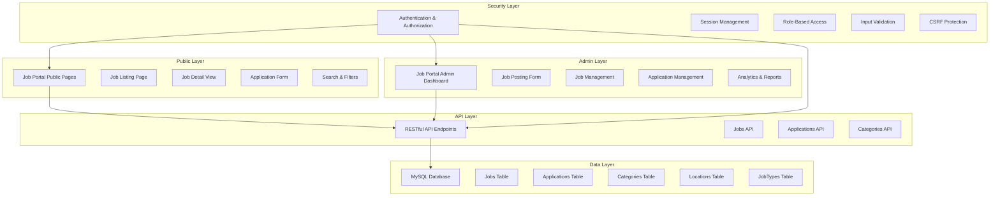

# Job Portal Architecture - Tulima Solar

## Executive Summary

This document outlines the comprehensive architecture for a self-contained Job Portal component that integrates seamlessly with the existing Tulima Solar website. The portal includes public-facing job listings with advanced search/filtering, detailed job descriptions, secure application forms, and a restricted administrative dashboard for job management.

## System Architecture



## Database Schema

### Jobs Table
```sql
CREATE TABLE jobs (
    id INT UNSIGNED AUTO_INCREMENT PRIMARY KEY,
    title VARCHAR(255) NOT NULL,
    slug VARCHAR(255) NOT NULL UNIQUE,
    description TEXT NOT NULL,
    requirements TEXT,
    responsibilities TEXT,
    qualifications TEXT,
    job_type ENUM('full-time', 'part-time', 'contract', 'internship', 'volunteer') NOT NULL,
    employment_type ENUM('permanent', 'temporary', 'seasonal') NOT NULL,
    category_id INT UNSIGNED NOT NULL,
    location_id INT UNSIGNED,
    salary_min DECIMAL(10,2),
    salary_max DECIMAL(10,2),
    salary_currency VARCHAR(3) DEFAULT 'USD',
    status ENUM('draft', 'active', 'closed') DEFAULT 'draft',
    is_featured TINYINT(1) DEFAULT 0,
    is_urgent TINYINT(1) DEFAULT 0,
    application_deadline DATETIME,
    created_at TIMESTAMP DEFAULT CURRENT_TIMESTAMP,
    updated_at TIMESTAMP DEFAULT CURRENT_TIMESTAMP ON UPDATE CURRENT_TIMESTAMP,
    created_by INT UNSIGNED,
    FOREIGN KEY (category_id) REFERENCES job_categories(id) ON DELETE RESTRICT,
    FOREIGN KEY (location_id) REFERENCES job_locations(id) ON DELETE SET NULL,
    FOREIGN KEY (created_by) REFERENCES admins(id) ON DELETE SET NULL,
    INDEX idx_status (status),
    INDEX idx_category (category_id),
    INDEX idx_location (location_id),
    INDEX idx_type (job_type),
    INDEX idx_deadline (application_deadline)
) ENGINE=InnoDB;
```

### Job Categories Table
```sql
CREATE TABLE job_categories (
    id INT UNSIGNED AUTO_INCREMENT PRIMARY KEY,
    name VARCHAR(100) NOT NULL,
    slug VARCHAR(100) NOT NULL UNIQUE,
    description TEXT,
    icon VARCHAR(255),
    sort_order INT DEFAULT 0,
    is_active TINYINT(1) DEFAULT 1,
    created_at TIMESTAMP DEFAULT CURRENT_TIMESTAMP,
    updated_at TIMESTAMP DEFAULT CURRENT_TIMESTAMP ON UPDATE CURRENT_TIMESTAMP,
    INDEX idx_sort (sort_order)
) ENGINE=InnoDB;
```

### Job Locations Table
```sql
CREATE TABLE job_locations (
    id INT UNSIGNED AUTO_INCREMENT PRIMARY KEY,
    name VARCHAR(100) NOT NULL,
    country VARCHAR(100),
    city VARCHAR(100),
    address TEXT,
    latitude DECIMAL(10,8),
    longitude DECIMAL(11,8),
    is_remote TINYINT(1) DEFAULT 0,
    sort_order INT DEFAULT 0,
    is_active TINYINT(1) DEFAULT 1,
    created_at TIMESTAMP DEFAULT CURRENT_TIMESTAMP,
    updated_at TIMESTAMP DEFAULT CURRENT_TIMESTAMP ON UPDATE CURRENT_TIMESTAMP,
    INDEX idx_sort (sort_order)
) ENGINE=InnoDB;
```

### Job Applications Table
```sql
CREATE TABLE job_applications (
    id INT UNSIGNED AUTO_INCREMENT PRIMARY KEY,
    job_id INT UNSIGNED NOT NULL,
    applicant_name VARCHAR(255) NOT NULL,
    applicant_email VARCHAR(255) NOT NULL,
    applicant_phone VARCHAR(50),
    cover_letter TEXT,
    resume_path VARCHAR(500),
    status ENUM('pending', 'reviewed', 'interview', 'accepted', 'rejected') DEFAULT 'pending',
    notes TEXT,
    created_at TIMESTAMP DEFAULT CURRENT_TIMESTAMP,
    updated_at TIMESTAMP DEFAULT CURRENT_TIMESTAMP ON UPDATE CURRENT_TIMESTAMP,
    FOREIGN KEY (job_id) REFERENCES jobs(id) ON DELETE CASCADE,
    INDEX idx_job (job_id),
    INDEX idx_status (status),
    INDEX idx_date (created_at)
) ENGINE=InnoDB;
```

### Job Application Documents Table
```sql
CREATE TABLE job_application_documents (
    id INT UNSIGNED AUTO_INCREMENT PRIMARY KEY,
    application_id INT UNSIGNED NOT NULL,
    document_type ENUM('resume', 'cover_letter', 'other') NOT NULL,
    file_path VARCHAR(500) NOT NULL,
    file_name VARCHAR(255) NOT NULL,
    file_size INT UNSIGNED,
    uploaded_at TIMESTAMP DEFAULT CURRENT_TIMESTAMP,
    FOREIGN KEY (application_id) REFERENCES job_applications(id) ON DELETE CASCADE,
    INDEX idx_application (application_id)
) ENGINE=InnoDB;
```

### Job Tags Table (Many-to-Many)
```sql
CREATE TABLE job_tags (
    id INT UNSIGNED AUTO_INCREMENT PRIMARY KEY,
    name VARCHAR(50) NOT NULL UNIQUE,
    slug VARCHAR(50) NOT NULL UNIQUE,
    created_at TIMESTAMP DEFAULT CURRENT_TIMESTAMP
) ENGINE=InnoDB;

CREATE TABLE job_tag_relations (
    job_id INT UNSIGNED NOT NULL,
    tag_id INT UNSIGNED NOT NULL,
    PRIMARY KEY (job_id, tag_id),
    FOREIGN KEY (job_id) REFERENCES jobs(id) ON DELETE CASCADE,
    FOREIGN KEY (tag_id) REFERENCES job_tags(id) ON DELETE CASCADE
) ENGINE=InnoDB;
```

## File Structure

```
job-portal/
├── public/
│   ├── index.php                 # Main job portal page (job listings)
│   ├── job-detail.php            # Individual job detail view
│   ├── apply.php                  # Application form
│   ├── search.php                 # Advanced search page
│   └── assets/
│       ├── css/
│       │   └── job-portal.css    # Portal-specific styles
│       └── js/
│           └── job-portal.js     # Frontend interactions
├── admin/
│   ├── jobs.php                  # Job management dashboard
│   ├── job-post.php              # Job posting form
│   ├── job-edit.php              # Job editing form
│   ├── applications.php          # Application management
│   ├── categories.php            # Category management
│   ├── locations.php             # Location management
│   ├── api/
│   │   ├── jobs-api.php          # Jobs REST API
│   │   └── applications-api.php  # Applications REST API
│   └── assets/
│       ├── css/
│       │   └── admin-jobs.css    # Admin-specific styles
│       └── js/
│           └── admin-jobs.js     # Admin interactions
├── includes/
│   ├── job-portal-functions.php  # Portal helper functions
│   └── job-portal-auth.php       # Authentication helpers
└── config/
    └── job-portal-config.php     # Portal configuration
```

## API Endpoints

### Jobs API
```
GET    /job-portal/api/jobs                    # List all jobs with filters
GET    /job-portal/api/jobs/{id}               # Get single job
GET    /job-portal/api/jobs/search             # Search jobs
POST   /job-portal/api/jobs                    # Create job (admin only)
PUT    /job-portal/api/jobs/{id}               # Update job (admin only)
DELETE /job-portal/api/jobs/{id}               # Delete job (admin only)
GET    /job-portal/api/jobs/{id}/applications  # Get job applications
```

### Applications API
```
GET    /job-portal/api/applications            # List applications (admin only)
GET    /job-portal/api/applications/{id}       # Get application details
POST   /job-portal/api/applications            # Submit application
PUT    /job-portal/api/applications/{id}       # Update application status (admin only)
DELETE /job-portal/api/applications/{id}       # Delete application (admin only)
```

### Categories & Locations API
```
GET    /job-portal/api/categories              # List categories
GET    /job-portal/api/locations               # List locations
```

## Public Pages

### 1. Job Listing Page (`public/index.php`)
**Features:**
- Display all active jobs in a responsive grid/card layout
- Advanced search with filters:
  - Keyword search (title, description)
  - Category filter
  - Location filter
  - Job type filter
  - Salary range filter
  - Date posted filter
- Pagination (20 jobs per page)
- Sort options (newest, oldest, salary, relevance)
- Featured jobs highlighted
- Urgent jobs highlighted

**Visual Design:**
- Hero section with search bar
- Filter sidebar (desktop) / filter dropdowns (mobile)
- Job cards with:
  - Job title and company
  - Location
  - Job type and employment type
  - Salary range
  - Posted date
  - Apply button
  - Bookmark/favorite functionality

### 2. Job Detail Page (`public/job-detail.php`)
**Features:**
- Full job description
- Job requirements and responsibilities
- Qualifications needed
- Application deadline
- Company information (if applicable)
- Related jobs
- "Apply Now" button leading to application form
- Share functionality

### 3. Application Form (`public/apply.php`)
**Features:**
- Multi-step form:
  - Step 1: Personal information
  - Step 2: Cover letter
  - Step 3: Resume upload
  - Step 4: Confirmation
- Form validation
- File upload (resume, cover letter)
- Success/error messages
- Email confirmation
- Application tracking

## Administrative Dashboard

### 1. Job Management (`admin/jobs.php`)
**Features:**
- Dashboard overview:
  - Total jobs count
  - Active jobs count
  - Applications received
  - Pending applications
- Job listing with:
  - Table view with sorting and filtering
  - Status badges (active, closed, draft)
  - Quick actions (edit, delete, view applications)
- Create new job with:
  - Rich text editor for description
  - Category and location selection
  - Salary range input
  - Deadline setting
  - Featured/urgent toggles
- Edit existing jobs
- Delete jobs (with confirmation)

### 2. Application Management (`admin/applications.php`)
**Features:**
- Application listing with:
  - Applicant information
  - Job applied for
  - Application date
  - Status
  - Resume preview
- View application details:
  - Full cover letter
  - Resume download
  - Notes
- Update application status
- Add internal notes
- Bulk actions (mark as reviewed, reject, etc.)

### 3. Category Management (`admin/categories.php`)
**Features:**
- Create, edit, delete job categories
- Icon selection
- Sort order management
- Active/inactive toggle

### 4. Location Management (`admin/locations.php`)
**Features:**
- Create, edit, delete job locations
- Remote work option
- Address and coordinates
- Sort order management

## Security Implementation

### Authentication & Authorization
- Session-based authentication
- Role-based access control (RBAC):
  - `admin` role for full access
  - `hr_manager` role for job management
  - `recruiter` role for application management
- Password hashing (bcrypt)
- Session timeout and security headers

### Input Validation
- Sanitize all user inputs
- Validate file uploads (type, size, virus scan)
- Rate limiting for form submissions
- CSRF protection with tokens

### Data Protection
- SQL injection prevention (PDO prepared statements)
- XSS prevention (output escaping)
- Secure file handling (no direct file access)
- GDPR compliance for personal data

## Integration with Existing Website

### Navigation Integration
- Add "Careers" link to main navigation
- Add "Job Portal" to admin navigation
- Support for job portal as a standalone page or embedded section

### Visual Identity
- Use existing color palette:
  - Primary purple: #660099
  - Secondary green: #B0D7AB
  - Accent orange: #E98E39
- Use Inter font family
- Follow existing responsive design patterns
- Maintain consistent spacing and typography

### Database Integration
- Use existing PDO connection (`config/database.php`)
- Leverage existing authentication system
- Use existing activity logging system
- Follow existing naming conventions

### URL Structure
```
Public:
- Job listing: index.php?page=careers
- Job detail: index.php?page=careers&job=job-slug
- Application: index.php?page=apply&job=job-slug

Admin:
- Dashboard: admin/jobs.php
- Job posting: admin/job-post.php
- Applications: admin/applications.php
```

## Features & Functionality

### Search & Filtering
- Real-time search as user types
- Multiple filter combinations
- Saved search preferences
- Search history

### Job Status Management
- Draft (not visible to public)
- Active (visible, accepting applications)
- Closed (visible but not accepting applications)

### Application Tracking
- Unique application ID
- Status updates
- Email notifications
- Application timeline

### Analytics & Reporting
- Jobs by category
- Applications by job
- Application status distribution
- Popular search terms
- Geographic distribution

### Notifications
- Email notifications for new applications
- Status change notifications
- Deadline reminders
- Weekly digest

## Responsive Design

### Breakpoints
- Mobile: < 768px
- Tablet: 768px - 1024px
- Desktop: > 1024px

### Mobile Considerations
- Hamburger menu for navigation
- Collapsible filter panels
- Touch-friendly form elements
- Optimized file upload for mobile

## Performance Optimization

### Caching
- Job listing cache (5 minutes)
- Job detail cache (10 minutes)
- API response caching
- Static asset compression

### Database Optimization
- Indexes on frequently queried columns
- Query optimization
- Connection pooling

### Frontend Optimization
- Lazy loading for images
- Minified CSS/JS
- CDN for static assets
- Async loading of non-critical scripts

## Testing Strategy

### Unit Testing
- Database queries
- API endpoints
- Form validation
- Helper functions

### Integration Testing
- End-to-end workflows
- User flows
- API integrations

### User Acceptance Testing
- Real-world usage scenarios
- Cross-browser testing
- Mobile device testing

## Deployment Plan

### Phase 1: Database Setup
1. Create migration file for job portal tables
2. Run migration in existing database
3. Seed initial categories and locations

### Phase 2: Public Pages
1. Create job listing page
2. Implement search and filters
3. Create job detail page
4. Build application form

### Phase 3: Admin Dashboard
1. Create job management interface
2. Build application management
3. Implement category/location management

### Phase 4: API Development
1. Create RESTful API endpoints
2. Implement authentication
3. Add rate limiting

### Phase 5: Integration & Testing
1. Integrate with existing navigation
2. Test all functionality
3. Optimize performance
4. Deploy to production

## Maintenance & Updates

### Regular Tasks
- Monitor application inbox
- Update job listings regularly
- Review and approve applications
- Clean up old applications
- Update analytics

### Security Tasks
- Regular security audits
- Update dependencies
- Monitor for vulnerabilities
- Backup database regularly

## Success Metrics

### Key Performance Indicators
- Number of jobs posted
- Number of applications received
- Application completion rate
- Time to fill positions
- User engagement metrics

### User Experience Metrics
- Search success rate
- Application completion rate
- Page load times
- Mobile usage statistics
