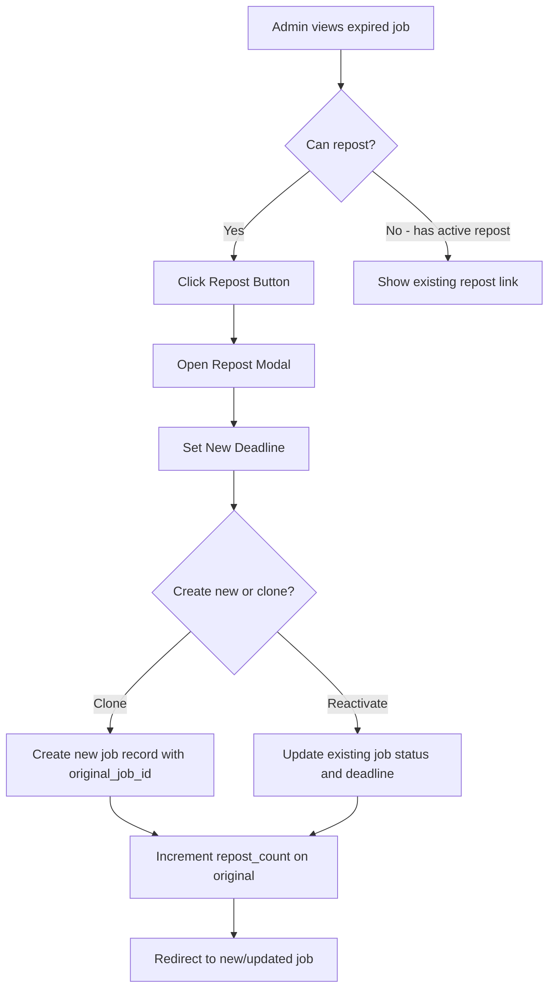

# Job Portal Enhancements Architecture

## Overview

This document outlines the architectural design for enhancing the Tulima Solar job portal with:
1. Dynamic Configuration System for categories, locations, and currencies
2. Application Deadline Validation (client-side and server-side)
3. Job Repost Feature for expired listings

## Current State Analysis

### Existing Database Tables
- `job_categories` - Already exists with basic fields
- `job_locations` - Already exists with geographic data
- `jobs` - Main job listings table with `application_deadline` field
- `job_tags` / `job_tag_relations` - Tagging system
- `job_applications` - Application submissions

### Existing Functions
- [`getJobCategories()`](../includes/job-portal-functions.php:144) - Fetches active categories
- [`getJobLocations()`](../includes/job-portal-functions.php:158) - Fetches active locations
- [`isJobAcceptingApplications()`](../includes/job-portal-functions.php:614) - Basic deadline check

---

## 1. Dynamic Configuration System

### 1.1 Database Schema

#### New Table: `currencies`

```sql
CREATE TABLE IF NOT EXISTS currencies (
    id INT UNSIGNED AUTO_INCREMENT PRIMARY KEY,
    code VARCHAR(3) NOT NULL UNIQUE,
    name VARCHAR(100) NOT NULL,
    symbol VARCHAR(10) NOT NULL,
    exchange_rate DECIMAL(12,6) DEFAULT 1.000000,
    is_default TINYINT(1) DEFAULT 0,
    is_active TINYINT(1) DEFAULT 1,
    sort_order INT DEFAULT 0,
    created_at TIMESTAMP DEFAULT CURRENT_TIMESTAMP,
    updated_at TIMESTAMP DEFAULT CURRENT_TIMESTAMP ON UPDATE CURRENT_TIMESTAMP,
    INDEX idx_active (is_active),
    INDEX idx_default (is_default)
) ENGINE=InnoDB;
```

#### Modifications to `job_categories` Table

```sql
-- Add new columns for enhanced category management
ALTER TABLE job_categories 
ADD COLUMN parent_id INT UNSIGNED NULL AFTER slug,
ADD COLUMN color VARCHAR(7) DEFAULT '#3498db' AFTER icon,
ADD COLUMN meta_title VARCHAR(255) NULL AFTER description,
ADD COLUMN meta_description TEXT NULL AFTER meta_title,
ADD CONSTRAINT fk_category_parent FOREIGN KEY (parent_id) 
    REFERENCES job_categories(id) ON DELETE SET NULL;

CREATE INDEX idx_parent ON job_categories(parent_id);
```

#### Modifications to `job_locations` Table

```sql
-- Add new columns for enhanced location management
ALTER TABLE job_locations
ADD COLUMN region VARCHAR(100) NULL AFTER country,
ADD COLUMN postal_code VARCHAR(20) NULL AFTER address,
ADD COLUMN meta_title VARCHAR(255) NULL AFTER is_remote,
ADD COLUMN meta_description TEXT NULL AFTER meta_title;
```

### 1.2 Admin Management Pages

#### New Files Required

| File Path | Purpose |
|-----------|---------|
| `admin/job-categories.php` | CRUD interface for job categories |
| `admin/job-locations.php` | CRUD interface for job locations |
| `admin/currencies.php` | CRUD interface for currency management |
| `admin/assets/css/admin-job-config.css` | Styles for configuration pages |
| `admin/assets/js/admin-job-config.js` | JavaScript for configuration management |

### 1.3 Backend Function Signatures

```php
/**
 * Currency Management Functions
 */

// Get all active currencies
function getCurrencies(PDO $pdo, bool $activeOnly = true): array;

// Get currency by code
function getCurrencyByCode(PDO $pdo, string $code): ?array;

// Get default currency
function getDefaultCurrency(PDO $pdo): ?array;

// Create new currency
function createCurrency(PDO $pdo, array $currencyData): int;

// Update currency
function updateCurrency(PDO $pdo, int $currencyId, array $currencyData): bool;

// Delete currency (soft delete by setting is_active = 0)
function deleteCurrency(PDO $pdo, int $currencyId): bool;

// Set default currency
function setDefaultCurrency(PDO $pdo, int $currencyId): bool;

/**
 * Enhanced Category Management Functions
 */

// Get all categories with hierarchy support
function getJobCategoriesWithHierarchy(PDO $pdo): array;

// Get category by ID with parent info
function getCategoryById(PDO $pdo, int $categoryId): ?array;

// Create category
function createJobCategory(PDO $pdo, array $categoryData): int;

// Update category
function updateJobCategory(PDO $pdo, int $categoryId, array $categoryData): bool;

// Delete category (checks for job associations)
function deleteJobCategory(PDO $pdo, int $categoryId): array;

// Reorder categories
function reorderJobCategories(PDO $pdo, array $categoryOrder): bool;

/**
 * Enhanced Location Management Functions
 */

// Get all locations with filters
function getJobLocationsWithFilters(PDO $pdo, array $filters = []): array;

// Get location by ID
function getLocationById(PDO $pdo, int $locationId): ?array;

// Create location
function createJobLocation(PDO $pdo, array $locationData): int;

// Update location
function updateJobLocation(PDO $pdo, int $locationId, array $locationData): bool;

// Delete location (checks for job associations)
function deleteJobLocation(PDO $pdo, int $locationId): array;
```

---

## 2. Application Deadline Validation

### 2.1 Database Modifications

```sql
-- Add computed/expired status tracking to jobs table
ALTER TABLE jobs
ADD COLUMN is_expired TINYINT(1) GENERATED ALWAYS AS (
    CASE 
        WHEN status = 'active' AND application_deadline IS NOT NULL 
             AND application_deadline < NOW() 
        THEN 1 
        ELSE 0 
    END
) VIRTUAL AFTER application_deadline;

-- Add index for expired status queries
CREATE INDEX idx_expired ON jobs(is_expired);
```

### 2.2 Server-Side Validation Logic

#### Enhanced Backend Functions

```php
/**
 * Check if a job has expired based on deadline
 * 
 * @param array $job Job data array
 * @return bool True if job has expired
 */
function isJobExpired(array $job): bool;

/**
 * Check if job accepts applications with detailed response
 * 
 * @param PDO $pdo Database connection
 * @param int $jobId Job ID to check
 * @return array Status array with keys: success, message, error_code
 */
function validateJobApplicationEligibility(PDO $pdo, int $jobId): array;

/**
 * Get expired jobs count for admin dashboard
 * 
 * @param PDO $pdo Database connection
 * @return int Number of expired jobs
 */
function getExpiredJobsCount(PDO $pdo): int;

/**
 * Get jobs expiring soon (within N days)
 * 
 * @param PDO $pdo Database connection
 * @param int $days Number of days threshold
 * @return array Jobs expiring within threshold
 */
function getJobsExpiringSoon(PDO $pdo, int $days = 7): array;

/**
 * Bulk update expired job statuses
 * 
 * @param PDO $pdo Database connection
 * @return int Number of jobs updated
 */
function updateExpiredJobsStatus(PDO $pdo): int;
```

### 2.3 Client-Side Validation Architecture

#### JavaScript Functions (job-portal.js)

```javascript
/**
 * Job Deadline Validation Module
 */
const JobDeadlineValidator = {
    // Check if deadline has passed
    isExpired: function(deadline) {},
    
    // Format remaining time for display
    getTimeRemaining: function(deadline) {},
    
    // Disable apply button with visual feedback
    disableApplyButton: function(buttonElement, message) {},
    
    // Show expired badge on job card
    showExpiredBadge: function(container) {},
    
    // Initialize validation on page load
    init: function() {}
};
```

### 2.4 Visitor-Facing Display Logic

#### Modified Files

| File | Changes |
|------|---------|
| `job-portal/pages/index.php` | Add expired badge display, filter expired from default view |
| `job-portal/pages/job-detail.php` | Disable apply button, show expired message |
| `job-portal/pages/assets/css/job-portal.css` | Add expired badge styles |
| `job-portal/pages/assets/js/job-portal.js` | Add deadline validation logic |

### 2.5 Admin Display Logic

#### Modified Files

| File | Changes |
|------|---------|
| `admin/jobs.php` | Add red highlighting for expired jobs, expired badge |
| `admin/assets/css/admin-jobs.css` | Add expired row highlighting styles |
| `admin/assets/js/admin-jobs.js` | Add expired job filtering and bulk actions |

---

## 3. Job Repost Feature

### 3.1 Database Schema

#### Modifications to `jobs` Table

```sql
-- Add repost tracking columns
ALTER TABLE jobs
ADD COLUMN original_job_id INT UNSIGNED NULL AFTER created_by,
ADD COLUMN repost_count INT UNSIGNED DEFAULT 0 AFTER original_job_id,
ADD COLUMN last_reposted_at DATETIME NULL AFTER repost_count,
ADD COLUMN last_reposted_by INT UNSIGNED NULL AFTER last_reposted_at,
ADD CONSTRAINT fk_original_job FOREIGN KEY (original_job_id) 
    REFERENCES jobs(id) ON DELETE SET NULL,
ADD CONSTRAINT fk_reposted_by FOREIGN KEY (last_reposted_by) 
    REFERENCES admins(id) ON DELETE SET NULL;

CREATE INDEX idx_original_job ON jobs(original_job_id);
CREATE INDEX idx_repost_count ON jobs(repost_count);
```

### 3.2 Repost Workflow



### 3.3 Backend Function Signatures

```php
/**
 * Repost an expired job as a new listing
 * 
 * @param PDO $pdo Database connection
 * @param int $originalJobId Original job ID to repost
 * @param array $newData New data (deadline, etc.)
 * @param int $userId Admin user ID
 * @return int New job ID
 * @throws Exception If job cannot be reposted
 */
function repostJob(PDO $pdo, int $originalJobId, array $newData, int $userId): int;

/**
 * Reactivate an expired job (update deadline without creating new record)
 * 
 * @param PDO $pdo Database connection
 * @param int $jobId Job ID to reactivate
 * @param string $newDeadline New application deadline
 * @param int $userId Admin user ID
 * @return bool Success status
 */
function reactivateJob(PDO $pdo, int $jobId, string $newDeadline, int $userId): bool;

/**
 * Check if job can be reposted
 * 
 * @param PDO $pdo Database connection
 * @param int $jobId Job ID to check
 * @return array Status with can_repost, has_active_repost, active_repost_id
 */
function canRepostJob(PDO $pdo, int $jobId): array;

/**
 * Get repost history for a job
 * 
 * @param PDO $pdo Database connection
 * @param int $jobId Original job ID
 * @return array List of reposted job records
 */
function getRepostHistory(PDO $pdo, int $jobId): array;

/**
 * Get original job for a reposted job
 * 
 * @param PDO $pdo Database connection
 * @param int $repostedJobId Reposted job ID
 * @return array|null Original job data
 */
function getOriginalJob(PDO $pdo, int $repostedJobId): ?array;
```

### 3.4 Admin Interface Components

#### New Files

| File Path | Purpose |
|-----------|---------|
| `admin/includes/job-repost-modal.php` | Modal component for repost action |
| `admin/assets/js/job-repost.js` | JavaScript for repost functionality |

#### Modified Files

| File | Changes |
|------|---------|
| `admin/jobs.php` | Add Repost button for expired jobs, show repost history |
| `admin/job-post.php` | Show original job reference for reposted jobs |

---

## 4. Complete Database Migration SQL

```sql
-- Job Portal Enhancements Migration
-- Run after the base migration-job-portal.sql

USE tulima_solar;

-- =====================================================
-- 1. CURRENCIES TABLE
-- =====================================================
CREATE TABLE IF NOT EXISTS currencies (
    id INT UNSIGNED AUTO_INCREMENT PRIMARY KEY,
    code VARCHAR(3) NOT NULL UNIQUE,
    name VARCHAR(100) NOT NULL,
    symbol VARCHAR(10) NOT NULL,
    exchange_rate DECIMAL(12,6) DEFAULT 1.000000,
    is_default TINYINT(1) DEFAULT 0,
    is_active TINYINT(1) DEFAULT 1,
    sort_order INT DEFAULT 0,
    created_at TIMESTAMP DEFAULT CURRENT_TIMESTAMP,
    updated_at TIMESTAMP DEFAULT CURRENT_TIMESTAMP ON UPDATE CURRENT_TIMESTAMP,
    INDEX idx_active (is_active),
    INDEX idx_default (is_default)
) ENGINE=InnoDB;

-- Insert default currencies
INSERT INTO currencies (code, name, symbol, is_default, sort_order) VALUES
('KES', 'Kenyan Shilling', 'KSh', 1, 1),
('USD', 'US Dollar', '$', 0, 2),
('EUR', 'Euro', '€', 0, 3),
('GBP', 'British Pound', '£', 0, 4)
ON DUPLICATE KEY UPDATE name = VALUES(name);

-- =====================================================
-- 2. JOB CATEGORIES ENHANCEMENTS
-- =====================================================
ALTER TABLE job_categories 
ADD COLUMN IF NOT EXISTS parent_id INT UNSIGNED NULL AFTER slug,
ADD COLUMN IF NOT EXISTS color VARCHAR(7) DEFAULT '#3498db' AFTER icon,
ADD COLUMN IF NOT EXISTS meta_title VARCHAR(255) NULL AFTER description,
ADD COLUMN IF NOT EXISTS meta_description TEXT NULL AFTER meta_title;

-- Add foreign key constraint (check if exists first)
SET @constraint_exists = (
    SELECT COUNT(*) FROM information_schema.TABLE_CONSTRAINTS 
    WHERE CONSTRAINT_SCHEMA = 'tulima_solar' 
    AND TABLE_NAME = 'job_categories' 
    AND CONSTRAINT_NAME = 'fk_category_parent'
);
SET @sql = IF(@constraint_exists = 0, 
    'ALTER TABLE job_categories ADD CONSTRAINT fk_category_parent FOREIGN KEY (parent_id) REFERENCES job_categories(id) ON DELETE SET NULL',
    'SELECT 1'
);
PREPARE stmt FROM @sql;
EXECUTE stmt;
DEALLOCATE PREPARE stmt;

CREATE INDEX IF NOT EXISTS idx_parent ON job_categories(parent_id);

-- =====================================================
-- 3. JOB LOCATIONS ENHANCEMENTS
-- =====================================================
ALTER TABLE job_locations
ADD COLUMN IF NOT EXISTS region VARCHAR(100) NULL AFTER country,
ADD COLUMN IF NOT EXISTS postal_code VARCHAR(20) NULL AFTER address,
ADD COLUMN IF NOT EXISTS meta_title VARCHAR(255) NULL AFTER is_remote,
ADD COLUMN IF NOT EXISTS meta_description TEXT NULL AFTER meta_title;

-- =====================================================
-- 4. JOBS TABLE - REPOST TRACKING
-- =====================================================
ALTER TABLE jobs
ADD COLUMN IF NOT EXISTS original_job_id INT UNSIGNED NULL AFTER created_by,
ADD COLUMN IF NOT EXISTS repost_count INT UNSIGNED DEFAULT 0 AFTER original_job_id,
ADD COLUMN IF NOT EXISTS last_reposted_at DATETIME NULL AFTER repost_count,
ADD COLUMN IF NOT EXISTS last_reposted_by INT UNSIGNED NULL AFTER last_reposted_at;

-- Add foreign key constraints for repost tracking
SET @fk_original_exists = (
    SELECT COUNT(*) FROM information_schema.TABLE_CONSTRAINTS 
    WHERE CONSTRAINT_SCHEMA = 'tulima_solar' 
    AND TABLE_NAME = 'jobs' 
    AND CONSTRAINT_NAME = 'fk_original_job'
);
SET @sql = IF(@fk_original_exists = 0,
    'ALTER TABLE jobs ADD CONSTRAINT fk_original_job FOREIGN KEY (original_job_id) REFERENCES jobs(id) ON DELETE SET NULL',
    'SELECT 1'
);
PREPARE stmt FROM @sql;
EXECUTE stmt;
DEALLOCATE PREPARE stmt;

SET @fk_reposted_exists = (
    SELECT COUNT(*) FROM information_schema.TABLE_CONSTRAINTS 
    WHERE CONSTRAINT_SCHEMA = 'tulima_solar' 
    AND TABLE_NAME = 'jobs' 
    AND CONSTRAINT_NAME = 'fk_reposted_by'
);
SET @sql = IF(@fk_reposted_exists = 0,
    'ALTER TABLE jobs ADD CONSTRAINT fk_reposted_by FOREIGN KEY (last_reposted_by) REFERENCES admins(id) ON DELETE SET NULL',
    'SELECT 1'
);
PREPARE stmt FROM @sql;
EXECUTE stmt;
DEALLOCATE PREPARE stmt;

CREATE INDEX IF NOT EXISTS idx_original_job ON jobs(original_job_id);
CREATE INDEX IF NOT EXISTS idx_repost_count ON jobs(repost_count);

-- =====================================================
-- 5. JOBS TABLE - EXPIRED STATUS (Virtual Column)
-- =====================================================
-- Note: Virtual columns cannot use IF NOT EXISTS, so we check first
SET @expired_col_exists = (
    SELECT COUNT(*) FROM information_schema.COLUMNS 
    WHERE TABLE_SCHEMA = 'tulima_solar' 
    AND TABLE_NAME = 'jobs' 
    AND COLUMN_NAME = 'is_expired'
);
SET @sql = IF(@expired_col_exists = 0,
    'ALTER TABLE jobs ADD COLUMN is_expired TINYINT(1) GENERATED ALWAYS AS (CASE WHEN status = ''active'' AND application_deadline IS NOT NULL AND application_deadline < NOW() THEN 1 ELSE 0 END) VIRTUAL AFTER application_deadline',
    'SELECT 1'
);
PREPARE stmt FROM @sql;
EXECUTE stmt;
DEALLOCATE PREPARE stmt;

CREATE INDEX IF NOT EXISTS idx_expired ON jobs(is_expired);
```

---

## 5. File Structure Summary

### New Files to Create

```
admin/
├── job-categories.php          # Category management page
├── job-locations.php           # Location management page
├── currencies.php              # Currency management page
├── includes/
│   └── job-repost-modal.php    # Repost modal component
└── assets/
    ├── css/
    │   └── admin-job-config.css  # Configuration pages styles
    └── js/
        ├── admin-job-config.js   # Configuration management JS
        └── job-repost.js         # Repost functionality JS
```

### Files to Modify

```
admin/
├── jobs.php                    # Add expired highlighting, repost button
├── job-post.php                # Show original job reference
└── assets/
    ├── css/
    │   └── admin-jobs.css      # Add expired job styles
    └── js/
        └── admin-jobs.js       # Add expired filtering, bulk actions

includes/
└── job-portal-functions.php    # Add all new backend functions

job-portal/pages/
├── index.php                   # Filter expired, show badges
├── job-detail.php              # Disable apply for expired
└── assets/
    ├── css/
    │   └── job-portal.css      # Expired badge styles
    └── js/
        └── job-portal.js       # Deadline validation

database/
└── migration-job-portal-enhancements.sql  # New migration file
```

---

## 6. API Endpoints (Optional Future Enhancement)

If AJAX-based management is needed, consider these API endpoints:

| Endpoint | Method | Purpose |
|----------|--------|---------|
| `/admin/api/job-config.php` | GET, POST, DELETE | CRUD for categories, locations, currencies |
| `/admin/api/job-repost.php` | POST | Handle repost actions |
| `/job-portal/api/check-deadline.php` | GET | Check if job is still accepting applications |

---

## 7. Security Considerations

1. **CSRF Protection**: All form submissions must include CSRF tokens
2. **Input Validation**: Sanitize all user inputs for category/location/currency names
3. **Access Control**: Verify admin permissions before configuration changes
4. **Rate Limiting**: Consider rate limiting for application submissions
5. **SQL Injection**: Use prepared statements (already implemented in existing functions)

---

## 8. Testing Checklist

- [ ] Currency CRUD operations work correctly
- [ ] Category hierarchy displays properly
- [ ] Location management with geographic data
- [ ] Expired jobs show correct badge on visitor pages
- [ ] Apply button disabled for expired jobs
- [ ] Server-side rejection of expired job applications
- [ ] Admin sees red highlighting for expired jobs
- [ ] Repost creates new job with correct reference
- [ ] Reactivate updates deadline correctly
- [ ] Repost history displays correctly
- [ ] Original job shows repost count
