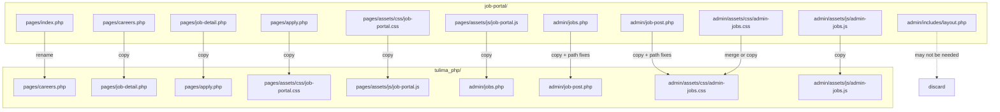
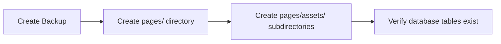
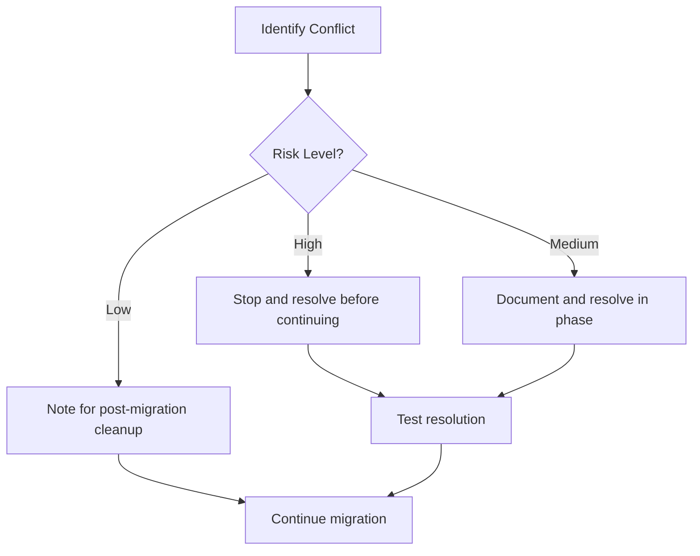

# Job Portal Migration Plan

## Executive Summary

This document outlines the comprehensive migration plan for moving the Job Portal module from its isolated `job-portal/` directory into the main Tulima Solar website structure. The migration involves relocating files, updating path references, and integrating with existing configuration and authentication systems.

---

## Table of Contents

1. [Current State Analysis](#1-current-state-analysis)
2. [Target State Architecture](#2-target-state-architecture)
3. [File-by-File Mapping](#3-file-by-file-mapping)
4. [Path Transformations Required](#4-path-transformations-required)
5. [Configuration Integration](#5-configuration-integration)
6. [Order of Operations](#6-order-of-operations)
7. [Potential Conflicts and Resolutions](#7-potential-conflicts-and-resolutions)
8. [Rollback Plan](#8-rollback-plan)
9. [Testing Checklist](#9-testing-checklist)
10. [Post-Migration Cleanup](#10-post-migration-cleanup)

---

## 1. Current State Analysis

### 1.1 Source Directory Structure

```
job-portal/
├── pages/                          # Public-facing pages
│   ├── index.php                   # Main job listing (24,386 chars)
│   ├── careers.php                 # Alternative careers page (7,700 chars)
│   ├── job-detail.php              # Job detail view (17,797 chars)
│   ├── apply.php                   # Application form (17,590 chars)
│   └── assets/
│       ├── css/
│       │   └── job-portal.css      # Public styles (22,788 chars)
│       └── js/
│           └── job-portal.js       # Frontend interactions (16,287 chars)
├── admin/                          # Admin dashboard
│   ├── jobs.php                    # Job management (15,260 chars)
│   ├── job-post.php                # Job posting form (19,671 chars)
│   ├── assets/
│   │   ├── css/
│   │   │   └── admin-jobs.css      # Admin styles (11,773 chars)
│   │   └── js/
│   │       └── admin-jobs.js       # Admin interactions (13,828 chars)
│   └── includes/
│       └── layout.php              # Admin layout template (2,733 chars)
├── README.md                       # Documentation (4,755 chars)
└── FINAL-STRUCTURE.md              # Structure documentation (5,107 chars)
```

### 1.2 Existing Root Structure (Relevant Directories)

```
tulima_php/
├── config/
│   ├── database.php                # Existing DB config ✓
│   └── path.php                    # BASE_PATH definition ✓
├── includes/
│   ├── functions.php               # Main helper functions ✓
│   ├── job-portal-functions.php    # Already exists! (21,273 chars) ✓
│   ├── header.php                  # Site header ✓
│   └── footer.php                  # Site footer ✓
├── admin/
│   ├── auth.php                    # Admin authentication ✓
│   ├── includes/
│   │   ├── header.php              # Admin header with nav ✓
│   │   └── footer.php              # Admin footer ✓
│   └── assets/
│       ├── css/
│       │   └── admin.css           # Main admin styles (95,957 chars) ✓
│       └── js/
├── media/
│   └── job_applications/
│       └── resumes/                # Upload directory exists ✓
└── database/
    └── migration-job-portal.sql    # DB schema already exists ✓
```

### 1.3 Key Findings

| Finding | Impact | Action Required |
|---------|--------|-----------------|
| `includes/job-portal-functions.php` already exists in root | Low | Verify it's the same version; no migration needed |
| Admin files reference non-existent `auth.php` in job-portal/admin/ | High | Update to use `../../admin/auth.php` |
| Inconsistent CSS paths in source files | Medium | Standardize to `/pages/assets/css/` |
| `config/database.php` not in job-portal directory | High | Update all require paths |
| `media/job_applications/resumes/` exists | Low | Update upload paths in apply.php |

---

## 2. Target State Architecture

### 2.1 Directory Structure After Migration

```
tulima_php/
├── pages/                          # NEW DIRECTORY
│   ├── careers.php                 # Job listing page (from job-portal/pages/careers.php)
│   ├── job-detail.php              # Job detail view
│   ├── apply.php                   # Application form
│   └── assets/
│       ├── css/
│       │   └── job-portal.css      # Public portal styles
│       └── js/
│           └── job-portal.js       # Frontend interactions
├── admin/
│   ├── jobs.php                    # Job management (NEW)
│   ├── job-post.php                # Job posting form (NEW)
│   ├── assets/
│   │   ├── css/
│   │   │   └── admin-jobs.css      # Merged or separate
│   │   └── js/
│   │       └── admin-jobs.js       # Admin job interactions
│   └── includes/
│       └── (existing files)        # No changes to existing
├── includes/
│   └── job-portal-functions.php    # Already exists - verify/update
└── config/
    └── (existing files)            # No changes needed
```

### 2.2 Migration Flow Diagram



---

## 3. File-by-File Mapping

### 3.1 Public Pages Migration

| Source File | Destination File | Action | Priority |
|-------------|------------------|--------|----------|
| `job-portal/pages/index.php` | `pages/careers.php` | Rename and update paths | High |
| `job-portal/pages/careers.php` | `pages/careers-alt.php` | Copy as alternative or discard | Low |
| `job-portal/pages/job-detail.php` | `pages/job-detail.php` | Copy and update paths | High |
| `job-portal/pages/apply.php` | `pages/apply.php` | Copy and update paths | High |
| `job-portal/pages/assets/css/job-portal.css` | `pages/assets/css/job-portal.css` | Copy as-is | Medium |
| `job-portal/pages/assets/js/job-portal.js` | `pages/assets/js/job-portal.js` | Copy and update API paths | Medium |

### 3.2 Admin Pages Migration

| Source File | Destination File | Action | Priority |
|-------------|------------------|--------|----------|
| `job-portal/admin/jobs.php` | `admin/jobs.php` | Copy and update paths | High |
| `job-portal/admin/job-post.php` | `admin/job-post.php` | Copy and update paths | High |
| `job-portal/admin/assets/css/admin-jobs.css` | `admin/assets/css/admin-jobs.css` | Copy separate (recommended) or merge | Medium |
| `job-portal/admin/assets/js/admin-jobs.js` | `admin/assets/js/admin-jobs.js` | Copy as-is | Medium |
| `job-portal/admin/includes/layout.php` | — | **Do not migrate** - use existing admin layout | Low |

### 3.3 Files NOT to Migrate

| Source File | Reason |
|-------------|--------|
| `job-portal/config/*` | Use existing root `config/` |
| `job-portal/includes/*` | Use existing root `includes/` |
| `job-portal/admin/includes/layout.php` | Use existing admin header/footer system |
| `job-portal/admin/auth.php` | Does not exist; use root `admin/auth.php` |

---

## 4. Path Transformations Required

### 4.1 Public Pages Path Changes

#### `pages/careers.php` (formerly index.php)

| Line | Current Path | New Path | Type |
|------|--------------|----------|------|
| 7 | `__DIR__ . '/../config/database.php'` | `__DIR__ . '/../config/database.php'` | require |
| 8 | `__DIR__ . '/../includes/job-portal-functions.php'` | `__DIR__ . '/../includes/job-portal-functions.php'` | require |
| 57 | `BASE_PATH . '/master-style.css'` | `BASE_PATH . '/master-style.css'` | CSS (no change) |
| 58 | `BASE_PATH . '/job-portal/assets/css/job-portal.css'` | `BASE_PATH . '/pages/assets/css/job-portal.css'` | CSS |
| 62 | `__DIR__ . '/../includes/header.php'` | `__DIR__ . '/../includes/header.php'` | include |

#### `pages/job-detail.php`

| Line | Current Path | New Path | Type |
|------|--------------|----------|------|
| 7 | `__DIR__ . '/../config/database.php'` | `__DIR__ . '/../config/database.php'` | require |
| 8 | `__DIR__ . '/../includes/job-portal-functions.php'` | `__DIR__ . '/../includes/job-portal-functions.php'` | require |
| 55 | `BASE_PATH . '/master-style.css'` | `BASE_PATH . '/master-style.css'` | CSS (no change) |
| 56 | `BASE_PATH . '/job-portal/assets/css/job-portal.css'` | `BASE_PATH . '/pages/assets/css/job-portal.css'` | CSS |
| 60 | `__DIR__ . '/../includes/header.php'` | `__DIR__ . '/../includes/header.php'` | include |

#### `pages/apply.php`

| Line | Current Path | New Path | Type |
|------|--------------|----------|------|
| 7 | `__DIR__ . '/../config/database.php'` | `__DIR__ . '/../config/database.php'` | require |
| 8 | `__DIR__ . '/../includes/job-portal-functions.php'` | `__DIR__ . '/../includes/job-portal-functions.php'` | require |
| 55 | `__DIR__ . '/../media/job_applications/resumes/'` | `__DIR__ . '/../media/job_applications/resumes/'` | upload (no change) |

### 4.2 Admin Pages Path Changes

#### `admin/jobs.php`

| Line | Current Path | New Path | Type |
|------|--------------|----------|------|
| 7 | `__DIR__ . '/auth.php'` | `__DIR__ . '/auth.php'` | require (no change - auth.php is in admin/) |
| 9 | `__DIR__ . '/../config/database.php'` | `__DIR__ . '/../config/database.php'` | require |
| 10 | `__DIR__ . '/../includes/job-portal-functions.php'` | `__DIR__ . '/../includes/job-portal-functions.php'` | require |

**Note:** The source file references `__DIR__ . '/auth.php'` but `auth.php` doesn't exist in `job-portal/admin/`. After migration to root `admin/`, this will correctly reference the existing `admin/auth.php`.

#### `admin/job-post.php`

| Line | Current Path | New Path | Type |
|------|--------------|----------|------|
| 7 | `__DIR__ . '/auth.php'` | `__DIR__ . '/auth.php'` | require (no change) |
| 9 | `__DIR__ . '/../config/database.php'` | `__DIR__ . '/../config/database.php'` | require |
| 10 | `__DIR__ . '/../includes/job-portal-functions.php'` | `__DIR__ . '/../includes/job-portal-functions.php'` | require |

### 4.3 CSS/JS Asset Path Updates

#### In `pages/assets/js/job-portal.js`

Search for and update any API endpoints or asset references:

```javascript
// Before
const API_BASE = '/job-portal/api/';

// After
const API_BASE = '/api/jobs/';
```

#### In `admin/assets/js/admin-jobs.js`

```javascript
// Before
const ADMIN_BASE = '/job-portal/admin/';

// After  
const ADMIN_BASE = '/admin/';
```

### 4.4 Link Updates Between Pages

| File | Current Link | New Link |
|------|--------------|----------|
| `pages/careers.php` | `job-detail.php?id=X` | `job-detail.php?id=X` (no change) |
| `pages/careers.php` | `apply.php?job_id=X` | `apply.php?job_id=X` (no change) |
| `pages/job-detail.php` | `index.php` | `careers.php` |
| `pages/apply.php` | `job-detail.php?id=X` | `job-detail.php?id=X` (no change) |
| Admin navigation | `job-portal/admin/jobs.php` | `admin/jobs.php` |

---

## 5. Configuration Integration

### 5.1 Database Configuration

The job portal will use the existing database configuration. No changes needed to `config/database.php`.

**Current `config/database.php`:**
```php
define('DB_HOST', 'localhost');
define('DB_NAME', 'tulima_solar');
define('DB_USER', 'root');
define('DB_PASS', '');
define('DB_CHARSET', 'utf8mb4');

function getDb(): PDO {
    // ... connection logic
}
```

### 5.2 Path Configuration

The existing `config/path.php` defines:
```php
define('BASE_PATH', '/tulima_php');
define('UPLOAD_DIR', 'uploads');
```

**Recommendation:** Add job portal specific paths:
```php
// Add to config/path.php after migration
define('JOB_PORTAL_UPLOAD_DIR', 'media/job_applications');
```

### 5.3 Functions Integration

The `includes/job-portal-functions.php` already exists in the root. Verify it contains all required functions:

| Function | Purpose | Status |
|----------|---------|--------|
| `getJobs()` | Get jobs with filters | ✓ Exists |
| `getJobById()` | Get single job | ✓ Exists |
| `getFeaturedJobs()` | Get featured jobs | ✓ Exists |
| `getUrgentJobs()` | Get urgent jobs | ✓ Exists |
| `getJobCategories()` | Get all categories | ✓ Exists |
| `getJobLocations()` | Get all locations | ✓ Exists |
| `getJobTags()` | Get job tags | ✓ Exists |
| `createJob()` | Create new job | ✓ Exists |
| `updateJob()` | Update existing job | ✓ Exists |
| `deleteJob()` | Delete job | ✓ Exists |
| `submitApplication()` | Submit job application | ✓ Exists |
| `isJobAcceptingApplications()` | Check if job is open | ✓ Exists |
| `generateSlug()` | Create URL slug | ✓ Exists |

### 5.4 Admin Authentication Integration

The migrated admin files will use the existing authentication system:

```php
// In admin/jobs.php and admin/job-post.php
require_once __DIR__ . '/auth.php';
requireAdmin();  // Existing function from admin/auth.php
```

### 5.5 Admin Navigation Integration

Add job portal to the admin sidebar. Edit `admin/includes/header.php`:

```php
// Add after existing navigation items
<div class="admin-sidebar__nav-section">
  <div class="admin-sidebar__nav-section-title">Job Portal</div>
  <a href="<?php echo $adminBase; ?>/jobs.php" class="admin-sidebar__nav-link <?php echo $currentNav === 'jobs' ? 'active' : ''; ?>">
    <svg class="admin-sidebar__nav-icon" viewBox="0 0 24 24" fill="none" stroke="currentColor" stroke-width="2">
      <rect x="2" y="7" width="20" height="14" rx="2" ry="2"/>
      <path d="M16 21V5a2 2 0 0 0-2-2h-4a2 2 0 0 0-2 2v16"/>
    </svg>
    <span class="admin-sidebar__nav-text">Manage Jobs</span>
  </a>
  <a href="<?php echo $adminBase; ?>/job-post.php" class="admin-sidebar__nav-link <?php echo $currentNav === 'job-post' ? 'active' : ''; ?>">
    <svg class="admin-sidebar__nav-icon" viewBox="0 0 24 24" fill="none" stroke="currentColor" stroke-width="2">
      <line x1="12" y1="5" x2="12" y2="19"/>
      <line x1="5" y1="12" x2="19" y2="12"/>
    </svg>
    <span class="admin-sidebar__nav-text">Post New Job</span>
  </a>
</div>
```

---

## 6. Order of Operations

### Phase 1: Preparation (5-10 minutes)



| Step | Action | Command/Details |
|------|--------|-----------------|
| 1.1 | Create full backup | `cp -r tulima_php tulima_php_backup_YYYYMMDD` |
| 1.2 | Create pages directory | `mkdir -p pages/assets/css pages/assets/js` |
| 1.3 | Verify DB migration ran | Check `job_categories`, `jobs`, `job_applications` tables exist |
| 1.4 | Document current state | Take screenshots of working job-portal |

### Phase 2: Asset Migration (5 minutes)

| Step | Action | Command |
|------|--------|---------|
| 2.1 | Copy CSS | `cp job-portal/pages/assets/css/job-portal.css pages/assets/css/` |
| 2.2 | Copy JS | `cp job-portal/pages/assets/js/job-portal.js pages/assets/js/` |
| 2.3 | Copy admin CSS | `cp job-portal/admin/assets/css/admin-jobs.css admin/assets/css/` |
| 2.4 | Copy admin JS | `cp job-portal/admin/assets/js/admin-jobs.js admin/assets/js/` |

### Phase 3: Public Pages Migration (15-20 minutes)

| Step | Action | Details |
|------|--------|---------|
| 3.1 | Copy careers.php | `cp job-portal/pages/index.php pages/careers.php` |
| 3.2 | Update CSS path | Change `/job-portal/assets/css/` to `/pages/assets/css/` |
| 3.3 | Copy job-detail.php | `cp job-portal/pages/job-detail.php pages/` |
| 3.4 | Update paths in job-detail.php | Same CSS path update |
| 3.5 | Update back link | Change `index.php` to `careers.php` |
| 3.6 | Copy apply.php | `cp job-portal/pages/apply.php pages/` |
| 3.7 | Verify upload path | Ensure `media/job_applications/resumes/` is correct |

### Phase 4: Admin Pages Migration (15-20 minutes)

| Step | Action | Details |
|------|--------|---------|
| 4.1 | Copy jobs.php | `cp job-portal/admin/jobs.php admin/` |
| 4.2 | Verify auth path | `require_once __DIR__ . '/auth.php';` should work |
| 4.3 | Copy job-post.php | `cp job-portal/admin/job-post.php admin/` |
| 4.4 | Verify auth path | Same as above |
| 4.5 | Update CSS/JS paths | Change to use `admin/assets/` |

### Phase 5: Integration (10-15 minutes)

| Step | Action | Details |
|------|--------|---------|
| 5.1 | Update admin navigation | Add Job Portal section to `admin/includes/header.php` |
| 5.2 | Update main navigation | Add Careers link to site navigation |
| 5.3 | Verify functions | Check `includes/job-portal-functions.php` is complete |
| 5.4 | Test authentication | Ensure admin pages require login |

### Phase 6: Testing (15-20 minutes)

| Step | Action | Details |
|------|--------|---------|
| 6.1 | Test public pages | Load careers.php, job-detail.php, apply.php |
| 6.2 | Test admin pages | Login and test jobs.php, job-post.php |
| 6.3 | Test CRUD operations | Create, read, update, delete jobs |
| 6.4 | Test application flow | Submit test application |
| 6.5 | Check file uploads | Verify resume upload works |

---

## 7. Potential Conflicts and Resolutions

### 7.1 File Conflicts

| Conflict | Risk Level | Resolution |
|----------|------------|------------|
| `admin/jobs.php` exists | **High** | Rename to `admin/job-listings.php` or merge functionality |
| CSS class name collisions | Medium | Prefix job portal CSS classes with `jp-` namespace |
| JavaScript function collisions | Medium | Wrap in IIFE or namespace as `JobPortal.*` |

### 7.2 Configuration Conflicts

| Conflict | Risk Level | Resolution |
|----------|------------|------------|
| Different BASE_PATH values | Low | Use `BASE_PATH` constant consistently |
| Session handling differences | Medium | Verify `$_SESSION['admin_id']` is used consistently |
| Database connection pooling | Low | Both use same `getDb()` singleton |

### 7.3 Navigation Conflicts

| Conflict | Risk Level | Resolution |
|----------|------------|------------|
| Admin sidebar becomes too long | Low | Consider collapsible sections |
| Multiple "Jobs" entries | Medium | Clear naming: "Job Listings" vs other jobs |

### 7.4 CSS Specificity Issues

The job portal CSS uses class names like:
- `.job-portal-hero`
- `.job-portal-job-card`
- `.job-portal-btn`

These are already well-namespaced and unlikely to conflict with existing admin CSS.

### 7.5 Resolution Strategy



---

## 8. Rollback Plan

### 8.1 Backup Strategy

**Before Migration:**
```bash
# Create timestamped backup
BACKUP_DIR="backups/pre_migration_$(date +%Y%m%d_%H%M%S)"
mkdir -p "$BACKUP_DIR"

# Backup entire project
cp -r . "$BACKUP_DIR/tulima_php/"

# Backup database
mysqldump -u root tulima_solar > "$BACKUP_DIR/database.sql"
```

### 8.2 Rollback Procedures

#### Scenario 1: Partial Migration Failure

If migration fails partway through:

| Step | Action |
|------|--------|
| 1 | Stop migration immediately |
| 2 | Delete any newly created files in `pages/` and `admin/` |
| 3 | Restore modified files from backup |
| 4 | Verify original job-portal still works |
| 5 | Document failure point for retry |

```bash
# Quick rollback commands
rm -rf pages/
cp "$BACKUP_DIR/tulima_php/admin/jobs.php" admin/
cp "$BACKUP_DIR/tulima_php/admin/job-post.php" admin/
cp "$BACKUP_DIR/tulima_php/admin/includes/header.php" admin/includes/
```

#### Scenario 2: Complete Migration Failure

If migration completes but system is broken:

| Step | Action |
|------|--------|
| 1 | Restore entire codebase from backup |
| 2 | Verify database is intact (no changes expected) |
| 3 | Test original job-portal functionality |
| 4 | Review migration plan for issues |

```bash
# Full rollback
rm -rf pages/ admin/jobs.php admin/job-post.php admin/assets/css/admin-jobs.css admin/assets/js/admin-jobs.js
cp -r "$BACKUP_DIR/tulima_php/"* .
```

#### Scenario 3: Database Issues

If database tables are missing or corrupted:

```bash
# Restore database
mysql -u root tulima_solar < "$BACKUP_DIR/database.sql"

# Or re-run migration
mysql -u root tulima_solar < database/migration-job-portal.sql
```

### 8.3 Verification After Rollback

- [ ] Original job-portal pages load correctly
- [ ] Admin panel functions normally
- [ ] No PHP errors in logs
- [ ] Database queries work
- [ ] File uploads work

---

## 9. Testing Checklist

### 9.1 Pre-Migration Testing

- [ ] Job portal works in current location (`job-portal/pages/`)
- [ ] Admin authentication works
- [ ] Database tables exist and have data
- [ ] File upload directory is writable
- [ ] All functions in `includes/job-portal-functions.php` work

### 9.2 Post-Migration Testing

#### Public Pages

| Test | URL | Expected Result | Status |
|------|-----|-----------------|--------|
| Careers page loads | `/pages/careers.php` | Shows job listings | [ ] |
| Job detail loads | `/pages/job-detail.php?id=1` | Shows job details | [ ] |
| Apply form loads | `/pages/apply.php?job_id=1` | Shows application form | [ ] |
| CSS loads correctly | View page source | CSS file linked properly | [ ] |
| JS functions work | Test search/filter | Real-time filtering | [ ] |
| Form submission | Submit application | Success message | [ ] |
| File upload | Upload resume | File saved to media/ | [ ] |

#### Admin Pages

| Test | URL | Expected Result | Status |
|------|-----|-----------------|--------|
| Auth required | `/admin/jobs.php` (not logged in) | Redirect to login | [ ] |
| Jobs dashboard | `/admin/jobs.php` (logged in) | Shows job management | [ ] |
| Job post form | `/admin/job-post.php` | Shows creation form | [ ] |
| Create job | Submit new job | Job appears in list | [ ] |
| Edit job | Click edit button | Form with job data | [ ] |
| Delete job | Click delete button | Job removed | [ ] |
| Status toggle | Toggle job status | Status changes | [ ] |

#### Integration Testing

| Test | Expected Result | Status |
|------|-----------------|--------|
| Admin navigation shows Job Portal | Link appears in sidebar | [ ] |
| Main navigation shows Careers | Link appears in menu | [ ] |
| Job appears on public site after creation | New job visible | [ ] |
| Application appears in admin | Application visible | [ ] |

### 9.3 Browser Testing

| Browser | Version | Public Pages | Admin Pages | Status |
|---------|---------|--------------|-------------|--------|
| Chrome | Latest | [ ] | [ ] | |
| Firefox | Latest | [ ] | [ ] | |
| Safari | Latest | [ ] | [ ] | |
| Edge | Latest | [ ] | [ ] | |
| Mobile Chrome | Latest | [ ] | N/A | |
| Mobile Safari | Latest | [ ] | N/A | |

---

## 10. Post-Migration Cleanup

### 10.1 Files to Remove

After successful migration and testing:

```bash
# Remove original job-portal directory (KEEP BACKUP!)
# Only do this after confirming everything works
rm -rf job-portal/
```

### 10.2 Files to Archive

Keep these for reference:
- `job-portal/README.md` → Move to `docs/job-portal/README.md`
- `job-portal/FINAL-STRUCTURE.md` → Move to `docs/job-portal/`

### 10.3 Documentation Updates

Update these files after migration:

| File | Update Required |
|------|-----------------|
| `docs/job-portal-file-structure.md` | Update all paths to new locations |
| `docs/job-portal-implementation-guide.md` | Update installation steps |
| `DOCUMENTATION.md` | Add job portal section |
| `README.md` | Add job portal to features list |

### 10.4 Configuration Cleanup

Remove or update any hardcoded paths:
- Search for `/job-portal/` in all files
- Update any absolute URLs
- Verify BASE_PATH usage is consistent

### 10.5 Performance Optimization

After migration is stable:
- [ ] Minify CSS files
- [ ] Minify JavaScript files
- [ ] Enable gzip compression
- [ ] Add caching headers for assets
- [ ] Optimize images if any

---

## Appendix A: Quick Reference Commands

### Migration Commands (Linux/Mac)

```bash
# Create directories
mkdir -p pages/assets/css pages/assets/js

# Copy assets
cp job-portal/pages/assets/css/job-portal.css pages/assets/css/
cp job-portal/pages/assets/js/job-portal.js pages/assets/js/
cp job-portal/admin/assets/css/admin-jobs.css admin/assets/css/
cp job-portal/admin/assets/js/admin-jobs.js admin/assets/js/

# Copy pages
cp job-portal/pages/index.php pages/careers.php
cp job-portal/pages/job-detail.php pages/
cp job-portal/pages/apply.php pages/

# Copy admin
cp job-portal/admin/jobs.php admin/
cp job-portal/admin/job-post.php admin/

# Update paths (using sed)
sed -i 's|/job-portal/assets/css/|/pages/assets/css/|g' pages/*.php
sed -i 's|/job-portal/pages/assets/css/|/pages/assets/css/|g' pages/*.php
```

### Migration Commands (Windows)

```cmd
# Create directories
mkdir pages\assets\css pages\assets\js

# Copy assets
copy job-portal\pages\assets\css\job-portal.css pages\assets\css\
copy job-portal\pages\assets\js\job-portal.js pages\assets\js\
copy job-portal\admin\assets\css\admin-jobs.css admin\assets\css\
copy job-portal\admin\assets\js\admin-jobs.js admin\assets\js\

# Copy pages
copy job-portal\pages\index.php pages\careers.php
copy job-portal\pages\job-detail.php pages\
copy job-portal\pages\apply.php pages\

# Copy admin
copy job-portal\admin\jobs.php admin\
copy job-portal\admin\job-post.php admin\
```

---

## Appendix B: File Content Templates

### B.1 Updated pages/careers.php Header

```php
<?php
/**
 * Job Portal - Public Careers Page
 * Displays all active job listings dynamically from database
 */

require_once __DIR__ . '/../config/database.php';
require_once __DIR__ . '/../includes/job-portal-functions.php';

$pdo = getDb();
// ... rest of file
?>
<!DOCTYPE html>
<html lang="en">
<head>
    <meta charset="UTF-8">
    <meta name="viewport" content="width=device-width, initial-scale=1.0">
    <title><?php echo e($pageTitle); ?></title>
    <meta name="description" content="<?php echo e($pageDescription); ?>">
    <link rel="stylesheet" href="<?php echo BASE_PATH; ?>/master-style.css">
    <link rel="stylesheet" href="<?php echo BASE_PATH; ?>/pages/assets/css/job-portal.css">
    <link rel="stylesheet" href="https://fonts.googleapis.com/css2?family=Inter:wght@400;500;600;700&display=swap">
</head>
<body>
    <?php include __DIR__ . '/../includes/header.php'; ?>
```

### B.2 Updated admin/jobs.php Header

```php
<?php
/**
 * Job Portal - Admin Jobs Management
 * Dashboard for managing job listings
 */

require_once __DIR__ . '/auth.php';
requireAdmin();
require_once __DIR__ . '/../config/database.php';
require_once __DIR__ . '/../includes/job-portal-functions.php';

$pdo = getDb();
$pageTitle = 'Jobs Management';
$currentNav = 'jobs';

// Include admin header (provides navigation and layout)
include __DIR__ . '/includes/header.php';
// ... rest of content
```

---

## Document History

| Version | Date | Author | Changes |
|---------|------|--------|---------|
| 1.0 | 2026-02-24 | Migration Team | Initial migration plan |

---

## Approval

| Role | Name | Signature | Date |
|------|------|-----------|------|
| Developer | | | |
| Reviewer | | | |
| Project Lead | | | |
