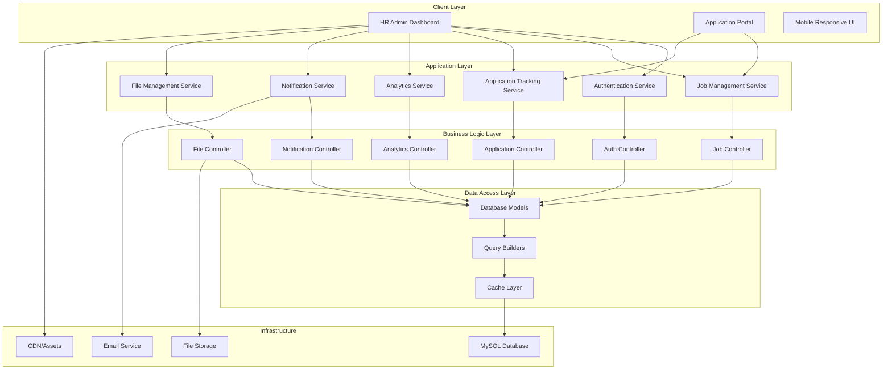
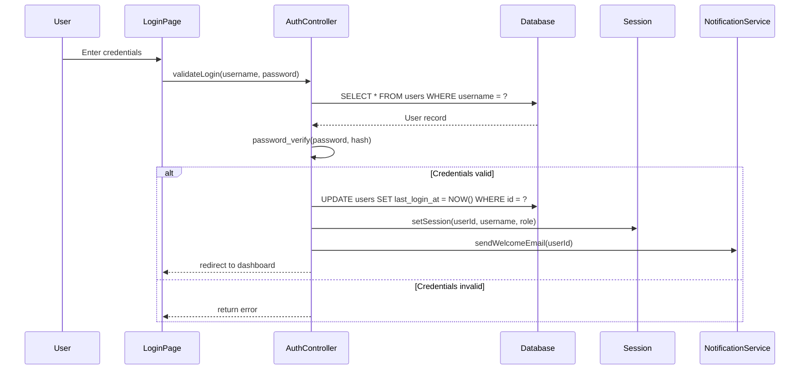
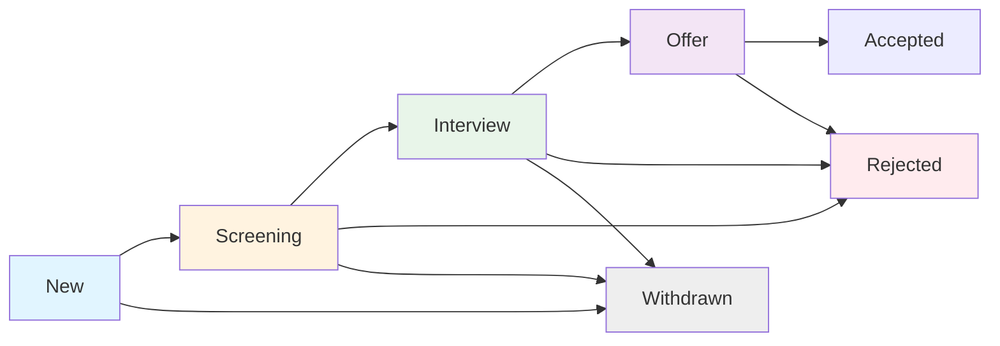

# HR Job and Application Management Portal - Comprehensive Architecture Design

## Executive Summary

This document outlines the complete architecture for a secure, role-based HR Job and Application Management Portal. The system provides HR administrators with a comprehensive interface to manage the entire recruitment lifecycle, from job posting creation to candidate selection and onboarding.

## System Overview

### Core Purpose
- Centralized platform for managing job postings and applicant tracking
- Secure, role-based access control for HR administrators
- Real-time analytics and reporting
- Automated communication workflows
- Comprehensive candidate management with stage progression

### Target Users
- **HR Administrators**: Full access to all features
- **Recruiters**: Limited access to specific job postings
- **Interviewers**: Access to interview scheduling and candidate reviews
- **Candidates**: Public-facing portal for applications (future phase)

### Technical Stack
- **Backend**: PHP (Laravel or custom framework)
- **Database**: MySQL 8.0+ with InnoDB engine
- **Frontend**: HTML5, CSS3, JavaScript (Vanilla or Vue.js/React)
- **Authentication**: Session-based + JWT tokens
- **Email**: PHPMailer or SendGrid API
- **File Storage**: Local filesystem with organized directory structure
- **Analytics**: Chart.js or D3.js with custom PHP backend

---

## System Architecture

### High-Level Architecture Diagram



---

## Database Schema Design

### Core Tables

#### 1. Users Table (HR Users)
```sql
CREATE TABLE users (
    id INT UNSIGNED AUTO_INCREMENT PRIMARY KEY,
    username VARCHAR(64) NOT NULL UNIQUE,
    email VARCHAR(255) NOT NULL UNIQUE,
    password_hash VARCHAR(255) NOT NULL,
    first_name VARCHAR(100) NOT NULL,
    last_name VARCHAR(100) NOT NULL,
    role ENUM('admin', 'recruiter', 'interviewer', 'hr_manager') NOT NULL,
    department VARCHAR(100),
    phone VARCHAR(20),
    avatar_path VARCHAR(500),
    is_active TINYINT(1) DEFAULT 1,
    last_login_at TIMESTAMP NULL,
    created_at TIMESTAMP DEFAULT CURRENT_TIMESTAMP,
    updated_at TIMESTAMP DEFAULT CURRENT_TIMESTAMP ON UPDATE CURRENT_TIMESTAMP,
    INDEX idx_email (email),
    INDEX idx_role (role)
) ENGINE=InnoDB DEFAULT CHARSET=utf8mb4 COLLATE=utf8mb4_unicode_ci;
```

#### 2. Departments Table
```sql
CREATE TABLE departments (
    id INT UNSIGNED AUTO_INCREMENT PRIMARY KEY,
    name VARCHAR(100) NOT NULL UNIQUE,
    description TEXT,
    manager_id INT UNSIGNED,
    created_at TIMESTAMP DEFAULT CURRENT_TIMESTAMP,
    updated_at TIMESTAMP DEFAULT CURRENT_TIMESTAMP ON UPDATE CURRENT_TIMESTAMP,
    FOREIGN KEY (manager_id) REFERENCES users(id) ON DELETE SET NULL
) ENGINE=InnoDB DEFAULT CHARSET=utf8mb4 COLLATE=utf8mb4_unicode_ci;
```

#### 3. Job Postings Table
```sql
CREATE TABLE job_postings (
    id INT UNSIGNED AUTO_INCREMENT PRIMARY KEY,
    title VARCHAR(255) NOT NULL,
    slug VARCHAR(255) NOT NULL UNIQUE,
    description TEXT NOT NULL,
    requirements TEXT,
    responsibilities TEXT,
    qualifications TEXT,
    salary_min DECIMAL(10,2),
    salary_max DECIMAL(10,2),
    salary_type ENUM('hourly', 'monthly', 'yearly') DEFAULT 'monthly',
    location VARCHAR(255),
    location_type ENUM('remote', 'hybrid', 'onsite') DEFAULT 'onsite',
    employment_type ENUM('full-time', 'part-time', 'contract', 'internship') DEFAULT 'full-time',
    department_id INT UNSIGNED,
    recruiter_id INT UNSIGNED NOT NULL,
    status ENUM('draft', 'active', 'closed', 'filled') DEFAULT 'draft',
    start_date DATE,
    end_date DATE,
    deadline DATE,
    applications_count INT UNSIGNED DEFAULT 0,
    views_count INT UNSIGNED DEFAULT 0,
    is_featured TINYINT(1) DEFAULT 0,
    created_at TIMESTAMP DEFAULT CURRENT_TIMESTAMP,
    updated_at TIMESTAMP DEFAULT CURRENT_TIMESTAMP ON UPDATE CURRENT_TIMESTAMP,
    FOREIGN KEY (department_id) REFERENCES departments(id) ON DELETE SET NULL,
    FOREIGN KEY (recruiter_id) REFERENCES users(id) ON DELETE CASCADE,
    INDEX idx_status (status),
    INDEX idx_department (department_id),
    INDEX idx_recruiter (recruiter_id),
    INDEX idx_deadline (deadline)
) ENGINE=InnoDB DEFAULT CHARSET=utf8mb4 COLLATE=utf8mb4_unicode_ci;
```

#### 4. Job Categories Table
```sql
CREATE TABLE job_categories (
    id INT UNSIGNED AUTO_INCREMENT PRIMARY KEY,
    name VARCHAR(100) NOT NULL UNIQUE,
    description TEXT,
    sort_order INT DEFAULT 0,
    created_at TIMESTAMP DEFAULT CURRENT_TIMESTAMP,
    updated_at TIMESTAMP DEFAULT CURRENT_TIMESTAMP ON UPDATE CURRENT_TIMESTAMP
) ENGINE=InnoDB DEFAULT CHARSET=utf8mb4 COLLATE=utf8mb4_unicode_ci;
```

#### 5. Applications Table
```sql
CREATE TABLE applications (
    id INT UNSIGNED AUTO_INCREMENT PRIMARY KEY,
    job_posting_id INT UNSIGNED NOT NULL,
    candidate_name VARCHAR(255) NOT NULL,
    candidate_email VARCHAR(255) NOT NULL,
    candidate_phone VARCHAR(20),
    resume_path VARCHAR(500),
    cover_letter TEXT,
    source ENUM('website', 'linkedin', 'referral', 'other') DEFAULT 'website',
    source_url VARCHAR(500),
    status ENUM('new', 'screening', 'interview', 'offer', 'rejected', 'withdrawn') DEFAULT 'new',
    assigned_recruiter_id INT UNSIGNED,
    stage_notes TEXT,
    created_at TIMESTAMP DEFAULT CURRENT_TIMESTAMP,
    updated_at TIMESTAMP DEFAULT CURRENT_TIMESTAMP ON UPDATE CURRENT_TIMESTAMP,
    FOREIGN KEY (job_posting_id) REFERENCES job_postings(id) ON DELETE CASCADE,
    FOREIGN KEY (assigned_recruiter_id) REFERENCES users(id) ON DELETE SET NULL,
    INDEX idx_job (job_posting_id),
    INDEX idx_status (status),
    INDEX idx_assigned (assigned_recruiter_id),
    INDEX idx_email (candidate_email),
    INDEX idx_created (created_at)
) ENGINE=InnoDB DEFAULT CHARSET=utf8mb4 COLLATE=utf8mb4_unicode_ci;
```

#### 6. ApplicationStages Table (for tracking progress)
```sql
CREATE TABLE application_stages (
    id INT UNSIGNED AUTO_INCREMENT PRIMARY KEY,
    application_id INT UNSIGNED NOT NULL,
    stage ENUM('new', 'screening', 'interview', 'offer', 'rejected', 'withdrawn') NOT NULL,
    notes TEXT,
    assigned_to INT UNSIGNED,
    scheduled_for DATETIME NULL,
    completed_at TIMESTAMP NULL,
    created_by INT UNSIGNED NOT NULL,
    created_at TIMESTAMP DEFAULT CURRENT_TIMESTAMP,
    FOREIGN KEY (application_id) REFERENCES applications(id) ON DELETE CASCADE,
    FOREIGN KEY (assigned_to) REFERENCES users(id) ON DELETE SET NULL,
    FOREIGN KEY (created_by) REFERENCES users(id) ON DELETE CASCADE,
    INDEX idx_application (application_id),
    INDEX idx_stage (stage),
    INDEX idx_scheduled (scheduled_for)
) ENGINE=InnoDB DEFAULT CHARSET=utf8mb4 COLLATE=utf8mb4_unicode_ci;
```

#### 7. ApplicationNotes Table
```sql
CREATE TABLE application_notes (
    id INT UNSIGNED AUTO_INCREMENT PRIMARY KEY,
    application_id INT UNSIGNED NOT NULL,
    user_id INT UNSIGNED NOT NULL,
    note TEXT NOT NULL,
    is_internal TINYINT(1) DEFAULT 1,
    created_at TIMESTAMP DEFAULT CURRENT_TIMESTAMP,
    FOREIGN KEY (application_id) REFERENCES applications(id) ON DELETE CASCADE,
    FOREIGN KEY (user_id) REFERENCES users(id) ON DELETE CASCADE,
    INDEX idx_application (application_id),
    INDEX idx_user (user_id)
) ENGINE=InnoDB DEFAULT CHARSET=utf8mb4 COLLATE=utf8mb4_unicode_ci;
```

#### 8. InterviewSchedules Table
```sql
CREATE TABLE interview_schedules (
    id INT UNSIGNED AUTO_INCREMENT PRIMARY KEY,
    application_id INT UNSIGNED NOT NULL,
    interviewer_id INT UNSIGNED NOT NULL,
    scheduled_for DATETIME NOT NULL,
    duration_minutes INT DEFAULT 60,
    interview_type ENUM('phone', 'video', 'in_person', 'panel') DEFAULT 'video',
    location VARCHAR(255),
    notes TEXT,
    status ENUM('scheduled', 'completed', 'cancelled', 'rescheduled') DEFAULT 'scheduled',
    created_at TIMESTAMP DEFAULT CURRENT_TIMESTAMP,
    updated_at TIMESTAMP DEFAULT CURRENT_TIMESTAMP ON UPDATE CURRENT_TIMESTAMP,
    FOREIGN KEY (application_id) REFERENCES applications(id) ON DELETE CASCADE,
    FOREIGN KEY (interviewer_id) REFERENCES users(id) ON DELETE CASCADE,
    INDEX idx_application (application_id),
    INDEX idx_interviewer (interviewer_id),
    INDEX idx_scheduled (scheduled_for)
) ENGINE=InnoDB DEFAULT CHARSET=utf8mb4 COLLATE=utf8mb4_unicode_ci;
```

#### 9. NotificationTemplates Table
```sql
CREATE TABLE notification_templates (
    id INT UNSIGNED AUTO_INCREMENT PRIMARY KEY,
    name VARCHAR(100) NOT NULL UNIQUE,
    subject VARCHAR(255) NOT NULL,
    body TEXT NOT NULL,
    category ENUM('application_status', 'interview_schedule', 'offer', 'rejection') NOT NULL,
    is_active TINYINT(1) DEFAULT 1,
    created_at TIMESTAMP DEFAULT CURRENT_TIMESTAMP,
    updated_at TIMESTAMP DEFAULT CURRENT_TIMESTAMP ON UPDATE CURRENT_TIMESTAMP
) ENGINE=InnoDB DEFAULT CHARSET=utf8mb4 COLLATE=utf8mb4_unicode_ci;
```

#### 10. Notifications Table
```sql
CREATE TABLE notifications (
    id INT UNSIGNED AUTO_INCREMENT PRIMARY KEY,
    user_id INT UNSIGNED NOT NULL,
    title VARCHAR(255) NOT NULL,
    message TEXT NOT NULL,
    type ENUM('info', 'success', 'warning', 'error') DEFAULT 'info',
    link VARCHAR(500),
    is_read TINYINT(1) DEFAULT 0,
    created_at TIMESTAMP DEFAULT CURRENT_TIMESTAMP,
    FOREIGN KEY (user_id) REFERENCES users(id) ON DELETE CASCADE,
    INDEX idx_user (user_id),
    INDEX idx_read (is_read),
    INDEX idx_created (created_at)
) ENGINE=InnoDB DEFAULT CHARSET=utf8mb4 COLLATE=utf8mb4_unicode_ci;
```

#### 11. AnalyticsMetrics Table
```sql
CREATE TABLE analytics_metrics (
    id INT UNSIGNED AUTO_INCREMENT PRIMARY KEY,
    metric_type ENUM('applications', 'jobs', 'interviews', 'offers', 'rejections') NOT NULL,
    period_start DATE NOT NULL,
    period_end DATE NOT NULL,
    value INT UNSIGNED NOT NULL,
    created_at TIMESTAMP DEFAULT CURRENT_TIMESTAMP,
    UNIQUE KEY uk_metric_period (metric_type, period_start, period_end),
    INDEX idx_period (period_start, period_end)
) ENGINE=InnoDB DEFAULT CHARSET=utf8mb4 COLLATE=utf8mb4_unicode_ci;
```

#### 12. ActivityLogs Table
```sql
CREATE TABLE activity_logs (
    id INT UNSIGNED AUTO_INCREMENT PRIMARY KEY,
    user_id INT UNSIGNED NOT NULL,
    action VARCHAR(100) NOT NULL,
    entity_type VARCHAR(50) NOT NULL,
    entity_id INT UNSIGNED,
    description TEXT,
    ip_address VARCHAR(45),
    user_agent TEXT,
    created_at TIMESTAMP DEFAULT CURRENT_TIMESTAMP,
    FOREIGN KEY (user_id) REFERENCES users(id) ON DELETE CASCADE,
    INDEX idx_user (user_id),
    INDEX idx_entity (entity_type, entity_id),
    INDEX idx_created (created_at)
) ENGINE=InnoDB DEFAULT CHARSET=utf8mb4 COLLATE=utf8mb4_unicode_ci;
```

#### 13. Settings Table
```sql
CREATE TABLE settings (
    id INT UNSIGNED AUTO_INCREMENT PRIMARY KEY,
    `key` VARCHAR(100) NOT NULL UNIQUE,
    value TEXT,
    label VARCHAR(255),
    description TEXT,
    updated_at TIMESTAMP DEFAULT CURRENT_TIMESTAMP ON UPDATE CURRENT_TIMESTAMP
) ENGINE=InnoDB DEFAULT CHARSET=utf8mb4 COLLATE=utf8mb4_unicode_ci;
```

---

## Authentication and Authorization System

### Authentication Flow



### Security Features

#### 1. Password Security
- **Hashing**: bcrypt with cost factor 12
- **Password Policy**: Minimum 12 characters, mixed case, numbers, special characters
- **Password Reset**: Secure token-based reset flow
- **Password History**: Prevent reuse of last 5 passwords

#### 2. Session Management
- **Session Timeout**: 30 minutes of inactivity
- **Secure Cookies**: HttpOnly, Secure, SameSite=Strict
- **IP Binding**: Optional IP-based session validation
- **Session Regeneration**: On login and logout

#### 3. Role-Based Access Control (RBAC)
```php
// Role definitions
const ROLES = [
    'admin' => ['all_permissions'],
    'recruiter' => ['manage_own_jobs', 'view_all_applications', 'manage_interviews'],
    'interviewer' => ['schedule_interviews', 'review_candidates'],
    'hr_manager' => ['manage_all_jobs', 'manage_all_applications', 'approve_offers']
];

// Permission checks
function canAccessResource($userId, $resource, $action) {
    $user = getUserById($userId);
    $permissions = getPermissionsForRole($user['role']);
    
    return in_array("{$resource}:{$action}", $permissions);
}
```

#### 4. API Security (for future mobile/web apps)
- **JWT Tokens**: Access tokens (15 min) + Refresh tokens (7 days)
- **Token Rotation**: Refresh token rotation on use
- **Rate Limiting**: 100 requests per minute per user
- **API Keys**: For third-party integrations

---

## Job Management System

### Core Features

#### 1. Job Creation and Editing

**UI Components:**
- Job Title input (required)
- Slug generation (auto-generated from title)
- Description WYSIWYG editor
- Requirements/Responsibilities sections
- Qualifications section
- Salary range with type selector
- Location with type selector (remote/hybrid/onsite)
- Employment type selector
- Department dropdown
- Recruiter assignment
- Status management (draft/active/closed/filled)
- Start and end dates
- Application deadline
- Featured toggle

**API Endpoints:**
```
POST   /api/jobs                    - Create new job
GET    /api/jobs                    - List jobs with filters
GET    /api/jobs/{id}               - Get job details
PUT    /api/jobs/{id}               - Update job
DELETE /api/jobs/{id}               - Delete job
POST   /api/jobs/{id}/publish       - Publish job
POST   /api/jobs/{id}/schedule      - Schedule job
```

#### 2. Job Dashboard

**Dashboard Layout:**
```
┌─────────────────────────────────────────────────────────────┐
│  Header: HR Portal - Job Management                        │
│  [Dashboard] [Jobs] [Applications] [Analytics] [Settings]   │
├─────────────────────────────────────────────────────────────┤
│  Statistics Cards:                                          │
│  [Active Jobs: 12] [Total Applications: 345]                │
│  [New Today: 23] [Interviews Scheduled: 8]                 │
├─────────────────────────────────────────────────────────────┤
│  Quick Actions:                                             │
│  [+ Create New Job] [View Drafts] [Export Reports]         │
├─────────────────────────────────────────────────────────────┤
│  Recent Jobs Table:                                         │
│  Job Title        | Dept  | Status  | Applications | Actions │
│  Senior Developer | IT    | Active  | 45          | [Edit]  │
│  Marketing Mgr    | Marketing | Active | 32          | [Edit]  │
│  ...                                                          │
└─────────────────────────────────────────────────────────────┘
```

#### 3. Job Search and Filtering

**Search Features:**
- Full-text search in job title and description
- Filter by status (active, closed, filled)
- Filter by department
- Filter by location type (remote, hybrid, onsite)
- Filter by employment type
- Filter by date range
- Sort by (created date, applications, deadline)

**Pagination:**
- Default: 20 jobs per page
- Show page numbers and "Next/Previous" buttons
- Show total results count

---

## Application Management System

### Core Features

#### 1. Application Dashboard

**Dashboard Layout:**
```
┌─────────────────────────────────────────────────────────────┐
│  Header: HR Portal - Application Management                 │
│  [Dashboard] [Jobs] [Applications] [Analytics] [Settings]   │
├─────────────────────────────────────────────────────────────┤
│  Filters:                                                   │
│  [All Applications] [New] [Screening] [Interview] [Offer]   │
│  [Job: All] [Department: All] [Recruiter: All]              │
│  [Search: __________] [Apply Filters]                       │
├─────────────────────────────────────────────────────────────┤
│  Application Cards (Grid View):                             │
│  ┌───────────────────────────────────────────────────────┐ │
│  │ [Avatar] John Doe | Senior Developer                   │ │
│  │ Applied for: Backend Developer | Status: Interview    │ │
│  │ [View Details] [Schedule Interview] [Add Note]         │ │
│  └───────────────────────────────────────────────────────┘ │
│  ┌───────────────────────────────────────────────────────┐ │
│  │ [Avatar] Jane Smith | Product Manager                  │ │
│  │ Applied for: Product Manager | Status: Screening       │ │
│  │ [View Details] [Schedule Interview] [Add Note]         │ │
│  └───────────────────────────────────────────────────────┘ │
│  ...                                                        │
├─────────────────────────────────────────────────────────────┤
│  Pagination: [1] [2] [3] ... [10] [Next]                   │
└─────────────────────────────────────────────────────────────┘
```

#### 2. Application Details View

**Details Layout:**
```
┌─────────────────────────────────────────────────────────────┐
│  Back to Applications | Application #1234                   │
├─────────────────────────────────────────────────────────────┤
│  Candidate Information:                                     │
│  ┌───────────────────────────────────────────────────────┐ │
│  │ [Avatar] John Doe                                     │ │
│  │ Full Name: John Doe                                   │ │
│  │ Email: john.doe@email.com | Phone: +254 700 000 000   │ │
│  │ Applied Date: 2026-02-20 | Source: LinkedIn          │ │
│  │ Status: Interview | Assigned Recruiter: Jane Smith    │ │
│  └───────────────────────────────────────────────────────┘ │
├─────────────────────────────────────────────────────────────┤
│  Job Information:                                           │
│  Position: Senior Backend Developer                         │
│  Department: Engineering                                     │
│  Salary Range: KES 150,000 - 250,000/month                 │
├─────────────────────────────────────────────────────────────┤
│  Resume & Cover Letter:                                     │
│  [📄 Download Resume] [📄 View Cover Letter]                 │
├─────────────────────────────────────────────────────────────┤
│  Application Stages:                                        │
│  ┌───────────────────────────────────────────────────────┐ │
│  │ ✓ New (2026-02-20)                                    │ │
│  │ ✓ Screening (2026-02-21) - Jane Smith                 │ │
│  │ ✓ Interview (2026-02-25) - Scheduled                  │ │
│  │ [→ Offer] [→ Rejected] [→ Withdrawn]                  │ │
│  └───────────────────────────────────────────────────────┘ │
├─────────────────────────────────────────────────────────────┤
│  Notes:                                                     │
│  ┌───────────────────────────────────────────────────────┐ │
│  │ Jane Smith (2026-02-21): Strong technical background  │ │
│  │ Jane Smith (2026-02-22): Good communication skills    │ │
│  │ [+ Add Note]                                          │ │
│  └───────────────────────────────────────────────────────┘ │
├─────────────────────────────────────────────────────────────┤
│  Actions:                                                   │
│  [Schedule Interview] [Upload Feedback] [Send Email]       │
│  [Archive Application] [Delete Application]                 │
└─────────────────────────────────────────────────────────────┘
```

#### 3. Stage Management

**Stage Progression:**
1. **New** - Application received
2. **Screening** - Initial review by recruiter
3. **Interview** - Technical or behavioral interview
4. **Offer** - Job offer extended
5. **Rejected** - Application rejected
6. **Withdrawn** - Candidate withdrew application

**Stage Transition Flow:**


#### 4. Resume Management

**Features:**
- Upload PDF resumes only (max 5MB)
- Automatic PDF parsing for candidate information
- Preview resume inline
- Download resume
- Store in organized directory structure:
  ```
  media/job_applications/resumes/
  ├── {application_id}/
  │   ├── {candidate_name}_resume.pdf
  │   └── {candidate_name}_resume_parsed.json
  ```

---

## Real-Time Analytics Dashboard

### Core Metrics

#### 1. Overview Dashboard

**KPI Cards:**
- Total Jobs Posted
- Active Jobs
- Total Applications
- Applications in Pipeline
- Interviews Scheduled
- Offers Extended
- Rejection Rate
- Time to Fill

#### 2. Application Trends

**Charts:**
- Applications by Status (Pie Chart)
- Applications Over Time (Line Chart)
- Applications by Department (Bar Chart)
- Applications by Source (Doughnut Chart)
- Interview Conversion Rates (Stacked Bar Chart)

#### 3. Job Performance

**Metrics:**
- Jobs by Status
- Jobs by Department
- Average Time to Fill
- Most Viewed Jobs
- Most Applied Jobs

#### 4. Recruiter Performance

**Metrics:**
- Applications Processed
- Interviews Scheduled
- Offers Extended
- Response Time
- Quality Metrics

### API Endpoints

```
GET    /api/analytics/overview              - Get overview metrics
GET    /api/analytics/trends                - Get trends data
GET    /api/analytics/charts/{chart_type}   - Get chart data
GET    /api/analytics/export                - Export analytics data
GET    /api/analytics/report/{report_type}  - Generate report
```

---

## Automated Email Notifications

### Notification Types

#### 1. Application Status Changes
- **To Candidate:** Application received, Interview scheduled, Offer extended, Rejection notification
- **To Recruiter:** New application received, Application status changed

#### 2. Interview Scheduling
- **To Candidate:** Interview confirmation, Interview reminder
- **To Interviewer:** Interview schedule notification

#### 3. Job-Related
- **To Candidate:** Job published, Job closed
- **To Recruiter:** Job published, Job closed

### Email Templates

**Template Structure:**
```php
{
    "template_id": "application_status_changed",
    "subject": "Application Status Update: {job_title}",
    "to": "{candidate_email}",
    "cc": "{recruiter_email}",
    "body": {
        "greeting": "Dear {candidate_name},",
        "content": "Your application for the <strong>{job_title}</strong> position has been updated to <strong>{status}</strong>.",
        "next_steps": "{next_steps}",
        "closing": "Best regards,<br>HR Team"
    }
}
```

### Email Service Integration

**Providers:**
- **PHPMailer:** For local development and small-scale deployments
- **SendGrid:** For scalable, enterprise-grade email delivery
- **AWS SES:** For cost-effective email sending

**Implementation:**
```php
class NotificationService {
    public function sendApplicationStatusChange($applicationId, $newStatus) {
        $application = Application::find($applicationId);
        $job = Job::find($application->job_posting_id);
        $candidate = $application->candidate;
        $recruiter = $application->recruiter;
        
        $template = NotificationTemplate::where('category', 'application_status')
            ->where('key', $newStatus)
            ->first();
            
        $emailData = [
            'candidate_name' => $candidate->name,
            'job_title' => $job->title,
            'status' => $newStatus,
            'next_steps' => $this->getNextSteps($newStatus),
            'recruiter_name' => $recruiter->name
        ];
        
        $this->sendEmail($candidate->email, $template, $emailData);
        $this->sendEmail($recruiter->email, $template, $emailData);
    }
}
```

---

## Search and Pagination System

### Search Features

#### 1. Full-Text Search
- **Jobs:** Title, description, requirements, responsibilities
- **Applications:** Candidate name, email, phone, job title
- **Users:** Name, email, username

#### 2. Advanced Search
- Multiple criteria simultaneously
- Boolean operators (AND, OR, NOT)
- Wildcard search (*)
- Phrase search ("")

#### 3. Search Results
- Highlight matching terms
- Show relevance score
- Pagination with configurable page size
- Sort by relevance, date, etc.

### Pagination Implementation

**Database Query:**
```php
SELECT 
    a.*,
    j.title as job_title,
    u.name as recruiter_name
FROM applications a
JOIN job_postings j ON a.job_posting_id = j.id
JOIN users u ON a.assigned_recruiter_id = u.id
WHERE 1=1
-- Filters here
ORDER BY a.created_at DESC
LIMIT :offset, :limit
```

**Server-Side Pagination:**
- Total records count
- Current page number
- Items per page (configurable)
- Show all pages or "Next/Previous" buttons
- Display "Showing X-Y of Z results"

---

## UI/UX Design Specifications

### Design Principles

1. **Clean and Professional**
   - Minimalist design with clear visual hierarchy
   - Consistent color scheme
   - Ample white space

2. **User-Friendly**
   - Intuitive navigation
   - Clear call-to-action buttons
   - Helpful error messages
   - Confirmation dialogs

3. **Responsive**
   - Mobile-first approach
   - Breakpoints: 320px, 768px, 1024px, 1440px
   - Touch-friendly interfaces
   - Adaptive layouts

4. **Accessible**
   - WCAG 2.1 AA compliance
   - Keyboard navigation
   - Screen reader support
   - Color contrast ratios

### Color Palette

```css
:root {
    /* Primary Colors */
    --primary: #0066cc;
    --primary-dark: #004c99;
    --primary-light: #e6f0ff;
    
    /* Secondary Colors */
    --secondary: #6c757d;
    --success: #28a745;
    --warning: #ffc107;
    --danger: #dc3545;
    --info: #17a2b8;
    
    /* Backgrounds */
    --bg-body: #f8f9fa;
    --bg-white: #ffffff;
    --bg-light: #f1f3f5;
    
    /* Text */
    --text-primary: #212529;
    --text-secondary: #6c757d;
    --text-muted: #adb5bd;
    
    /* Borders */
    --border-color: #dee2e6;
    --border-light: #e9ecef;
    
    /* Spacing */
    --spacing-xs: 0.25rem;
    --spacing-sm: 0.5rem;
    --spacing-md: 1rem;
    --spacing-lg: 1.5rem;
    --spacing-xl: 2rem;
}
```

### Typography

```css
:root {
    --font-family-base: 'Segoe UI', system-ui, -apple-system, sans-serif;
    --font-size-xs: 0.75rem;
    --font-size-sm: 0.875rem;
    --font-size-base: 1rem;
    --font-size-lg: 1.125rem;
    --font-size-xl: 1.25rem;
    --font-size-2xl: 1.5rem;
    --font-size-3xl: 1.875rem;
    
    --font-weight-normal: 400;
    --font-weight-medium: 500;
    --font-weight-semibold: 600;
    --font-weight-bold: 700;
}
```

### Component Library

#### 1. Buttons
```css
.btn {
    display: inline-flex;
    align-items: center;
    justify-content: center;
    padding: 0.5rem 1rem;
    font-size: var(--font-size-base);
    font-weight: var(--font-weight-medium);
    border-radius: 0.375rem;
    border: 1px solid transparent;
    cursor: pointer;
    transition: all 0.2s;
}

.btn-primary {
    background-color: var(--primary);
    color: white;
}

.btn-primary:hover {
    background-color: var(--primary-dark);
}

.btn-sm { padding: 0.25rem 0.5rem; font-size: var(--font-size-sm); }
```

#### 2. Cards
```css
.card {
    background: var(--bg-white);
    border: 1px solid var(--border-color);
    border-radius: 0.5rem;
    box-shadow: 0 0.125rem 0.25rem rgba(0,0,0,0.075);
    overflow: hidden;
}

.card-header {
    padding: var(--spacing-md);
    border-bottom: 1px solid var(--border-color);
    background-color: var(--bg-light);
}

.card-body {
    padding: var(--spacing-md);
}
```

#### 3. Tables
```css
.table {
    width: 100%;
    margin-bottom: 1rem;
    color: var(--text-primary);
    border-collapse: collapse;
}

.table th {
    padding: 0.75rem;
    vertical-align: top;
    border-top: 2px solid var(--border-color);
    font-weight: var(--font-weight-semibold);
}

.table td {
    padding: 0.75rem;
    vertical-align: top;
    border-top: 1px solid var(--border-color);
}
```

#### 4. Forms
```css
.form-group {
    margin-bottom: var(--spacing-md);
}

.form-label {
    display: block;
    margin-bottom: 0.5rem;
    font-weight: var(--font-weight-medium);
}

.form-control {
    display: block;
    width: 100%;
    padding: 0.5rem 0.75rem;
    font-size: var(--font-size-base);
    line-height: 1.5;
    color: var(--text-primary);
    background-color: var(--bg-white);
    border: 1px solid var(--border-color);
    border-radius: 0.375rem;
}

.form-control:focus {
    border-color: var(--primary);
    outline: 0;
    box-shadow: 0 0 0 0.2rem var(--primary-light);
}
```

---

## Security and Compliance

### Data Security

#### 1. Authentication Security
- Strong password policies
- Multi-factor authentication (optional)
- Session management
- Password reset with secure tokens
- Login attempt limiting (5 attempts, then lockout)

#### 2. Authorization Security
- Role-based access control
- Resource-based permissions
- Least privilege principle
- Regular permission audits

#### 3. Data Protection
- Encryption at rest (database)
- Encryption in transit (SSL/TLS)
- Sensitive data masking in reports
- Regular backups with encryption
- Data retention policies

#### 4. Audit Logging
- All user actions logged
- IP address tracking
- User agent logging
- Changes to sensitive data
- Failed login attempts
- Regular log review

### Compliance

#### 1. GDPR Compliance
- Data subject rights (access, deletion, portability)
- Privacy policy
- Cookie consent management
- Data processing agreements
- Data breach notification

#### 2. Data Privacy
- Candidate data protection
- Consent management
- Data minimization
- Purpose limitation
- Accuracy requirements

#### 3. Security Standards
- OWASP Top 10 protection
- Regular security audits
- Penetration testing
- Vulnerability scanning
- Security training

---

## API Design

### RESTful API Structure

#### Base URL
```
https://api.yourdomain.com/v1
```

#### Authentication
```
GET  /api/v1/auth/login
POST /api/v1/auth/logout
POST /api/v1/auth/refresh
POST /api/v1/auth/forgot-password
POST /api/v1/auth/reset-password
```

#### Jobs
```
GET    /api/v1/jobs
GET    /api/v1/jobs/{id}
POST   /api/v1/jobs
PUT    /api/v1/jobs/{id}
DELETE /api/v1/jobs/{id}
POST   /api/v1/jobs/{id}/publish
GET    /api/v1/jobs/{id}/applications
```

#### Applications
```
GET    /api/v1/applications
GET    /api/v1/applications/{id}
POST   /api/v1/applications
PUT    /api/v1/applications/{id}/status
GET    /api/v1/applications/{id}/notes
POST   /api/v1/applications/{id}/notes
GET    /api/v1/applications/{id}/resume
POST   /api/v1/applications/{id}/schedule-interview
```

#### Analytics
```
GET    /api/v1/analytics/overview
GET    /api/v1/analytics/trends
GET    /api/v1/analytics/charts/{chart_type}
GET    /api/v1/analytics/export
```

#### Notifications
```
GET    /api/v1/notifications
GET    /api/v1/notifications/{id}
POST   /api/v1/notifications/mark-read/{id}
POST   /api/v1/notifications/mark-all-read
```

### API Response Format

```json
{
    "success": true,
    "data": {
        // Response data
    },
    "meta": {
        "pagination": {
            "current_page": 1,
            "per_page": 20,
            "total": 100,
            "total_pages": 5
        },
        "filters": {
            // Applied filters
        }
    },
    "message": "Operation successful"
}
```

### Error Response Format

```json
{
    "success": false,
    "error": {
        "code": "VALIDATION_ERROR",
        "message": "Validation failed",
        "details": {
            "email": ["Email is required"],
            "password": ["Password must be at least 8 characters"]
        }
    }
}
```

---

## Implementation Roadmap

### Phase 1: Foundation (Weeks 1-2)
- [ ] Database schema creation and migration
- [ ] Authentication system implementation
- [ ] Basic user management
- [ ] Role-based access control
- [ ] Project structure setup

### Phase 2: Job Management (Weeks 3-4)
- [ ] Job creation/editing interface
- [ ] Job listing and filtering
- [ ] Job search functionality
- [ ] Job scheduling features
- [ ] Job analytics

### Phase 3: Application Management (Weeks 5-6)
- [ ] Application dashboard
- [ ] Application details view
- [ ] Stage management
- [ ] Resume upload and management
- [ ] Note-taking system

### Phase 4: Interview Management (Weeks 7-8)
- [ ] Interview scheduling
- [ ] Interview reminders
- [ ] Interview feedback collection
- [ ] Interview analytics

### Phase 5: Notifications (Weeks 9-10)
- [ ] Email notification system
- [ ] Notification templates
- [ ] In-app notifications
- [ ] Notification preferences

### Phase 6: Analytics (Weeks 11-12)
- [ ] Analytics dashboard
- [ ] Chart implementation
- [ ] Custom reports
- [ ] Data export functionality

### Phase 7: Polish and Testing (Weeks 13-14)
- [ ] UI/UX refinements
- [ ] Performance optimization
- [ ] Security testing
- [ ] User acceptance testing
- [ ] Documentation

---

## File Structure

```
hr-portal/
├── config/
│   ├── database.php
│   ├── auth.php
│   ├── email.php
│   └── settings.php
├── app/
│   ├── Controllers/
│   │   ├── AuthController.php
│   │   ├── JobController.php
│   │   ├── ApplicationController.php
│   │   ├── InterviewController.php
│   │   ├── AnalyticsController.php
│   │   └── NotificationController.php
│   ├── Models/
│   │   ├── User.php
│   │   ├── Job.php
│   │   ├── Application.php
│   │   ├── ApplicationStage.php
│   │   ├── ApplicationNote.php
│   │   ├── Interview.php
│   │   └── Analytics.php
│   ├── Services/
│   │   ├── AuthService.php
│   │   ├── JobService.php
│   │   ├── ApplicationService.php
│   │   ├── EmailService.php
│   │   ├── NotificationService.php
│   │   └── AnalyticsService.php
│   ├── Middleware/
│   │   ├── AuthMiddleware.php
│   │   ├── RoleMiddleware.php
│   │   └── RateLimitMiddleware.php
│   └── Helpers/
│       ├── functions.php
│       └── validators.php
├── public/
│   ├── index.php
│   ├── api/
│   │   ├── v1/
│   │   │   ├── auth.php
│   │   │   ├── jobs.php
│   │   │   ├── applications.php
│   │   │   ├── analytics.php
│   │   │   └── notifications.php
│   │   └── index.php
│   ├── uploads/
│   │   ├── resumes/
│   │   └── documents/
│   └── assets/
│       ├── css/
│       │   ├── admin.css
│       │   ├── dashboard.css
│       │   └── responsive.css
│       ├── js/
│       │   ├── dashboard.js
│       │   ├── applications.js
│       │   └── analytics.js
│       └── images/
├── views/
│   ├── layouts/
│   │   ├── admin.php
│   │   └── dashboard.php
│   ├── auth/
│   │   ├── login.php
│   │   └── forgot-password.php
│   ├── jobs/
│   │   ├── index.php
│   │   ├── create.php
│   │   ├── edit.php
│   │   └── view.php
│   ├── applications/
│   │   ├── index.php
│   │   ├── view.php
│   │   └── details.php
│   ├── interviews/
│   │   ├── index.php
│   │   └── schedule.php
│   └── analytics/
│       ├── index.php
│       └── reports.php
├── database/
│   ├── migrations/
│   │   ├── 001_create_users_table.php
│   │   ├── 002_create_departments_table.php
│   │   ├── 003_create_job_postings_table.php
│   │   └── ...
│   └── seeders/
│       ├── 001_create_default_admin.php
│       └── 002_seed_default_data.php
├── tests/
│   ├── Unit/
│   ├── Feature/
│   └── Integration/
├── docs/
│   ├── API.md
│   ├── USER_GUIDE.md
│   └── DEVELOPER_GUIDE.md
└── .env
```

---

## Performance Optimization

### Database Optimization
- Proper indexing on frequently queried columns
- Query optimization and profiling
- Connection pooling
- Caching frequently accessed data

### Application Optimization
- Lazy loading of data
- Pagination for large datasets
- Minification of CSS/JS
- Image optimization
- Code splitting

### Caching Strategy
- Database query caching
- API response caching
- Session caching
- Static asset caching
- CDN integration

---

## Monitoring and Maintenance

### Monitoring
- Application performance monitoring
- Error tracking and logging
- Database performance monitoring
- User activity monitoring
- Security event monitoring

### Maintenance
- Regular database backups
- Security patching
- Performance tuning
- Code reviews
- Documentation updates

---

## Conclusion

This comprehensive architecture design provides a solid foundation for building a robust, secure, and user-friendly HR Job and Application Management Portal. The system is designed to scale, be maintainable, and provide excellent user experience for HR administrators while ensuring data security and compliance.

The modular design allows for easy extension and customization as business needs evolve. The clear separation of concerns, comprehensive documentation, and phased implementation approach ensure a successful project delivery.
