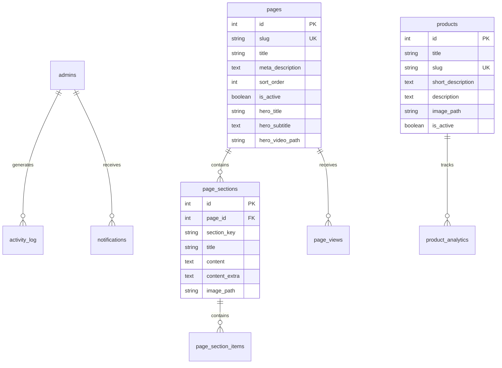
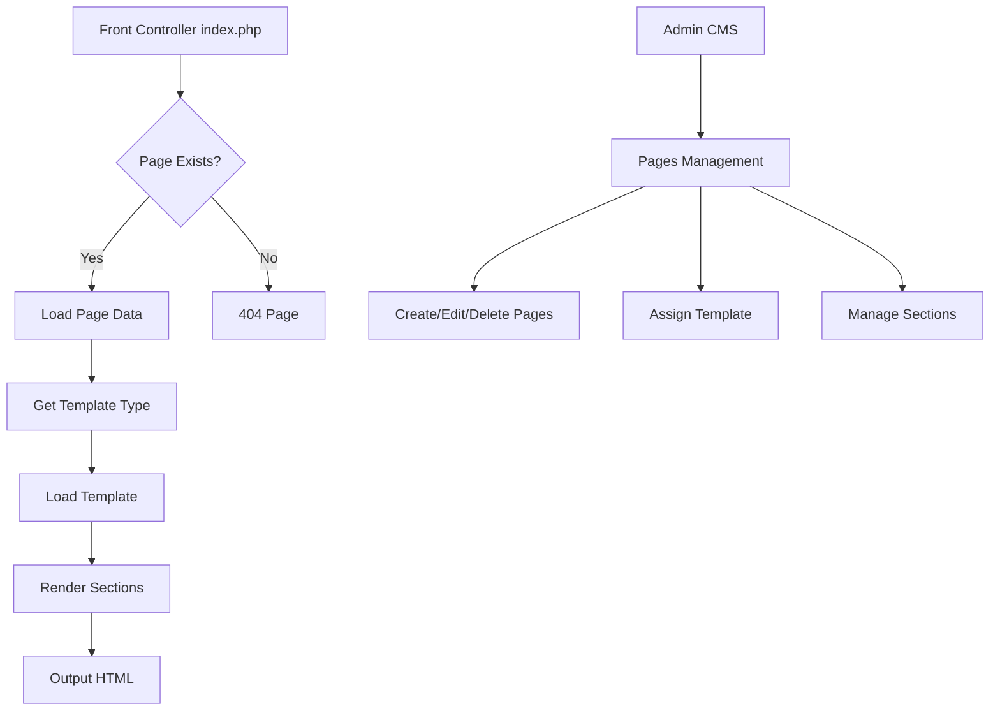

# Tulima Solar PHP Project - Comprehensive Analysis Report

**Date:** February 23, 2026  
**Status:** Analysis Complete

---

## Executive Summary

The Tulima Solar PHP project is a website redesign with a custom CMS admin portal. The project has made significant progress with a fully functional admin system including analytics, reporting, and content management. The frontend has 16 page templates implemented, and the database schema supports all core features.

**Overall Completion Estimate: 75-80%**

---

## 1. Current State Summary

### 1.1 Admin Portal - FULLY FUNCTIONAL ✅

The admin portal has been extensively developed across 5 phases:

| Phase | Focus | Status |
|-------|-------|--------|
| Phase 1 | Analytics Foundation | ✅ Complete |
| Phase 2 | Dashboard Redesign | ✅ Complete |
| Phase 3 | UI/UX Improvements | ✅ Complete |
| Phase 4 | Advanced Features & Reporting | ✅ Complete |
| Phase 5 | Data Export, Bulk Ops, Accessibility | ✅ Complete |

**Admin Files:**
- [`admin/index.php`](admin/index.php) - Dashboard with analytics widgets
- [`admin/pages.php`](admin/pages.php) - Page management
- [`admin/sections.php`](admin/sections.php) - Content block management
- [`admin/section_items.php`](admin/section_items.php) - Section items CRUD
- [`admin/products.php`](admin/products.php) - Product catalog management
- [`admin/testimonials.php`](admin/testimonials.php) - Testimonials management
- [`admin/partners.php`](admin/partners.php) - Partner logos management
- [`admin/impact_numbers.php`](admin/impact_numbers.php) - Statistics management
- [`admin/office_locations.php`](admin/office_locations.php) - Office locations
- [`admin/contact.php`](admin/contact.php) - Contact info management
- [`admin/contact_submissions.php`](admin/contact_submissions.php) - Contact form submissions
- [`admin/navigation.php`](admin/navigation.php) - Navigation menu management
- [`admin/users.php`](admin/users.php) - User management with roles
- [`admin/settings.php`](admin/settings.php) - Site settings
- [`admin/legal_pages.php`](admin/legal_pages.php) - Legal content management
- [`admin/activity-log.php`](admin/activity-log.php) - Activity audit trail
- [`admin/reports.php`](admin/reports.php) - Analytics reports
- [`admin/media/index.php`](admin/media/index.php) - Media library
- [`admin/api/analytics.php`](admin/api/analytics.php) - Analytics API
- [`admin/api/export.php`](admin/api/export.php) - Data export API

### 1.2 Frontend Pages - IMPLEMENTED ✅

16 page templates have been created:

| Page | File | Status |
|------|------|--------|
| Home | [`pages/home-new.php`](pages/home-new.php) | ✅ Complete |
| About | [`pages/about-new.php`](pages/about-new.php) | ✅ Complete |
| Impact | [`pages/impact-new.php`](pages/impact-new.php) | ✅ Complete |
| What We Offer | [`pages/what-we-offer-new.php`](pages/what-we-offer-new.php) | ✅ Complete |
| Services | [`pages/services-new.php`](pages/services-new.php) | ✅ Complete |
| Products | [`pages/products-new.php`](pages/products-new.php) | ✅ Complete |
| Solar Water Pumps | [`pages/solar-water-pumps-new.php`](pages/solar-water-pumps-new.php) | ✅ Complete |
| Surface Pumps | [`pages/surface-pumps-new.php`](pages/surface-pumps-new.php) | ✅ Complete |
| Submersible Pumps | [`pages/submersible-pumps-new.php`](pages/submersible-pumps-new.php) | ✅ Complete |
| Processing Machines | [`pages/agricultural-processing-machines-new.php`](pages/agricultural-processing-machines-new.php) | ✅ Complete |
| Contact | [`pages/contact-new.php`](pages/contact-new.php) | ✅ Complete |
| Testimonials | [`pages/testimonials-new.php`](pages/testimonials-new.php) | ✅ Complete |
| Privacy Policy | [`pages/privacy-new.php`](pages/privacy-new.php) | ✅ Complete |
| Terms & Conditions | [`pages/terms-new.php`](pages/terms-new.php) | ✅ Complete |
| Sitemap | [`pages/sitemap-new.php`](pages/sitemap-new.php) | ✅ Complete |
| 404 Error | [`pages/404-new.php`](pages/404-new.php) | ✅ Complete |

### 1.3 Database Schema - COMPLETE ✅

**Core Tables (18 tables):**

1. `admins` - Admin users with advanced features
2. `site_settings` - Global settings (key-value)
3. `pages` - Page definitions with hero config
4. `page_sections` - Content blocks per page
5. `page_section_items` - Items within sections
6. `products` - Product catalog
7. `benefits` - Reusable benefit items
8. `contact_info` - Contact information
9. `contact_submissions` - Form submissions
10. `media` - Media library
11. `testimonials` - Client testimonials
12. `partners` - Partner logos
13. `impact_numbers` - Statistics/impact metrics
14. `office_locations` - Office locations
15. `faqs` - FAQ items
16. `legal_pages` - Legal content
17. `page_views` - Analytics tracking
18. `activity_log` - Admin audit trail
19. `notifications` - Admin notifications
20. `product_analytics` - Product performance

---

## 2. CMS Capabilities Assessment

### 2.1 Content Management Features - WORKING ✅

| Feature | Status | Notes |
|---------|--------|-------|
| Page Management | ✅ | Edit title, meta, hero, video |
| Section Management | ✅ | Edit content blocks per page |
| Section Items | ✅ | CRUD for cards/steps within sections |
| Product Management | ✅ | Full CRUD with images |
| Testimonials | ✅ | Full CRUD with client photos |
| Partners | ✅ | Logo management with URLs |
| Impact Numbers | ✅ | Statistics with icons |
| Office Locations | ✅ | With lat/lng for maps |
| Contact Info | ✅ | Key-value pairs |
| Legal Pages | ✅ | HTML content editor |
| Media Library | ✅ | Upload, edit, picker |
| Navigation Management | ✅ | Show/hide, reorder |
| User Management | ✅ | Roles, locking, disabling |

### 2.2 Analytics & Reporting - WORKING ✅

| Feature | Status | Notes |
|---------|--------|-------|
| Page View Tracking | ✅ | Via analytics.php |
| Visitor Tracking | ✅ | Unique visitors via hash |
| Dashboard Charts | ✅ | Chart.js integration |
| Traffic Trends | ✅ | Configurable date ranges |
| Content Performance | ✅ | Top pages table |
| Contact Analytics | ✅ | Submission tracking |
| Activity Logging | ✅ | All admin actions |
| Notifications | ✅ | Per-admin and global |
| Data Export | ✅ | CSV for 7 content types |
| Reports Page | ✅ | 5 report types |

### 2.3 UI/UX Features - WORKING ✅

| Feature | Status | Notes |
|---------|--------|-------|
| Dark Mode | ✅ | Toggle with persistence |
| Responsive Design | ✅ | Mobile-friendly |
| Global Search | ⚠️ | UI exists, functionality limited |
| Bulk Operations | ✅ | Contact submissions |
| Accessibility | ✅ | WCAG AA compliant |
| Skip to Content | ✅ | Keyboard navigation |

---

## 3. Frontend Status Assessment

### 3.1 Page Implementation Status

All 16 frontend pages are implemented with the `-new.php` suffix, indicating they are the redesigned versions matching the test site reference.

**Routing (from [`index.php`](index.php)):**
```
/home → pages/home-new.php
/about → pages/about-new.php
/impact → pages/impact-new.php
/what-we-offer → pages/what-we-offer-new.php
/services → pages/services-new.php
/products → pages/products-new.php
/solar-water-pumps → pages/solar-water-pumps-new.php
/surface-pumps → pages/surface-pumps-new.php
/submersible-pumps → pages/submersible-pumps-new.php
/agricultural-processing-machines → pages/agricultural-processing-machines-new.php
/contact → pages/contact-new.php
/testimonials → pages/testimonials-new.php
```

### 3.2 Frontend Features

| Feature | Status | Implementation |
|---------|--------|----------------|
| Dynamic Navigation | ✅ | From database via `getNavPages()` |
| Hero Video Support | ✅ | Transparent navbar on home |
| Responsive Design | ✅ | Bootstrap 5 + custom CSS |
| WhatsApp Integration | ✅ | Floating button |
| Contact Form | ✅ | With math CAPTCHA |
| Interactive Maps | ✅ | Leaflet/OpenStreetMap |
| Partner Marquee | ✅ | Animated logo scroll |
| Impact Counters | ✅ | Count-up animation |
| SEO Meta Tags | ✅ | Open Graph support |
| Favicon | ✅ | Multiple sizes |

### 3.3 Test Site Reference Files

Reference HTML files exist for comparison:
- [`test_site_home.html`](test_site_home.html) - 157,767 chars
- [`test_site_about.html`](test_site_about.html) - 160,824 chars
- [`test_site_contact.html`](test_site_contact.html) - 145,569 chars
- [`test_site_products.html`](test_site_products.html) - 244,293 chars
- [`test_site_style.css`](test_site_style.css) - 557,240 chars
- [`test_site_main.js`](test_site_main.js) - 114,273 chars

---

## 4. Database Completeness Assessment

### 4.1 Schema Coverage

The database schema supports all documented features:



### 4.2 Migration Files (19 files)

| Migration | Purpose |
|-----------|---------|
| `migration_analytics.sql` | Analytics tables |
| `migration_admin_users_advanced.sql` | User roles, locking |
| `migration_impact_partners_offices.sql` | Impact, partners, offices |
| `migration_testimonials.sql` | Testimonials table |
| `migration_faqs.sql` | FAQ table |
| `migration_legal_pages.sql` | Legal content |
| `migration_media.sql` | Media library |
| `migration_section_items.sql` | Section items |
| `migration_contact_submissions.sql` | Contact submissions |
| `migration_hero.sql` | Hero columns |
| + 9 more | Various enhancements |

---

## 5. Gap Analysis

### 5.1 Critical Missing Features

| Gap | Priority | Impact | Notes |
|-----|----------|--------|-------|
| Dynamic Page Creation | HIGH | Cannot add new pages via CMS | Pages must be hardcoded in index.php |
| Section Reordering | MEDIUM | Manual sort_order editing | No drag-and-drop UI |
| Product Categories | MEDIUM | Limited product organization | Single-level product list |
| Global Search | LOW | UI exists but not functional | Console logging only |

### 5.2 Nice-to-Have Features Missing

| Feature | Priority | Notes |
|---------|----------|-------|
| Blog/News System | LOW | Not in original scope |
| Multilingual Support | LOW | Not in original scope |
| Form Builder | LOW | Contact form is hardcoded |
| Advanced SEO Tools | LOW | Basic meta only |
| Backup/Restore | LOW | Manual database backup |
| Page Versioning | LOW | No revision history |
| Scheduled Publishing | LOW | No scheduling feature |

### 5.3 Technical Debt

| Item | Severity | Notes |
|------|----------|-------|
| Multiple CSS Files | LOW | Many CSS overrides in test site |
| Hardcoded Routes | MEDIUM | index.php switch statement |
| Static Page Templates | MEDIUM | Not fully database-driven |
| Legacy Files | LOW | Old page versions may exist |

---

## 6. Recommendations

### 6.1 Priority Order for Completion

#### Phase 6: Dynamic Page System (HIGH PRIORITY)

1. **Create Page Templates Table**
   - Store page template types (home, about, contact, etc.)
   - Allow selecting template when creating page

2. **Dynamic Route Resolution**
   - Replace hardcoded switch statement
   - Load page template based on database setting

3. **Page Creation Interface**
   - Add "Create New Page" button
   - Select template, set slug, configure hero

#### Phase 7: Enhanced Content Management (MEDIUM PRIORITY)

1. **Drag-and-Drop Section Ordering**
   - Implement jQuery UI or SortableJS
   - Visual reordering of sections

2. **Product Categories**
   - Add categories table
   - Category management in admin

3. **Global Search Implementation**
   - Search across pages, products, sections
   - Results page with links

#### Phase 8: Polish & Optimization (LOW PRIORITY)

1. **CSS Consolidation**
   - Merge multiple CSS files
   - Remove unused styles

2. **Performance Optimization**
   - Image optimization
   - Caching implementation

3. **Documentation Updates**
   - User guide completion
   - API documentation

### 6.2 Architecture Recommendations



---

## 7. File Structure Summary

```
tulima_php/
├── index.php                    # Front controller
├── config/
│   ├── database.php             # DB configuration
│   └── path.php                 # Path configuration
├── includes/
│   ├── functions.php            # Helper functions
│   ├── analytics.php            # Analytics tracking
│   ├── activity_logger.php      # Activity logging
│   ├── notifications.php        # Notification system
│   ├── header*.php              # Header templates
│   └── footer*.php              # Footer templates
├── pages/
│   ├── home-new.php             # Home page
│   ├── about-new.php            # About page
│   ├── contact-new.php          # Contact page
│   └── ... (13 more pages)
├── admin/
│   ├── index.php                # Dashboard
│   ├── pages.php                # Page management
│   ├── sections.php             # Section management
│   ├── products.php             # Product management
│   ├── navigation.php           # Navigation management
│   ├── reports.php              # Analytics reports
│   ├── activity-log.php         # Activity viewer
│   ├── api/                     # API endpoints
│   ├── assets/                  # Admin CSS/JS
│   ├── includes/                # Admin header/footer
│   └── media/                   # Media library
├── database/
│   ├── schema.sql               # Base schema
│   ├── seed.sql                 # Initial data
│   └── migration_*.sql          # 19 migration files
├── docs/
│   ├── phase1-completion.md     # Phase 1 docs
│   ├── phase2-4-completion.md   # Phase 2-4 docs
│   ├── phase4-5-completion.md   # Phase 4-5 docs
│   └── user-training-guide.md   # Training guide
└── media/                       # Uploaded media
    ├── products/
    ├── partners/
    ├── team_members/
    └── hero_videos/
```

---

## 8. Conclusion

The Tulima Solar PHP project is well-architected and substantially complete. The admin portal is fully functional with comprehensive CMS capabilities, analytics, and reporting. The frontend has all required pages implemented.

**Key Strengths:**
- Comprehensive admin CMS
- Full analytics and reporting system
- Activity logging and notifications
- Media library with picker
- Responsive design
- Good documentation

**Key Areas for Improvement:**
- Dynamic page creation (currently hardcoded routes)
- Drag-and-drop section ordering
- Product categorization
- Global search functionality

**Estimated Completion: 75-80%**

The remaining work focuses primarily on making the system more flexible and user-friendly rather than building core functionality from scratch.

---

*Analysis completed: February 23, 2026*
