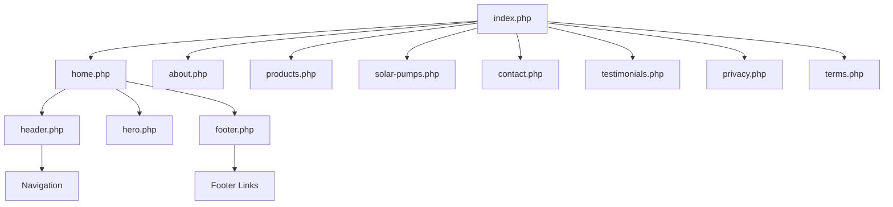
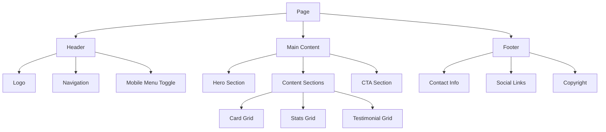

# Tulima Solar - Public Site Redesign Plan

## Overview

This document outlines a comprehensive plan to redesign the public-facing Tulima Solar website from scratch with modern, professional designs while maintaining the existing brand colors and ensuring responsiveness, mobile-friendliness, and accessibility.

## Current State Analysis

### Existing Structure
- **Front Controller**: `index.php` routes to page templates in `/pages/`
- **Page Templates**: home.php, about.php, products.php, solar-pumps.php, contact.php, testimonials.php, privacy.php, terms.php, sitemap.php, 404.php, generic.php
- **Includes**: header.php, footer.php, hero.php
- **Static Assets**: `/static/css/style.css` (54KB), images, JS
- **Design System**: Defined in `COLORS-AND-FONTS.txt`

### Brand Colors
| Color | Hex | CSS Variable |
|-------|-----|--------------|
| Primary Purple | #660099 | --primary-purple |
| Dark Purple | #4A0066 | --dark-purple |
| Light Purple | #F0E6F7 | --light-purple |
| Secondary Green | #B0D7AB | --secondary-green |
| Dark Green | #8BC4A0 | --dark-green |
| Light Green | #E8F5E8 | --light-green |
| Accent Orange | #E98E39 | --accent-orange |
| Dark Orange | #D17A1F | --dark-orange |
| Light Orange | #FDF4E8 | --light-orange |

### Typography
- **Font Family**: Inter (Google Fonts)
- **Weights**: 400, 500, 600, 700, 800, 900

---

## Design Principles

### 1. Modern & Professional
- Clean, minimalist design with ample white space
- Consistent visual hierarchy
- Professional typography with proper line heights and letter spacing
- Subtle animations and micro-interactions

### 2. Responsive & Mobile-First
- Mobile-first CSS approach
- Breakpoints: 480px, 768px, 1024px, 1280px, 1440px
- Touch-friendly interactive elements (min 44px tap targets)
- Optimized images for different screen sizes

### 3. Accessible
- WCAG 2.1 AA compliance
- Proper semantic HTML5 structure
- ARIA labels and roles where needed
- Keyboard navigation support
- Sufficient color contrast (4.5:1 for text)
- Screen reader friendly
- Skip to content links
- Focus indicators

---

## Architecture

### CSS Architecture

```
static/css/
├── main.css           # Main compiled stylesheet
├── base/
│   ├── _variables.css # CSS custom properties
│   ├── _reset.css     # Modern CSS reset
│   └── _typography.css# Typography styles
├── layout/
│   ├── _grid.css      # Grid system
│   ├── _header.css    # Header styles
│   ├── _footer.css    # Footer styles
│   └── _navigation.css# Navigation styles
├── components/
│   ├── _buttons.css   # Button styles
│   ├── _cards.css     # Card components
│   ├── _forms.css     # Form elements
│   ├── _hero.css      # Hero sections
│   ├── _sections.css  # Section styles
│   └── _utilities.css # Utility classes
└── pages/
    ├── _home.css      # Home page specific
    ├── _about.css     # About page specific
    └── _contact.css   # Contact page specific
```

### Component Library

#### Layout Components
- **Container**: Max-width container with responsive padding
- **Grid**: Flexible grid system (2, 3, 4 columns)
- **Section**: Page section with consistent spacing

#### UI Components
- **Button**: Primary, secondary, outline, ghost variants
- **Card**: Product card, feature card, testimonial card
- **Form**: Input, select, textarea, checkbox, radio
- **Navigation**: Main nav, mobile nav, breadcrumbs
- **Hero**: Video hero, image hero, text hero
- **Stats**: Impact numbers display
- **Testimonial**: Quote with avatar
- **Partner Logo**: Partner logo display
- **Office Location**: Location card with map

---

## Page-by-Page Redesign

### 1. Header/Navigation

**Current Issues:**
- Basic styling
- Limited mobile menu functionality
- No accessibility considerations

**New Design:**
- Sticky header with transparent-to-solid transition on scroll
- Hamburger menu for mobile with slide-in animation
- Dropdown support for future sub-pages
- Skip to content link
- Proper ARIA labels
- Keyboard navigation

```
┌─────────────────────────────────────────────────────────────┐
│ [Logo] Tulima Solar          Home About Products Contact [WA]│
└─────────────────────────────────────────────────────────────┘
```

### 2. Homepage

**Sections:**
1. **Hero Section**
   - Full-width video background with overlay
   - Bold headline with gradient text
   - Subheadline
   - CTA buttons (primary and secondary)
   - Scroll indicator

2. **Featured Products**
   - 3-column grid of product cards
   - Image, title, description, CTA
   - View all products link

3. **Transform Your Farm**
   - 4-column feature grid
   - Icons, titles, descriptions
   - Benefits-focused content

4. **How It Works**
   - Step-by-step process
   - Numbered steps with icons
   - Visual flow indicator

5. **Impact Numbers**
   - Animated counters
   - Large numbers with labels
   - Grid layout

6. **Solar Solutions**
   - Product/service showcase
   - Image and text layout

7. **Applications**
   - Use case cards
   - Industry-specific solutions

8. **Testimonials**
   - Carousel or grid
   - Quote, avatar, name, role

9. **Partners**
   - Logo grid
   - Grayscale to color on hover

10. **Office Locations**
    - Location cards
    - Contact info

11. **Final CTA**
    - Bold background
    - Strong headline
    - Contact form or CTA buttons

### 3. About Page

- Company story section
- Mission and values
- Team section (if applicable)
- Timeline or milestones
- Impact statistics

### 4. Products Page

- Product grid with filters
- Product cards with hover effects
- Category navigation
- Product detail modal or page

### 5. Solar Pumps Page

- Product focus
- Technical specifications
- Benefits grid
- Gallery/images
- Inquiry form

### 6. Contact Page

- Contact form with validation
- Office locations with map
- WhatsApp integration
- Social media links
- FAQ accordion

### 7. Testimonials Page

- Testimonial grid
- Filter by product/service
- Video testimonials (if available)

---

## Responsive Breakpoints

```css
/* Mobile First Approach */
/* Base: 0 - 479px (Mobile) */

/* Small: 480px - 767px */
@media (min-width: 480px) { }

/* Medium: 768px - 1023px (Tablet) */
@media (min-width: 768px) { }

/* Large: 1024px - 1279px (Small Desktop) */
@media (min-width: 1024px) { }

/* XLarge: 1280px - 1439px (Desktop) */
@media (min-width: 1280px) { }

/* XXLarge: 1440px+ (Large Desktop) */
@media (min-width: 1440px) { }
```

---

## Accessibility Checklist

### Perceivable
- [ ] All images have meaningful alt text
- [ ] Color contrast ratio ≥ 4.5:1 for normal text
- [ ] Color contrast ratio ≥ 3:1 for large text
- [ ] Text can be resized up to 200% without loss of content
- [ ] No information conveyed by color alone

### Operable
- [ ] All interactive elements keyboard accessible
- [ ] Focus indicators visible
- [ ] Skip to content link
- [ ] No keyboard traps
- [ ] Sufficient time for interactions

### Understandable
- [ ] Page language declared
- [ ] Consistent navigation
- [ ] Form labels associated with inputs
- [ ] Error messages clear and helpful

### Robust
- [ ] Valid HTML
- [ ] ARIA roles where needed
- [ ] Works with screen readers
- [ ] Works without JavaScript (progressive enhancement)

---

## Implementation Phases

### Phase 1: Foundation
1. Create new CSS architecture
2. Implement design tokens (CSS variables)
3. Build base layout components
4. Create header and footer

### Phase 2: Core Pages
1. Redesign homepage
2. Redesign about page
3. Redesign products page

### Phase 3: Additional Pages
1. Redesign solar-pumps page
2. Redesign contact page
3. Redesign testimonials page

### Phase 4: Polish & Testing
1. Responsive testing
2. Accessibility audit
3. Performance optimization
4. Cross-browser testing

---

## File Structure

```
tulima_php/
├── index.php                 # Front controller (unchanged)
├── pages/
│   ├── home.php             # Redesigned homepage
│   ├── about.php            # Redesigned about page
│   ├── products.php         # Redesigned products page
│   ├── solar-pumps.php      # Redesigned solar pumps page
│   ├── contact.php          # Redesigned contact page
│   └── testimonials.php     # Redesigned testimonials page
├── includes/
│   ├── header.php           # Redesigned header
│   ├── footer.php           # Redesigned footer
│   ├── hero.php             # Redesigned hero section
│   └── components/          # Reusable components
│       ├── card-product.php
│       ├── card-feature.php
│       ├── card-testimonial.php
│       ├── section-cta.php
│       └── stats-grid.php
├── static/
│   ├── css/
│   │   └── style.css        # Main stylesheet (redesigned)
│   └── js/
│       └── main.js          # JavaScript (enhanced)
└── plans/
    └── public-site-redesign.md
```

---

## Technical Specifications

### CSS Features
- CSS Custom Properties for theming
- CSS Grid for layouts
- CSS Flexbox for components
- CSS Transitions and Animations
- Media Queries for responsiveness
- Focus-visible for keyboard focus

### JavaScript Features
- Vanilla JS (no framework dependency)
- Intersection Observer for animations
- Form validation
- Mobile menu toggle
- Smooth scroll
- Lazy loading images

### Performance
- Minified CSS/JS
- Optimized images
- Lazy loading
- Critical CSS inline
- Preload fonts

---

## Mermaid Diagrams

### Site Structure



### Component Hierarchy



---

## Next Steps

1. **Review and approve this plan**
2. **Switch to Code mode to begin implementation**
3. **Start with Phase 1: Foundation**
   - Create new CSS architecture
   - Implement design tokens
   - Build base layout components

---

*Document created: 2026-02-22*
*Last updated: 2026-02-22*
