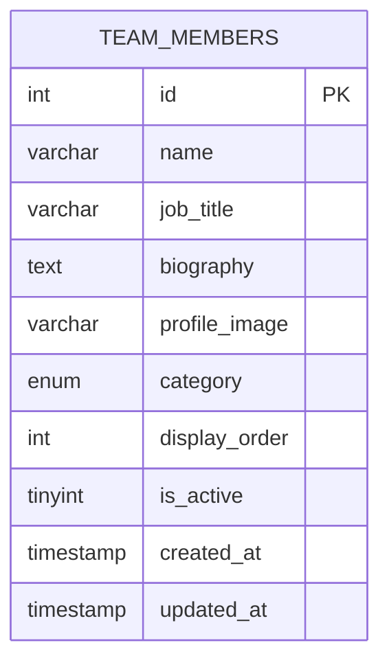

# Team Members Database Schema Design

## Overview
This document outlines the database schema design for the Team Members feature, which will be used on the "Who-we-are" page to display organizational hierarchy.

## Requirements
- Support three hierarchy categories: Directors, Advisors, and Staff
- Store team member information including name, title, biography, and profile image
- Allow ordering within categories
- Support active/inactive status for publishing control

## Schema Design

### Table: `team_members`

| Column | Type | Description |
|--------|------|-------------|
| `id` | `INT UNSIGNED AUTO_INCREMENT PRIMARY KEY` | Unique identifier |
| `name` | `VARCHAR(255) NOT NULL DEFAULT ''` | Team member's full name |
| `job_title` | `VARCHAR(255) NOT NULL DEFAULT ''` | Position/title |
| `biography` | `TEXT NULL` | Full biography/description |
| `profile_image` | `VARCHAR(500) NULL` | Path to image from media library |
| `category` | `ENUM('director', 'advisor', 'staff') NOT NULL DEFAULT 'staff'` | Hierarchy level |
| `display_order` | `INT NOT NULL DEFAULT 0` | Ordering within categories |
| `is_active` | `TINYINT(1) NOT NULL DEFAULT 1` | Active/inactive status |
| `created_at` | `TIMESTAMP DEFAULT CURRENT_TIMESTAMP` | Creation timestamp |
| `updated_at` | `TIMESTAMP DEFAULT CURRENT_TIMESTAMP ON UPDATE CURRENT_TIMESTAMP` | Last update timestamp |

### Indexes

| Index Name | Columns | Purpose |
|------------|---------|---------|
| `idx_active_sort` | `(is_active, display_order)` | List active members in order |
| `idx_category` | `(category)` | Filter by category |
| `idx_category_active_sort` | `(category, is_active, display_order)` | List active members within a category in order |

## Design Decisions

### 1. ENUM for Category
**Decision**: Use `ENUM('director', 'advisor', 'staff')` for the category field.

**Rationale**: 
- Ensures data integrity by restricting values to valid options
- Follows existing pattern used in [`media.type`](../database/schema.sql:101) which uses `ENUM('image','video')`
- More efficient than a foreign key lookup for a small, fixed set of values
- Provides clear documentation of valid values in the schema itself

### 2. VARCHAR(500) for profile_image
**Decision**: Use `VARCHAR(500)` for the profile image path.

**Rationale**:
- Consistent with [`testimonials.image_path`](../database/migration_testimonials.sql:9) and [`partners.image_path`](../database/migration_impact_partners_offices.sql:22)
- Accommodates longer file paths including directory structure
- Integrates with existing media library system via [`admin/media/picker.php`](../admin/media/picker.php)

### 3. Separate display_order Column
**Decision**: Use `display_order` instead of `sort_order`.

**Rationale**:
- More semantic naming for team member ordering
- Still follows the numeric ordering pattern used in other tables
- Allows independent ordering within each category

### 4. Composite Indexes
**Decision**: Create multiple indexes including composite indexes.

**Rationale**:
- `idx_category_active_sort`: Optimizes the most common query pattern - fetching active team members by category in display order
- `idx_active_sort`: Supports listing all active members across categories
- `idx_category`: Supports category filtering without active check

### 5. Default Value for Category
**Decision**: Default category is 'staff'.

**Rationale**:
- Safest default as it's the most common category
- Requires explicit action to promote to director or advisor
- Prevents accidental creation of directors/advisors

## Media Library Integration

The `profile_image` field stores a path reference to the media library. The admin interface should:

1. Use the existing media picker from [`admin/media/picker.php`](../admin/media/picker.php)
2. Call the picker with: `picker.php?field_id=profile_image&type=image`
3. Store the returned path (e.g., `media/team_members/filename.jpg`)

Existing team member images are already in `media/team_members/` directory.

## Migration File

The migration file will be created at: [`database/migration_team_members.sql`](../database/migration_team_members.sql)

## ER Diagram



## Query Examples

### Get all active directors ordered by display_order
```sql
SELECT * FROM team_members 
WHERE category = 'director' AND is_active = 1 
ORDER BY display_order ASC;
```

### Get all team members grouped by category
```sql
SELECT * FROM team_members 
WHERE is_active = 1 
ORDER BY 
    FIELD(category, 'director', 'advisor', 'staff'),
    display_order ASC;
```

## Status
- [x] Requirements analyzed
- [x] Schema designed
- [x] Design decisions documented
- [ ] Migration file created (requires Code mode)
